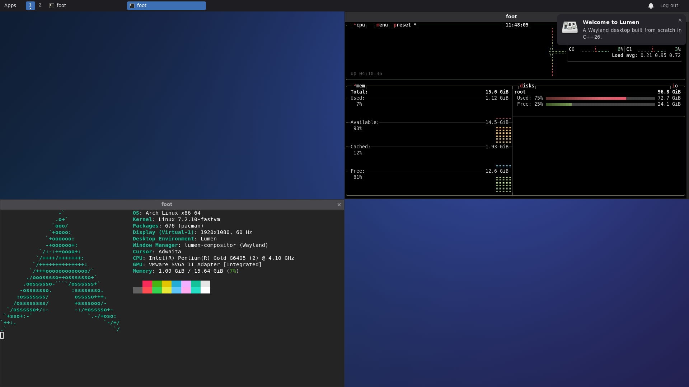

# Lumen

A fast, modern Wayland desktop — compositor, shell and UI library — written from scratch in
C++26.



## Why Lumen

- **Fast where you feel it.** On the same machine as weston, sway and Hyprland: the first
  frame on screen 106 ms after start (sway 379, Hyprland 617), commit to present 5.1 ms at
  the median (weston 11.1), 8 % CPU while a client animates (sway 35 %, Hyprland 74 %).
  An idle desktop costs no measurable CPU: the frame clock stops.
  [Measurements](docs/subsystems/rendering-performance.md#62-start-up)
- **Zero copy.** dma-buf clients are composited where they live (0.1 ms of render thread per
  frame), with explicit sync, a per-surface commit queue (FIFO, commit timing) and
  presentation feedback that carries the real flip time.
- **Never does work twice.** Damage-limited compositing, occlusion culling, covered windows
  throttled to one frame callback a second, screen capture copied from the composite it
  already drew, so an idle screencast is free.
- **Runs on what you have.** Vulkan first, GLES where Mesa has no Vulkan driver (VMs, older
  GPUs), a CPU compositor where the only GPU is a software one — picked automatically. The
  display card is found from sysfs, not assumed.
- **Hard to break.** Compositor and shell are separate processes: window management, key
  bindings and workspaces keep working while the shell restarts, and a hung compositor is
  caught by the systemd watchdog.
- **Secure by default.** The privileged shell protocol binds only from the configured shell
  binary; Flatpak apps see no capture, clipboard-control, layer-shell or output-management
  globals.
- **A complete desktop.** Panel, launcher, Alt+Tab, dynamic workspaces, edge snapping,
  notifications, system tray, idle and lock, input methods (fcitx5, ibus) and portals for
  screenshots, screencasts and colour picking.
- **Real monitors.** Hotplug, pixel-exact fractional scaling, adaptive sync, VT switching,
  wlr-randr and kanshi, setups remembered per set of monitors.
- **About 50 Wayland protocols**, from xdg-shell to linux-drm-syncobj, ext-image-copy-capture
  and ext-session-lock.
- **Easy to operate.** One `config.toml`, applied as you save it and validated with
  suggestions; `lumen-ctl` for health, outputs, windows and every action.

## Quick start

```bash
./scripts/install-deps.sh            # Arch, Debian testing, Ubuntu 26.04+, Fedora 44+, openSUSE Tumbleweed
cmake --preset release && cmake --build --preset release
./scripts/run-desktop.sh             # from a text console; over SSH add --join-seat-session
```

Log out with the panel's **Log out** or Ctrl+Alt+Backspace. Super opens the launcher,
Super+Return a terminal.

## Documentation

- [User guide](docs/user-guide.md) — building and testing, key bindings, the shell, monitors,
  protocols, login session, configuration, `lumen-ctl`
- [Architecture](docs/architecture.md) — processes, module layers, frame pipeline
- [API reference](docs/api/README.md) · [ADRs](docs/adr) · [Agent rules](AGENTS.md)

## License

MIT
