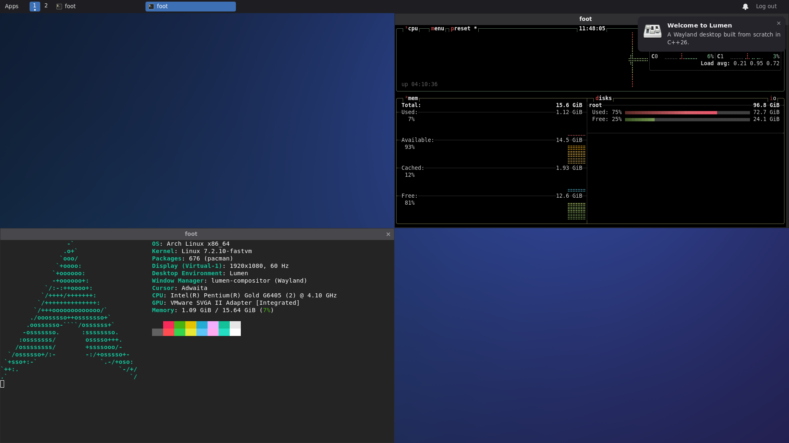

# Lumen

A fast, modern Wayland desktop — compositor, shell and UI library — written from scratch in
C++26.



## Why Lumen

- **Fast where you feel it.** On the same real machine as weston and sway (a Broadwell
  notebook, hardware Vulkan): the socket is up in 370 ms (weston 9 s, sway 10.4 s), a
  client's commit reaches the screen in 9.5 ms at the median (weston 22, sway 33), and a
  vsync'd client rides 60.00 fps with a 0.00 ms frame-interval spread. An idle desktop
  costs no measurable CPU: the frame clock stops.
  [Measurements](docs/subsystems/rendering-performance.md#62-start-up)
- **Zero copy.** dma-buf clients are composited where they live (~0.2 ms of render thread
  per frame; a moving 64×64 cursor frame costs 0.09 ms of GPU), with explicit sync, a
  per-surface commit queue (FIFO, commit timing) and presentation feedback that carries
  the real flip time.
- **Never does work twice.** Damage-limited compositing, occlusion culling, covered windows
  throttled to one frame callback a second, screen capture copied from the composite it
  already drew, so an idle screencast is free.
- **Runs on what you have.** Vulkan first, GLES where Mesa has no Vulkan driver (VMs, older
  GPUs), a CPU compositor where the only GPU is a software one — picked automatically. The
  display card is found from sysfs, not assumed.
- **Hard to break.** Compositor and shell are separate processes: window management, key
  bindings and workspaces keep working while the shell restarts, and a hung compositor is
  caught by the systemd watchdog.
- **Secure by default.** The privileged shell protocol binds only from the configured shell
  binary; Flatpak apps see no capture, clipboard-control, layer-shell or output-management
  globals.
- **A UI engine of its own.** The panel, launcher, Alt+Tab switcher, notifications, tray
  menus, tooltips and the portal's dialogs are drawn by Lumen's own declarative,
  retained-mode UI engine — descriptors reconciled onto a node tree, damage-scoped GPU
  primitives, text shaped off-thread, themes compiled at load, client-side key repeat —
  no widget toolkit, no shared-memory canvases. An idle shell makes zero context switches;
  a panel redraw costs ~250 µs of CPU. [The engine, measured](docs/subsystems/ui-engine.md)
- **A complete desktop.** Panel, launcher, Alt+Tab, dynamic workspaces, edge snapping and
  optional master-stack tiling per workspace, notifications, system tray, idle and lock,
  input methods (fcitx5, ibus) and portals for screenshots, screencasts and colour picking.
- **Real monitors.** Hotplug, pixel-exact fractional scaling, adaptive sync, VT switching,
  wlr-randr and kanshi, setups remembered per set of monitors.
- **About 50 Wayland protocols**, from xdg-shell to linux-drm-syncobj, ext-image-copy-capture
  and ext-session-lock.
- **Easy to operate.** One `config.toml`, applied as you save it and validated with
  suggestions; `lumen-ctl` for health, outputs, windows and every action.

## Quick start

```bash
./scripts/install-deps.sh            # Arch, Debian testing, Ubuntu 26.04+, Fedora 44+, openSUSE Tumbleweed
cmake --preset release && cmake --build --preset release
./scripts/run-desktop.sh             # from a text console; over SSH add --join-seat-session
```

Log out with the panel's **Log out** or Ctrl+Alt+Backspace. Super opens the launcher,
Super+Return a terminal.

Open **Lumen UI Demo** from the launcher, or run `./build/release/lumen-ui-demo`
from a Wayland session. The searchable catalog pairs live widget and layout examples
with a list of what `lx.ui` supports natively, what it can compose, and what is still missing.
Pass `--theme one-light` or `--theme one-dark` to preview a built-in theme.

### Graphical login at boot (optional)

`lumen-dm` draws the login screen directly through Lumen's DRM/KMS and input stack.
No Wayland compositor runs before login. It authenticates through the distro's
`greetd` PAM stack, starts `lumen-session` as the authenticated user, and returns on
logout. It does not configure automatic login. The Arch deployment uses `greetd`
with `pam_systemd` and `pam_umask`, and `json-c` at build and run time. Keep the
distro's PAM policy; do not use a shared or interactive account for the greeter.

The `release` preset includes `lumen-dm`; use `-DLUMEN_BUILD_DM=OFF` for a
console-only build. The Arch installation also needs the `greetd` package for
its PAM policy and session broker. Installing it does not require Weston.

```bash
sudo pacman -S --needed greetd  # Arch; use your distro's package elsewhere
cmake --preset release
cmake --build --preset release
sudo cmake --install build/release --prefix /usr
sudo systemd-sysusers lumen-dm.conf
sudo systemctl daemon-reload
```

Installation does not enable anything. Before switching, verify that a text login
on **VT2** works (Ctrl+Alt+F2), and check `systemctl is-enabled display-manager.service`.
If another display manager owns the alias, disable it explicitly before enabling Lumen;
do not force the alias over an active manager. Then configure the next boot:

```bash
sudo systemctl enable lumen-dm.service
sudo systemctl set-default graphical.target   # only if the default is not already graphical
```

On the next boot the greeter takes **VT1**. If recovery is needed, use the VT2 login
(or boot with `systemd.unit=multi-user.target`), inspect `journalctl -b -u lumen-dm.service`,
and run `sudo systemctl disable --now lumen-dm.service`. Re-enable your previous display
manager or return to `multi-user.target` for console logins. The installed files and
all parent directories must be trusted, root-owned, and not writable by ordinary users.

### Split-VT login preview (Arch Linux)

The experimental broker starts the authenticated Lumen session on VT7 while the
greeter is still visible on VT1. Orderly logout prepares VT1 again before the
desktop exits. The package in `deploy/lumen-dm/broker/` builds from pinned greetd
source using `makepkg` and installs a separate `lumen-dm-split-vt.service`.
It requires a matching Lumen build installed under `/usr`, Linux 6.5 or later,
logind, and POSIX ACL support under `/run`. Keep VT7 free and confirm the VT2
recovery console works before selecting the experimental service. The two
services share the `display-manager.service` alias, so disable the current
manager before enabling the preview. See ADR 015 for the rollout checks.

## Documentation

- [User guide](docs/user-guide.md) — building and testing, key bindings, the shell, monitors,
  protocols, login session, configuration, `lumen-ctl`
- [Architecture](docs/architecture.md) — processes, module layers, frame pipeline
- [The UI engine](docs/subsystems/ui-engine.md) — `lx.ui` and `lx.ui.host` as built, measured,
  and compared
- [API reference](docs/api/README.md) · [ADRs](docs/adr) · [Agent rules](AGENTS.md)

## License

MIT
