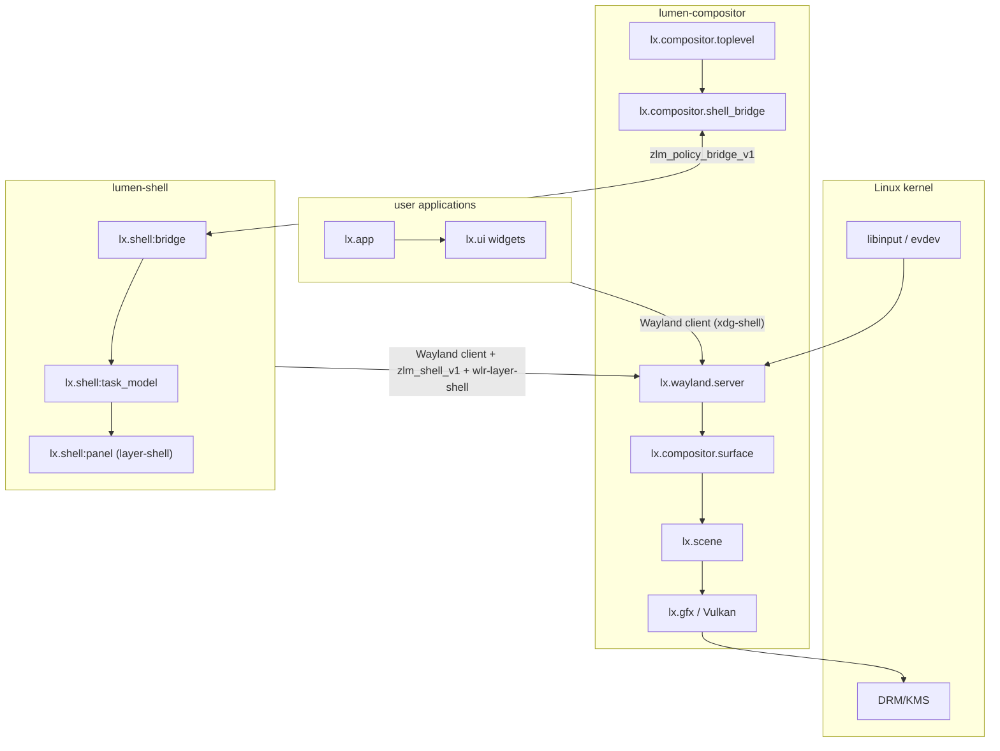
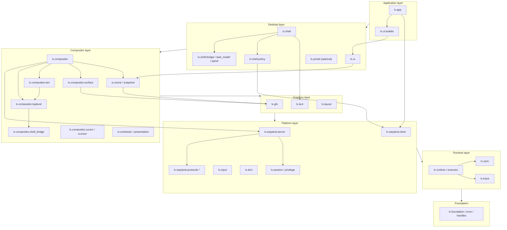
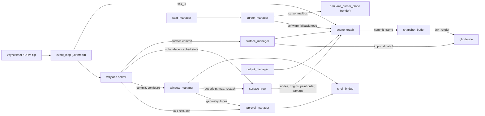
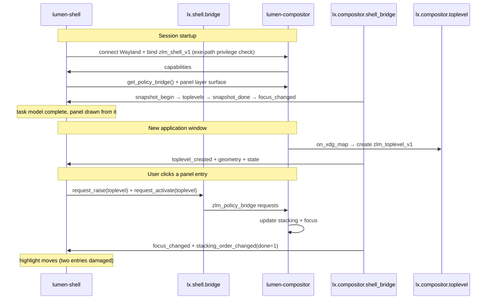
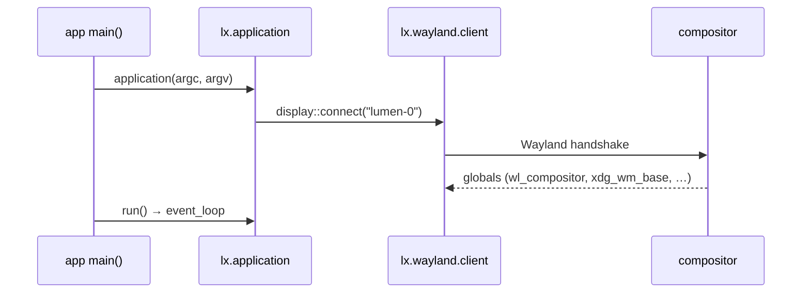
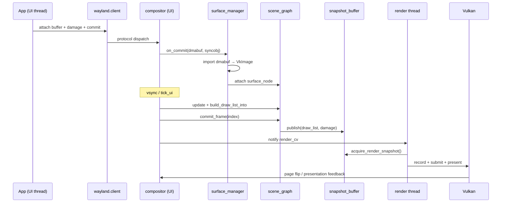
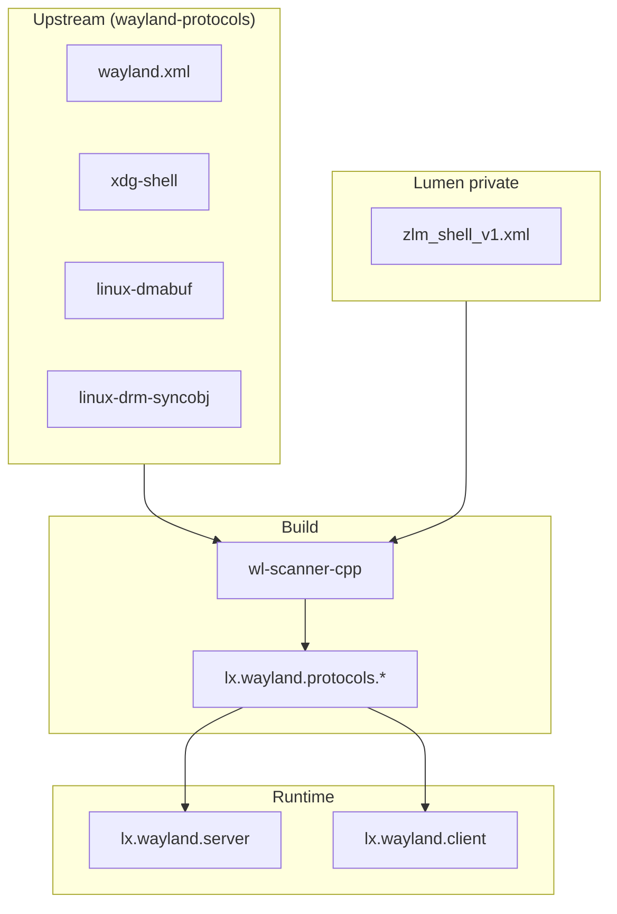
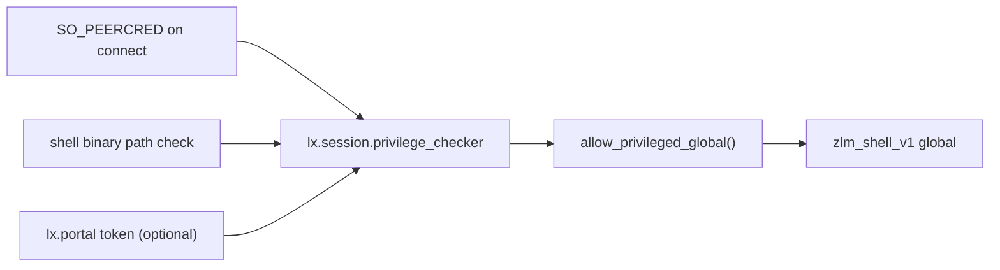
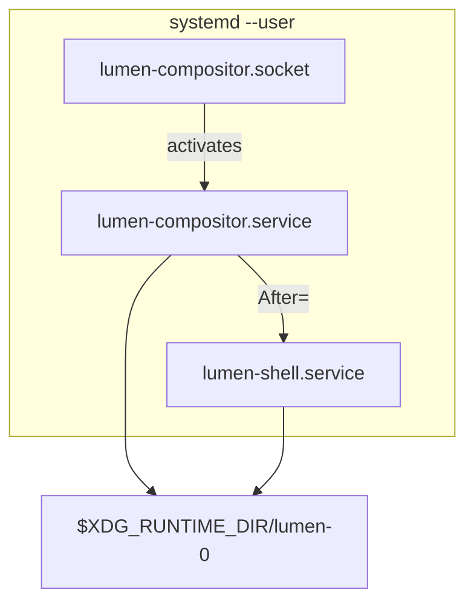

> **Status:** Current (v0.3) — see code for implementation truth

# Lumen Architecture

Detailed overview of the Lumen windowing stack: module layers, process boundaries,
interaction patterns, and runtime workflows.

**Related docs:** [API reference](api/README.md) · [UML diagrams](uml/README.md) ·
[Threading](subsystems/threading.md) · [Rendering performance](subsystems/rendering-performance.md) ·
[Errors & logging](subsystems/errors-and-logging.md) ·
[Shell state sync](subsystems/shell-state-sync.md) · [dmabuf/Vulkan](subsystems/dmabuf-vulkan-import.md) ·
[Memory](subsystems/memory-management.md) · [Health](subsystems/health.md) ·
[UI architecture](subsystems/ui-architecture.md) ·
[AI agent instructions](../AGENTS.md)

---

## 1. What Lumen is

Lumen is a greenfield Linux desktop stack built in **C++26** with **Clang**:

| Component | Role |
|-----------|------|
| **Compositor** (`lumen-compositor`) | Wayland display server, input routing, surface composition, Vulkan present |
| **Shell** (`lumen-shell`) | Desktop chrome — panel, workspaces, window management UI |
| **UI library** (`lx.ui`, `lx.ui.builder`) | Widget toolkit + fluent builders for apps and shell |
| **App framework** (`lx.app`) | Event loop, settings, clipboard for third-party apps |

Design goals:

- **Wayland-only** — no X11 layer
- **Vulkan-first, multi-backend** — Vulkan is the design centre and the default wherever a
  hardware Vulkan driver exists. A GL backend (EGL/GLES on GBM) covers hardware Mesa ships
  no Vulkan driver for, and a CPU backend covers hosts with no hardware renderer at all.
  All three live in `lx.gfx` behind `compositor::config::present`
  ([rendering-performance.md](subsystems/rendering-performance.md) §1.2, [AGENTS.md](../AGENTS.md) §1.1)
- **Multi-process** — compositor owns display; shell and apps are clients
- **Stacking-first WM** — optional tiling plugin via `lx.shell.policy`
- **First-class threading** — UI / render / worker affinities with immutable frame handoff
- **Zero-copy where possible** — dmabuf → Vulkan import, explicit sync via drm-syncobj
- **Performance pipeline** — snapshot v2, direct scanout, import cache, hot-path budgets ([rendering-performance.md](subsystems/rendering-performance.md))
- **Memory strategy** — unified arenas, pressure response, buffer lifecycle ([memory-management.md](subsystems/memory-management.md))
- **Health evaluation** — parts, processes, memory, speed → `health_report` ([health.md](subsystems/health.md))

---

## 2. Process model

Three classes of OS processes cooperate over Wayland:



### 2.1 Compositor process

**Binary:** `lumen-compositor`  
**Modules:** `lx.compositor`, `lx.compositor.*`, `lx.wayland.server`, `lx.scene`, `lx.gfx`, `lx.input`, `lx.drm`, …

Owns:

- Wayland socket (`$XDG_RUNTIME_DIR/lumen-0`)
- All `wl_*` / `xdg_*` / `zwp_*` protocol objects
- **`zlm_toplevel_v1`** handles (compositor-owned WM references)
- DRM master / KMS page-flip
- Scene graph + Vulkan composition
- Input seat and focus

Runs **three logical threads** (see [threading.md](subsystems/threading.md)):

| Thread | Affinity | Work |
|--------|----------|------|
| Main | `ui` | Event loop, vsync timer, `tick_ui()`, Wayland dispatch |
| Render | `render` | `tick_render()`, snapshot acquire, Vulkan record |
| Worker | `worker` | Executor drain — layout assist, I/O |

### 2.2 Shell process

**Binary:** `lumen-shell`  
**Modules:** `lx.shell` (`:bridge`, `:task_model`, `:panel`), `lx.shell.policy`, `lx.text`;
libwayland-client directly (`lx.wayland.client` is still a stub)

Acts as a **privileged Wayland client**:

- Connects to the compositor's display like any client (`--display NAME`, else
  `$WAYLAND_DISPLAY`)
- Binds **`zlm_shell_v1`**, which the compositor accepts only from its configured shell
  binary (§9); a refused or disconnected shell exits 1 and `lumen-shell.service` restarts it
- Uses **`zlm_policy_bridge_v1`** for window-management intent ↔ compositor execution: a
  task model fed by the snapshot and deltas, and requests (`request_raise` +
  `request_activate` on a panel click)
- Draws its **top panel** — a task list, one entry per window, the focused one
  highlighted — as a `wlr-layer-shell` surface (layer `top`, exclusive zone 32, so windows
  are placed and maximized below it), with CPU text from `lx::text`
- One thread, `ppoll` on the display fd and a signalfd: no timers, asleep when idle

The shell **does not** own surfaces of other apps or mutate the scene graph directly.
It sends policy requests; the compositor executes geometry, focus, and stacking. The
workspace switcher, launcher and session lock are not built yet (ADR-005 Phase 1). Details:
[shell-state-sync.md](subsystems/shell-state-sync.md) § The shell.

### 2.3 Application processes

**Typical binary:** user app linked against `lx.app`  
**Modules:** `lx.app`, `lx.ui`, `lx.ui.builder`, `lx.wayland.client`

Each app:

- Connects to the compositor display
- Creates `xdg_toplevel` + `wl_surface` for its windows
- Uses `lx.ui` widgets; optional fluent builder API
- Submits buffers (SHM during dev, dmabuf in production)

Apps never see `zlm_shell_v1` or `zlm_toplevel_v1`.

---

## 3. Module layers

Dependency flows **downward** — higher layers never export to lower ones.
CMake encodes this graph in `cmake/LumenCXXModules.cmake` (`LUMEN_LAYER_*`) and
rejects upward `DEPENDS` at configure time.

Shared WM vocabulary (`lx::toplevel_state`, `lx::placement`) lives in
`lx.foundation` so the compositor can describe toplevel state without depending
on `lx.shell.policy`. Policy implementations stay in the desktop layer.
`lx.ui` is also desktop-layer: shell and apps both consume it; only
`lx.ui.builder` / `lx.app` sit above.




### Layer responsibilities

| Layer | Purpose | Key contracts |
|-------|---------|---------------|
| **Foundation** | Types, errors, handles, WM vocabulary | `result<T>`, `toplevel_id`, `toplevel_state`, `placement` |
| **Runtime** | Event loop, thread routing, logging | `executor`, `event_loop`, `logger` |
| **Platform** | OS / kernel / Wayland wire | `server::bind`, `kms_device::open`, protocols |
| **Graphics** | Vulkan RHI, text, layout | `dmabuf_importer`, `layout_engine`, `scene_graph` |
| **Compositor** | Display server integration | `tick_ui` / `tick_render`, `shell_bridge` |
| **Desktop** | WM policy, shell UI, shared widget toolkit | `policy_bridge`, `stacking_policy`, `lx.ui` |
| **Application** | End-user programs + fluent builders | `lx::application`, `make_window()` |

---

## 4. Compositor internal architecture

Inside `lumen-compositor`, subsystems connect as follows:



### Subsystem roles

| Module | Responsibility |
|--------|----------------|
| `lx.wayland.server` | Socket, client connections, protocol dispatch, global registry |
| `lx.compositor.toplevel` | `toplevel_record` per `xdg_toplevel`, stacking order, configure state machine (one configure in flight, serials matched on ack) |
| `lx.compositor.wm` | The executor of window state: owns `toplevel_record::geometry` (the one source of truth for where a window is), places new windows (centred, cascaded), derives node origin from geometry and node bounds from the buffer, sends configures once per tick. Input routing: hit-testing (one top→bottom pass over the stacking order, surface extents ∩ `wl_surface` input region), enter/leave pairing, the implicit grab while a button is held, click-to-focus and raise-on-press (placeholder policy until the shell drives it), stacking and the shell's activate/raise/lower/restack/close requests. Interactive move/resize grabs (xdg, shell bridge and the placeholder Super+drag binding share one executor): move is an origin change applied once per tick, resize keeps one configure in flight and anchors left/top edges on the matching commit, Escape cancels. The usable area (output minus layer-shell exclusive zones) for placement, move constraints, `configure_bounds` and maximize; keyboard-focus resolution across layer surfaces, popups and toplevels. UI affinity |
| `lx.compositor.surface` | Commit handler: damage, dmabuf desc, syncobj timeline, `content_hint`, content opacity (blend only skipped for a format without alpha or a full opaque region); one scene node per *mapped* surface, created and placed by `surface_tree`. O(1) id → slot index; registry of each surface's `wl_resource` |
| `lx.compositor.surface_tree` | `wl_subsurface` trees, Wayland-free: parentage, the double-buffered child state (position, place_above/below order) pending → cached → current, effective sync, mapping (content + linked + parent mapped, recursively). Each root surface (toplevel, popup, layer surface) owns one container holding its whole tree **flattened in paint order** (an optional underlay below it); restacking a window moves that one container. Node origins stay global: relative positions live here and are pushed into the nodes when a root moves or its tree changes, damaging old and new rects per node. Hit-testing walks the container in reverse paint order (each surface clipped to its own extents and input region). UI affinity |
| `lx.compositor.positioner` | xdg_positioner placement, pure: base rectangle from anchor, offset and gravity; constraint adjustment per axis in the spec's precedence flip → slide → resize |
| `lx.compositor.popup` | xdg_popup state, Wayland-free: configure/ack, placement relative to the parent's window geometry, map/unmap, reposition, the popup grab and dismissal. UI affinity |
| `lx.compositor.layer_shell` | wlr-layer-shell, Wayland-free: layer-surface records, the configure/ack flow, arrangement against the output (`arrange_layers`, pure) and the usable area its exclusive zones leave, keyboard-interactivity queries; each layer surface's tree container sits in one of the four layer-shell scene containers. UI affinity |
| `lx.compositor.decoration` | Server-side frames (xdg-decoration), Wayland-free: frame extents and hit zones, the shared atlas, the frame scene node (underlay of the window's tree container), cached title textures rasterized with `lx.text`. UI affinity |
| `lx.compositor.shell_bridge` | Creates `zlm_toplevel_v1` handles; emits snapshot/deltas (created, destroyed, state, geometry, focus) on `zlm_policy_bridge_v1`; receives WM requests |
| `lx.compositor.cursor` | Pointer image and position (grab override → frame hover → client → default). Hardware cursor plane (`lx.drm:cursor`) by default: pointer motion is a plane update on the next atomic commit — or a cursor-only commit when nothing else changed — and never a composite. Software fallback is a node in the scene's overlay layer, damaged old+new. Images from the Xcursor theme (`lx.compositor.xcursor`) with a compiled-in vector set, `wp_cursor_shape_v1` and `wl_pointer.set_cursor` |
| `lx.compositor.output` | Per-output present mode, KMS damage flags |
| `lx.scene` | Scene graph (layers bottom→top: layer-shell background and bottom, windows — per-window tree containers —, layer-shell top and overlay, popups, cursor), multi-rect damage (`gfx::damage_region`), `build_draw_list_into` |
| `lx.scene.snapshot` | Triple-buffered handoff (v2: index swap, back-pressure policy) |
| `lx.gfx` | Vulkan device, swapchain, dmabuf import, render pass |
| `lx.gfx.gl_renderer` | EGL/GLES composite on GBM — the accelerated path on drivers with no Vulkan driver (vmwgfx/SVGA3D and similar) |
| `lx.gfx.cpu_renderer` | Software composite into a CPU-writable scanout buffer; chosen when no hardware renderer is available ([rendering-performance.md](subsystems/rendering-performance.md) §1.2) |
| `lx.gfx.import_cache` | LRU reuse of VkImage imports; per-client entry cap |
| `lx.compositor.buffer_lifecycle` | import → release → wl_buffer.release loop |
| `lx.runtime.memory` | Per-subsystem arenas, pressure coordinator, overflow policies |
| `lx.input` + `seat_manager` | libinput → pointer/keyboard events (ms wire time plus µs CLOCK_MONOTONIC time for latency) → `lx.compositor.wm` decides focus |
| `lx.drm` + `lx.drm.atomic` | Connectors, modes, atomic commit, KMS damage blobs, dumb scanout buffers |
| `lx.scheduler.presentation` | Page-flip bridge, wp_presentation feedback |
| `lx.scheduler.budget` | Hot-path CPU budgets per tick |

### Content updates and subsurfaces

`wl_surface.commit` is four steps in `protocols_p0.cpp`: role pre-checks on the pending
state (xdg rules that reject the whole commit), **merge** pending into the surface's cached
state (later state replaces earlier, damage and frame callbacks accumulate, a buffer
superseded before use is released), let the tree cache the children's pending positions and
order, and then — unless the surface is *effectively synchronized* — **apply**: cached →
current for the surface, its children's positions and order, and recursively the cached
state of every synchronized child, all in the same UI call and so the same snapshot. Then
the root's role finisher (window geometry, configure acks, map) and one `sync_scene` of the
root's container. `apply_cached` is the only path from cached to current, so commit
constraints (fences, transactions) can later hold updates back there without touching the
semantics. A surface that stops being effectively synchronized (`set_desync`, its
`wl_subsurface` or parent destroyed) applies what it had cached, top-down.

A window's geometry is clamped to the bounding box of its whole tree, so a client-side
title bar drawn as a subsurface above the main surface is part of the window (its origin
may be negative in surface coordinates). Texture updates carry the index of the snapshot
being built when they were queued, and the render thread holds an update back until it
composites that snapshot, so new pixels never show under the previous frame's geometry
(see [rendering-performance.md](subsystems/rendering-performance.md)).

### Popups

Every `xdg_popup` is the root of its own surface tree, with its container in the scene's
popup layer: above every window and every layer-shell surface, below the cursor (sway's
order — no panel or window ever covers a menu), newest on top. The hit test visits popups
top-down before any window. A popup is placed relative to its parent's window geometry
(`positioner_place`: flip, then slide, then resize, per axis, against the usable area for a
window's popups and the whole output for a layer surface's — Mutter/KWin and sway
respectively — expressed in parent coordinates); the placement a
configure carries takes effect at the commit after its ack, so the popup moves in the same
snapshot as the content drawn for it. When the parent moves or resizes, its popups move in
the same UI call; reactive ones are placed again and reconfigured.

The grab is a stack of one client's grabbing popups (`xdg_popup.grab`). The serial must be
the last button press or key press (or that key's release, Mutter's rule) the client
received; a grab during an interactive move/resize is denied, and a denied grab is an
immediate `popup_done`. While a grab is active the pointer is owner-events (only the grabbing
client's surfaces get it); a press anywhere else dismisses the whole chain top-down and is
consumed, an interactive move/resize or the activation of another client's window ends it,
and destroying the topmost grabbing popup returns the grab to its parent. Keyboard focus is
resolved in one place (`window_manager::resolve_keyboard_focus`): an `exclusive` layer
surface on the top or overlay layer first, then the topmost mapped grabbing popup (unless an
exclusive layer surface holds the keys and the popup is not its own, or the popup's layer
root has interactivity `none`), then a clicked `on_demand` layer surface, otherwise the
focused toplevel; the window manager's toplevel
focus decision (activation, the shell's `focus_changed`) is unchanged by a popup, so a window
whose menu is open stays activated. Errors the spec leaves unnamed are chosen deliberately: a
grab on a child of a popup that took no grab is `xdg_wm_base.invalid_popup_parent`.

### Server-side decorations

`zxdg_decoration_manager_v1` (v2) is advertised unless the compositor runs with
`--decorations=client`. The policy is KWin's and sway's: a client that asks for
`client_side` keeps drawing its own frame; `server_side` or no preference gets the
compositor's. The mode travels in the toplevel's configure (`toplevel_configure::decoration`,
a decoration configure sent before the `xdg_surface.configure` it belongs to) and takes
effect with the commit that answers it, so the frame appears or disappears in the same
snapshot as the content drawn for it. Destroying the decoration object returns to
client-side at the next commit; protocol errors are exact (`already_constructed`,
`invalid_mode`, `orphaned`, version 1's `unconfigured_buffer`).

`toplevel_record::geometry` stays the client's window geometry — what the shell is told —
and everything that is *placement* uses the frame around it: new windows are placed and
moves constrained by the frame rect (the title bar stays on the output), and
`configure_bounds` leaves room for it. The frame is a scene node (`frame_node`), the
underlay of the window's tree container, so it restacks with the window and paints below its
surfaces: four border fills and the title fill sample the centre of colour swatches baked
into one 64x64 atlas texture (identical colours on GL, CPU and Vulkan — no tint), the title
is a cached texture per window and focus state, re-rasterized by `lx.text` only when the
title changes or its ellipsis cut moves, and the close button is a glyph (with a circle on
hover). No backend code was added; damage is the frame's strips, never the client area.

The hit test checks a window's surfaces first, then its frame's zones (close button, title,
then resize bands that extend 8 px outside the visible border, corners within 20 px).
Presses on the frame never reach a client: the title starts a move and the bands a resize
through the same grab executor as `xdg_toplevel.move/resize` and the Super binding
(`grab_source::decoration`), the close button sends `xdg_toplevel.close` on release over it,
and a middle click on the title lowers the window. The pointer shape over a frame comes from
the cursor manager's hover layer, between a grab's override and the client's own cursor. The
window that owns the keyboard (after popup resolution) is drawn with the active colours.

### Layer shell, the usable area and maximize

`zwlr_layer_shell_v1` (v5) is open to every client, as in sway, KWin and niri. Each layer
surface roots a surface tree whose container sits in the scene container of its layer
(background, bottom under the windows; top, overlay above them; all under the popup layer),
appended on map; `set_layer` moves the container, nodes and all. Properties are
double-buffered and validated at commit with the spec's error codes (`invalid_size`,
`invalid_exclusive_edge`, `invalid_surface_state` for a buffer before the first ack).

Arrangement (`arrange_layers`, pure) is wlroots' scene helper: overlay, top, bottom,
background, each in creation order; two passes, surfaces with a positive exclusive zone
first, each shrinking the usable area for the ones after it; a zone of -1 places against the
whole output. Two deliberate deviations: a committed size smaller than the configured span
is centred between two opposite anchors (the spec's text), and a zone counts only once its
surface is mapped (a panel that has not drawn yet does not push windows). It runs on a layer
commit that changed something, on map, unmap and destroy, and on an output mode change;
configures go only to surfaces whose assigned size changed, every moved surface (and its
popups) moves in the same UI call, and a surface left no room is sent `closed`.

The usable area (output minus exclusive zones) is what windows are placed in, how far a move
may push them (a title bar stays below a top panel), what `configure_bounds` reports, what
window popups are constrained to, and what maximize fills. Normal windows are not moved when
it changes (sway, KWin); maximized ones are configured to the new area. Maximize
(`xdg_toplevel.set_maximized`, `zlm_policy_bridge_v1.request_maximize`, a title-bar double
click on a server-side frame) is always answered by a configure (also when nothing changes,
as the spec requires); the configure carries the position (`toplevel_configure::place`), and
the commit answering it applies position, size, state and the maximized frame extents in one
snapshot. Unmaximize restores the geometry the window had, kept reachable if the usable area
changed meanwhile. `wm_capabilities` now lists `maximize`.

Keyboard interactivity: `exclusive` on top/overlay takes the keys from everything but that
surface's own popups (clicking a window changes the window manager's focus decision, not the
keys) and deactivates the toplevel, as sway does; `on_demand` (and `exclusive` below the
windows, where the spec allows normal semantics) is focused by a press on it and released by
a press on a window or on nothing; `none` is never focused, and its popups grab the pointer
but not the keyboard ("inherited by child surfaces set by the get_popup request"). The hit
test order is popups, overlay, top, windows, bottom, background. A layer surface's popup is
created with a null parent and adopted by `zwlr_layer_surface_v1.get_popup` before its initial
commit; doing that later is `xdg_wm_base.invalid_popup_parent` (the spec names no error).

---

## 5. Shell ↔ compositor workflow

Window management is split: **shell decides intent**, **compositor enforces state**.



### Policy direction

| Direction | Mechanism | Examples |
|-----------|-----------|----------|
| Compositor → Shell | `zlm_policy_bridge_v1` events | `snapshot_*`, `toplevel_created`, `toplevel_geometry`, `focus_changed` |
| Shell → Compositor | `zlm_policy_bridge_v1` requests | `request_activate`, `set_toplevel_stacking_index`, `request_close`, `request_move`, `request_resize` |

Interactive move/resize has one executor in the compositor (`window_manager::begin_grab`)
and three entry points: the client's `xdg_toplevel.move`/`.resize`, the shell's
`request_move`/`request_resize`, and a placeholder Super+left/right-drag binding. The shell
decides *that* a window is dragged; the compositor runs the grab, because pointer motion,
configure throttling and the scene origin are all compositor state on the UI thread. The
keybinding is temporary and moves to shell policy over the bridge.

C++ API mirrors the wire protocol:

- Server: `lx::compositor::shell_bridge`
- Client: `lx::shell::policy_bridge`

See [shell-state-sync.md](subsystems/shell-state-sync.md) for the full event list.

---

## 6. Application workflow

### 6.1 Startup



### 6.2 UI construction (declarative)

UI is described as a function of state. A build function returns arena-allocated
descriptors, the reconciler folds them onto the retained node tree, and modifiers compose
with `operator|`:

```cpp
import lx.app;
import lx.ui;

child settings_body(const settings_state& s, host& h) {
    return vflow(
        label(s.title),
        checkbox(s.dark_mode, bind(h, toggle_dark{}))
    ) | insets(12) | grow();
}
```

Internally: `window` owns or wraps a `xdg_toplevel` + `wl_surface`; retained nodes run
measure/arrange and then **emit draw commands** into the scene graph — they never
rasterize. Commits go to the compositor on the UI thread.

The `lx.ui.builder` fluent API is superseded by decorators; see
[ui-architecture.md](subsystems/ui-architecture.md) §9 for migration status.

### 6.3 Frame commit (client → screen)



Details: [threading.md](subsystems/threading.md), [dmabuf-vulkan-import.md](subsystems/dmabuf-vulkan-import.md).

---

## 7. Threading and frame handoff

Golden rule: **UI mutates, render reads immutable snapshots.**

```
┌──────────────── UI thread (affinity::ui) ─────────────────┐
│  event_loop → vsync → tick_ui()                         │
│    wayland.dispatch()                                   │
│    scene.update() → build_draw_list_into(write_slot)    │
│    scene.commit_frame() → snapshot_buffer.publish()     │
└────────────────────────────┬──────────────────────────────┘
                             │ atomic index swap
┌──────────────── Render thread (affinity::render) ───────┐
│  render_cv.wait → tick_render()                         │
│    snapshot.acquire()  // immutable                     │
│    gfx.record + submit + present                        │
└─────────────────────────────────────────────────────────┘

┌──────────────── Worker thread (affinity::worker) ───────┐
│  executor.drain(worker) — layout assist, I/O, decode    │
│  results posted back: executor.post(ui, callback)       │
└─────────────────────────────────────────────────────────┘
```

Cross-thread work routing: `lx.runtime.executor` + `lx.sync.spsc_queue`.

Presentation timing (future): `lx.scheduler.presentation` replaces timer vsync with
DRM page-flip / `wp_presentation` feedback.

---

## 8. Wayland protocol stack

Protocols are declared in `protocols/manifest.toml` and codegen'd by `wl-scanner-cpp`
into `lx.wayland.protocols.*` modules.

| Priority | Protocols | Consumer |
|----------|-----------|----------|
| **P0** | `wayland`, `xdg-shell`, `linux-dmabuf`, `linux-drm-syncobj`, `xdg-output`, output-management | Compositor boot |
| **P1** | `presentation-time`, `xdg-decoration`, … | Frame timing, decorations |
| **Private** | `zlm_shell_v1` (+ bridge, workspace, layer, rules) | Shell only |



Regular clients: **xdg-shell** only.  
Shell: **xdg-shell** + **zlm_shell_v1** (privilege-gated).

### Decision: wrap libwayland-server

**Choice:** wrap **libwayland-server** behind `lx.wayland.server` — do not rewrite the wire
protocol from scratch for P0.

**Rationale:** the Wayland wire layer is not the compositor bottleneck. Frame cost lives in
dmabuf import, scanout evaluation, Vulkan composite, and KMS present. A from-scratch
marshaller would delay P0 (“one client → one dmabuf → one frame”) without improving those
paths.

**Seam:** `lx.wayland.server` remains the only module that talks to `wl_display` /
`wl_client` (when `LUMEN_HAS_WAYLAND` is defined). Callers see typed Lumen APIs
(`bind`, `dispatch`, `add_global`, `allow_privileged_global`). A from-scratch wire layer
is deferred indefinitely unless a concrete need appears.

---

## 9. Security and privilege



Default build: Unix session permissions — same UID, known shell binary.  
Optional Flatpak build: `lx.portal` validates capability tokens before exposing
privileged globals.

The binary check is real: `allow_privileged_global()` reads the peer's `/proc/<pid>/exe`
(the pid `SO_PEERCRED` recorded; the connection keeps it alive) and
`privilege_checker::check_shell_bind` compares it with the configured shell binary
(`lumen-compositor --shell PATH`; by default `lumen-shell` next to the compositor's own
executable, resolved once with `realpath`). A mismatch is refused with the display's
`implementation` error and a warning naming both paths, so a same-UID client can no longer
bind `zlm_shell_v1` and replace the shell's bridge. KWin restricts its privileged
interfaces the same way. It is not a defence against a same-UID process that can ptrace the
shell. See [shell-state-sync.md](subsystems/shell-state-sync.md) § Privilege model.

Window rules (`zlm_window_rules_v1`) load from `$XDG_CONFIG_HOME/lumen/window-rules.toml`.

---

## 10. Session deployment (systemd)

Typical user session:



Unit files: `deploy/systemd/`

| Unit | Role |
|------|------|
| `lumen-compositor.socket` | Creates `$XDG_RUNTIME_DIR/lumen-0` |
| `lumen-compositor.service` | Starts compositor, holds DRM lease |
| `lumen-shell.service` | Starts after compositor; `Requires=lumen-compositor` |

---

## 11. Errors and observability

All fallible APIs return **`lx::result<T>`**. Platform stubs return
`lx::not_implemented("fully::qualified::name")` until wired.

| Concern | Module | Behavior |
|---------|--------|----------|
| Typed errors | `lx.foundation.error` | Domains, codes, `LX_RETURN_IF_ERROR` |
| Logging | `lx.trace` | stderr default, `LUMEN_LOG` env, `log_error()` |
| Spans | `LX_TRACE_SCOPE` | Frame hot-path tracing at `trace` level |

Orchestration boundaries (e.g. `compositor::start()`) log failures once via
`log_error` before returning. See [errors-and-logging.md](subsystems/errors-and-logging.md).

---

## 12. Build and codegen pipeline

```
protocols/manifest.toml
        │
        ▼
scripts/fetch-protocols.sh  →  protocols/upstream/*.xml
        │
        ▼
scripts/protocol_manifest.py  →  GeneratedProtocols.cmake
        │
        ▼
wl-scanner-cpp  →  lx.wayland.protocols.* (C++26 modules)
        │
        ▼
CMake lumen_add_module_library  →  liblx.* + executables
```

Tools: `wl-scanner-cpp` (protocol codegen), `lumen-theme` (theme compiler stub).

---

## 13. Implementation status (scaffold vs P0)

The **architecture and API contracts** are in place; most **platform bodies** are stubs
returning `not_implemented` until P0 lands.

| Area | Status |
|------|--------|
| Module graph, protocols, docs | Complete |
| Threading model + snapshot handoff | Scaffold wired in compositor |
| Wayland server bind/dispatch | P0 — stub |
| dmabuf → Vulkan import | P0 — stub |
| Shell snapshot/delta wire-up | Done — lumen-shell consumes it (panel task list) |
| DRM page-flip vsync | P1 — timer stub today |

**First milestone:** one client → one dmabuf → one frame on screen.

---

## 14. Document map

| Topic | Document |
|-------|----------|
| Public API index | [api/README.md](api/README.md) |
| All UML diagrams | [uml/README.md](uml/README.md) |
| Threading | [subsystems/threading.md](subsystems/threading.md) |
| Rendering performance | [subsystems/rendering-performance.md](subsystems/rendering-performance.md) |
| Memory management | [subsystems/memory-management.md](subsystems/memory-management.md) |
| Health evaluation | [subsystems/health.md](subsystems/health.md) |
| Errors & logging | [subsystems/errors-and-logging.md](subsystems/errors-and-logging.md) |
| Shell state sync | [subsystems/shell-state-sync.md](subsystems/shell-state-sync.md) |
| dmabuf / Vulkan | [subsystems/dmabuf-vulkan-import.md](subsystems/dmabuf-vulkan-import.md) |
| UI architecture | [subsystems/ui-architecture.md](subsystems/ui-architecture.md) |
| Protocol registry | [../protocols/README.md](../protocols/README.md) |
