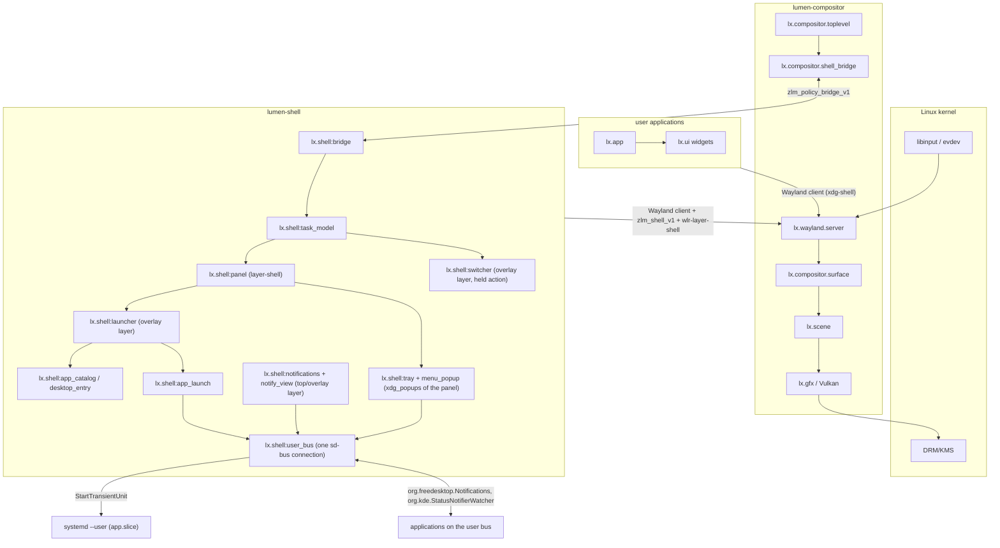
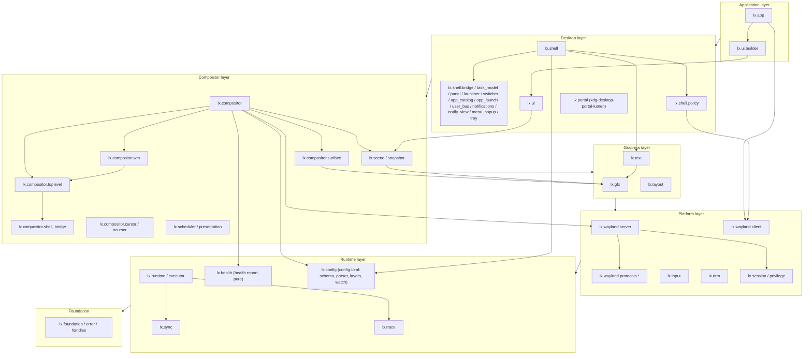
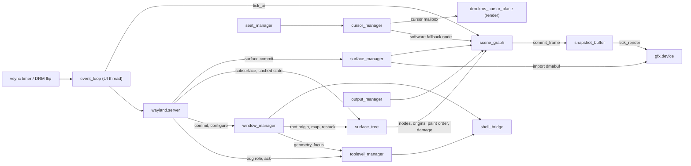
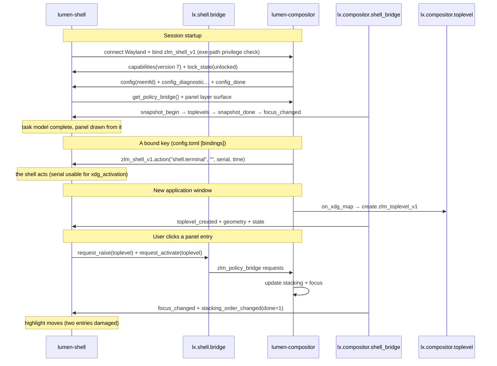
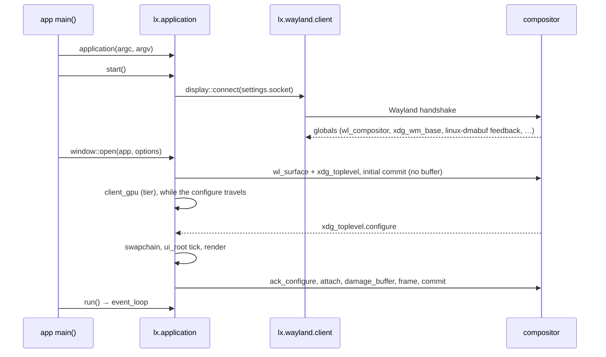
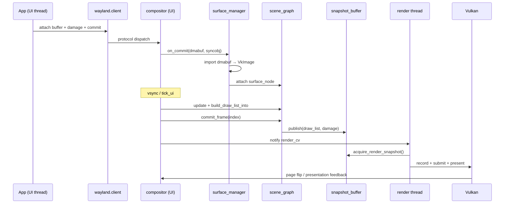
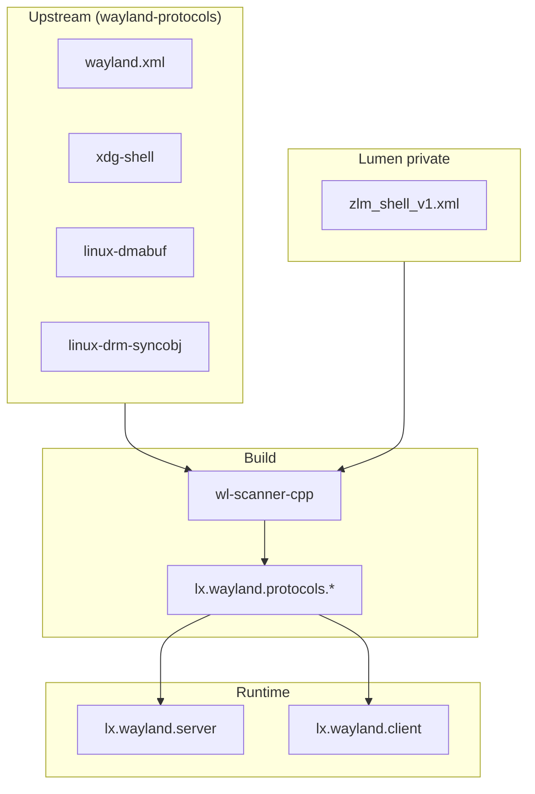
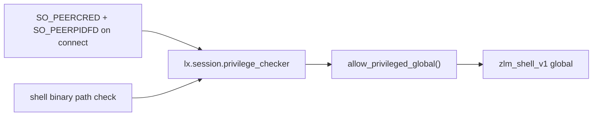

> **Status:** Current (v0.3) — see code for implementation truth

# Lumen Architecture

Detailed overview of the Lumen windowing stack: module layers, process boundaries,
interaction patterns, and runtime workflows.

**Related docs:** [API reference](api/README.md) · [UML diagrams](uml/README.md) ·
[Threading](subsystems/threading.md) · [Rendering performance](subsystems/rendering-performance.md) ·
[Errors & logging](subsystems/errors-and-logging.md) ·
[Shell state sync](subsystems/shell-state-sync.md) · [dmabuf/Vulkan](subsystems/dmabuf-vulkan-import.md) ·
[Memory](subsystems/memory-management.md) · [Health](subsystems/health.md) ·
[UI architecture](subsystems/ui-architecture.md) ·
[AI agent instructions](../AGENTS.md)

---

## 1. What Lumen is

Lumen is a greenfield Linux desktop stack built in **C++26** with **Clang**:

| Component | Role |
|-----------|------|
| **Compositor** (`lumen-compositor`) | Wayland display server, input routing, surface composition, Vulkan present |
| **Shell** (`lumen-shell`) | Desktop chrome — panel, workspaces, window management UI |
| **UI library** (`lx.ui`, `lx.ui.builder`) | Widget toolkit + fluent builders for apps and shell |
| **App framework** (`lx.app`) | Event loop, settings, clipboard for third-party apps |

Design goals:

- **Wayland-only** — no X11 layer
- **Vulkan-first, multi-backend** — Vulkan is the design centre and the default wherever a
  hardware Vulkan driver exists. A GL backend (EGL/GLES on GBM) covers hardware Mesa ships
  no Vulkan driver for, and a CPU backend covers hosts with no hardware renderer at all.
  All three live in `lx.gfx` behind `compositor::config::present`
  ([rendering-performance.md](subsystems/rendering-performance.md) §1.2, [AGENTS.md](../AGENTS.md) §1.1)
- **Multi-process** — compositor owns display; shell and apps are clients
- **Stacking-first WM** — optional tiling plugin via `lx.shell.policy`
- **First-class threading** — UI / render / worker affinities with immutable frame handoff
- **Zero-copy where possible** — dmabuf → Vulkan import, explicit sync via drm-syncobj
- **Performance pipeline** — snapshot v2, direct scanout, import cache, hot-path budgets ([rendering-performance.md](subsystems/rendering-performance.md))
- **Memory strategy** — unified arenas, pressure response, buffer lifecycle ([memory-management.md](subsystems/memory-management.md))
- **Health evaluation** — parts, processes, memory, speed → `health_report` ([health.md](subsystems/health.md))

---

## 2. Process model

Three classes of OS processes cooperate over Wayland:



### 2.1 Compositor process

**Binary:** `lumen-compositor`  
**Modules:** `lx.compositor`, `lx.compositor.*`, `lx.wayland.server`, `lx.scene`, `lx.gfx`, `lx.input`, `lx.drm`, …

Owns:

- Wayland socket (`$XDG_RUNTIME_DIR/lumen-0`)
- All `wl_*` / `xdg_*` / `zwp_*` protocol objects
- **`zlm_toplevel_v1`** handles (compositor-owned WM references)
- DRM master / KMS page-flip
- Scene graph + Vulkan composition
- Input seat and focus
- The logind session: it pauses with it (a VT switch away) and resumes with it, and
  executes the VT switch keys itself (§4, Session pause/resume)
- Key bindings: its own (VT switching, Ctrl+Alt+Backspace), the configured binding table
  (`config.toml [bindings]`: window, keyboard and session actions it executes, shell actions
  it sends over zlm v7) and the legacy key grabs a v4–v6 shell registers (§4, Key bindings)
- The configuration file (`$XDG_CONFIG_HOME/lumen/config.toml`): it reads, watches
  (inotify) and validates it, applies its own sections live and hands the shell the bytes
  (§4, Configuration)
- The control socket `$XDG_RUNTIME_DIR/<display>.varlink` (Varlink, `io.lumen.Compositor`:
  status and health, outputs, windows, actions, logout, an event stream; `lumen-ctl` is its
  client) and, run as the session's unit (`--session`), the session environment in the
  user manager and the sd_notify protocol (READY, RELOADING, STOPPING, the watchdog) — §10

Runs **three logical threads** (see [threading.md](subsystems/threading.md)):

| Thread | Affinity | Work |
|--------|----------|------|
| Main | `ui` | Event loop, vsync timer, `tick_ui()`, Wayland dispatch |
| Render | `render` | `tick_render()`, snapshot acquire, Vulkan record |
| Worker | `worker` | Executor drain — layout assist, I/O, the hotplug connector probe |

### 2.2 Shell process

**Binary:** `lumen-shell`  
**Modules:** `lx.shell` (`:bridge`, `:task_model`, `:panel`, `:shm_canvas`, `:launcher`,
`:desktop_entry`, `:app_catalog`, `:app_launch`, `:background`, `:workspaces`, `:switcher`,
`:user_bus`, `:notifications`, `:notify_view`, `:menu_popup`, `:tray`, `:icon_theme`,
`:svg`), `lx.shell.policy`, `lx.text`;
libwayland-client directly (its bindings move onto `lx.wayland.client` in ADR-010 Phase 5), xkbcommon for the
launcher's keyboard, sd-bus for the user bus (launching, notifications, the tray), librsvg
by `dlopen` on the first SVG not in the icon cache. It links only the platform parts it
uses (`lumen_link_platform_parts`), not the compositor's DRM, GBM, EGL, Vulkan and input
stack. That is 25 shared objects mapped instead of 69, and about 15 MB RSS instead of 24.

Acts as a **privileged Wayland client**:

- Connects to the compositor's display like any client (`--display NAME`, else
  `$WAYLAND_DISPLAY`)
- Binds **`zlm_shell_v1`**, which the compositor accepts only from its configured shell
  binary (§9); a refused or disconnected shell exits 1 and `lumen-shell.service` restarts it
  (300 ms, at most 5 times in 30 s; run-desktop.sh does the same in its direct mode). The
  restarted shell gets the snapshot of every window again; until its panel maps (5 s at
  most) the compositor keeps the dead shell's exclusive zones in the usable areas (the
  **zone hold**), so maximized windows do not grow into the panel's strip and back (§10,
  ADR 011 S6)
- Uses **`zlm_policy_bridge_v1`** for window-management intent ↔ compositor execution: a
  task model fed by the snapshot and deltas, and requests (`request_raise` +
  `request_activate` on a panel click)
- Shows the **workspaces** as an **ext-workspace-v1 client** (`:workspaces`, bound before the
  policy bridge, like any bar): the panel's indicator — one cell per workspace of its output
  right of the Apps button, the active one highlighted, a dot on occupied ones, urgent ones
  in the attention colour; a click activates, the wheel steps; hidden while there is only
  one. Each window's workspace arrives as zlm v7 `toplevel_workspace` (the shell's own
  handle), so each output's task list shows the windows of its active workspace and sticky
  ones; minimized windows are listed dimmed and a click brings them back
- Draws its **top panel** — a task list, one entry per window, the focused one
  highlighted — as a `wlr-layer-shell` surface (layer `top`, exclusive zone 32, so windows
  are placed and maximized below it), with CPU text from `lx::text`
- Draws the **desktop background** (`:background`): one `wlr-layer-shell` surface per output
  on layer `background`, opaque, taking no input. A colour is a `wp_single_pixel_buffer_v1`
  stretched by a `wp_viewport` (no pixels; the compositor's solid draw, the cost of a clear).
  Everything else — the procedural default `lumen`, two-stop gradients (linear light), and
  PNG/JPEG/WebP/SVG images (fill, fit, center, stretch, tile) — is rendered at the output's
  pixel size (fractional scale) on a worker thread, dithered (interleaved gradient noise,
  ±½ LSB: no banding on 8-bit outputs), into one shm buffer the shell unmaps once committed
  and destroys when released, so a background on screen holds no shell memory. JPEGs far
  larger than the output decode DCT-scaled (libjpeg-turbo); SVGs render at the size shown.
  Measured on vmwgfx at 1914×924: the default renders in 22 ms, a gradient in 47 ms, a
  6000×4000 JPEG filled in 262 ms, all off the shell's thread; the shell's RSS stays at
  23 MB with any of them. Any other client can draw the background instead
  (`--no-background`, then swaybg, wpaperd, …).
- Draws the **launcher** — installed applications from the XDG `.desktop` files (Desktop
  Entry Specification 1.5: ID shadowing, Hidden, NoDisplay, OnlyShowIn/NotShowIn,
  TryExec, Exec field codes), a search field, keyboard and pointer — as a separate
  overlay-layer surface with `on_demand` keyboard interactivity, which exists only while
  open. The panel's **Apps** button and the Super tap toggle it; it closes on Escape,
  launch, or when it loses the keyboard (a click elsewhere)
- **Launches applications** detached from itself: each launch is its own systemd user
  service, `app-lumen-<id>@<random>.service` in `app.slice`, started with
  `StartTransientUnit` (`Type=exec`, so a failed exec fails the start job, reported through
  `JobRemoved`; below systemd 250, which lacks `ExitType=cgroup`, a double fork held before
  `execve` until it is in its own transient scope `app-lumen-<id>-<random>.scope`); without
  systemd --user, a double fork + `setsid` with a clean signal state
  and fds. The new window gets an `xdg_activation_v1` token made from the triggering input's
  serial (`XDG_ACTIVATION_TOKEN`, `DESKTOP_STARTUP_ID`), so it takes the keyboard.
  Super+Return starts a terminal (`$TERMINAL`, `xdg-terminal-exec`, or the preferred
  TerminalEmulator entry)
- Is the **notification server** (`:notifications`, `:notify_view`, ADR 011 N1–N4):
  `org.freedesktop.Notifications` (spec 1.2: actions with `ActivationToken`, urgency,
  timeouts, `replaces_id`, image data and paths, the body-markup subset with links, close
  reasons, `persistence`) on the user bus, its popups one layer surface on the focused
  window's output (`top`, `overlay` while a critical one shows; never over the lock: they
  wait for the unlock), do-not-disturb (manual, and automatic while the screen is captured),
  and the history behind the panel's bell
- Is the **tray** (`:tray`, `:menu_popup`, ADR 011 N5–N6): the `StatusNotifierWatcher` and a
  host, the items' icons in the panel left of the bell, tooltips, Activate (with an
  activation token) / SecondaryActivate / Scroll, and `com.canonical.dbusmenu` menus as
  keyboard-navigable xdg_popups of the panel
- One thread, `ppoll` on the display fd, a signalfd, the catalog's inotify fd, one timerfd
  (armed only while key repeat, a notice, a catalog debounce, a token wait, a notification's
  expiry or a tooltip's delay is due) and the user bus (one `sd_bus`, opened once the first
  panel frame is on screen, shared by launching, notifications and the tray): asleep when
  idle
- Executes **shell actions** the compositor's binding table sends (zlm_shell_v1 v7
  `action`): `shell.launcher` (the Super tap), `shell.terminal` (Super+Return), `shell.lock`
  (Super+L) — which key does what is the user's configuration (ADR 011 C4). Against a v4–v6
  compositor it registers its own key grabs (`grab_key`) as before
- Runs the **window switcher** (`:switcher`, ADR 011 K1–K2): Alt+Tab gives it a hold
  (zlm_shell_v1 v7 `held_action`) — the keys while Alt is down, the focused window keeping the
  keyboard — over the task model's most-recently-used order; a quick Alt+Tab switches without
  drawing anything, a held one shows an overlay-layer view (icons, the selected window's
  title) after 150 ms; releasing Alt activates the selection, Escape cancels
- Applies its **sections of the configuration** (`[idle]`, `[background]`, `[switcher]`,
  `[notifications]`) from the bytes the compositor hands it (zlm v7 `config`), live;
  its command-line options win; one notification per generation with problems (the panel's
  notice until the notification server runs)
- Owns **idle and lock policy** (`:idle_policy`): blanking after `--blank-after` (600 s),
  and with a `--lock-command` (Lumen ships no locker) when to start it — Super+L, logind's
  Lock and before-sleep (zlm_shell_v1 v5 `lock_requested`), the blank timeout (lock, then
  blank once `locked`), again when a locker dies (`lock_state` abandoned); a shorter blank
  timeout while locked (`--blank-locked-after`, 60 s)

The shell **does not** own surfaces of other apps or mutate the scene graph directly.
It sends policy requests; the compositor executes geometry, focus, and stacking — and owns
the workspaces, which the shell displays and switches through ext-workspace. Details:
[shell-state-sync.md](subsystems/shell-state-sync.md) § The shell.

### 2.3 Application processes

**Typical binary:** user app linked against `lx.app` (`lumen-hello` is the reference)  
**Modules:** `lx.app` (`:window`, `:input`), `lx.ui`, `lx.gfx` (`:swapchain`, the UI
renderers), `lx.wayland.client`

Each app (ADR-010 §4.9–§4.10, Phase 4):

- `lx::application` connects (`lx.wayland.client`), loads the compiled theme, runs one
  `lx::runtime::event_loop` on the UI thread and a worker thread for icon rasters and theme
  reloads (threading.md, "Client process")
- `lx::app::window` creates the `wl_surface` + `xdg_toplevel` (server-side decorations
  requested), owns an `lx::ui::ui_root`, and draws it on the pixel tier `lx::gfx::client_gpu`
  picks the way the compositor picks its own (hardware Vulkan → hardware GL on GBM → CPU over
  `wl_shm`) into a `client_swapchain` of dma-bufs (or shm), one wl_buffer per image
- Frames follow lx.ui's damage ledger: drawn at once from idle, then throttled by the frame
  callback; only the damage is repainted (scissored, buffer age) and reported
  (`damage_buffer`); an idle window requests nothing and arms nothing
- Fractional scale through `wp_fractional_scale_v1` + `wp_viewport` (the buffer at
  ceil(logical × scale), the UI laid out in logical px and projected at emission)
- Input: `wl_pointer` (frames coalesced, one hit test per frame), `wl_keyboard` through xkb
  with client-side repeat, `zwp_text_input_v3` into the focused field, `wp_cursor_shape_v1`

- Measured as a whole by `lumen-ui-bench --client` (ADR-010 §8.3 S1, S5, S7, S9, S10) against
  a headless compositor, per tier (ADR-010 §7 Phase 4 "As built", stage 4): an idle window
  wakes 0 times in 10 s; a hover frame allocates nothing on the UI thread; a resize storm keeps
  the heap flat and allocates the swapchain once per size
- An `lx.app` executable links with `--as-needed`: the module archives carry the compositor's
  platform libraries (libinput, udev, libwayland-server), which a client never calls and would
  otherwise map and relocate at every exec

Apps never see `zlm_shell_v1` or `zlm_toplevel_v1`. `lx.ui.builder` is kept compiling until
ADR-010 Phase 5 deletes it; `lx.app` no longer imports it.

### 2.4 Portal processes

**Binaries:** `xdg-desktop-portal` (the frontend), `xdg-desktop-portal-wlr` (ScreenCast),
`xdg-desktop-portal-lumen` (Screenshot, PickColor, the cast source chooser; `lx.portal`),
`xdg-desktop-portal-gtk` (file chooser, access dialogs and the rest)

Applications — sandboxed or not — reach screen capture through D-Bus, not through the
capture globals: the frontend checks permissions and asks the user, and routes each
interface to a backend by `lumen-portals.conf`. The backends are ordinary Wayland clients of
the compositor (unsandboxed, so they see the capture globals); none of them is privileged
the way `lumen-shell` is. See [Portals](#portals) in §4.

---

## 3. Module layers

Dependency flows **downward** — higher layers never export to lower ones.
CMake encodes this graph in `cmake/LumenCXXModules.cmake` (`LUMEN_LAYER_*`) and
rejects upward `DEPENDS` at configure time.

Shared WM vocabulary (`lx::toplevel_state`, `lx::placement`) lives in
`lx.foundation` so the compositor can describe toplevel state without depending
on `lx.shell.policy`. Policy implementations stay in the desktop layer.
`lx.ui` is also desktop-layer: shell and apps both consume it; only
`lx.ui.builder` / `lx.app` sit above.




### Layer responsibilities

| Layer | Purpose | Key contracts |
|-------|---------|---------------|
| **Foundation** | Types, errors, handles, WM vocabulary | `result<T>`, `toplevel_id`, `toplevel_state`, `placement` |
| **Runtime** | Event loop, thread routing, logging | `executor`, `event_loop`, `logger` |
| **Platform** | OS / kernel / Wayland wire | `server::bind`, `kms_device::open`, protocols |
| **Graphics** | Vulkan RHI, text, layout (`lx.text` rasterises glyphs into `lx.gfx:atlas`, so it depends on `lx.gfx`; `lx.layout:flex` is the UI's flexbox, on `lx.foundation` only) | `dmabuf_importer`, `solve_flex`, `scene_graph` |
| **Compositor** | Display server integration | `tick_ui` / `tick_render`, `shell_bridge` |
| **Desktop** | WM policy, shell UI, shared widget toolkit | `policy_bridge`, `stacking_policy`, `lx.ui` |
| **Application** | End-user programs + fluent builders | `lx::application`, `make_window()` |

---

## 4. Compositor internal architecture

Inside `lumen-compositor`, subsystems connect as follows:



### Subsystem roles

| Module | Responsibility |
|--------|----------------|
| `lx.wayland.server` | Socket, client connections, protocol dispatch, global registry; the global filter hiding `deny_sandboxed` globals from sandboxed clients; security-context listeners (security-context-v1: an engine's socket accepted on libwayland's own loop, each client created with its context attached and sandboxed) |
| `lx.compositor.toplevel` | `toplevel_record` per `xdg_toplevel`, stacking order, configure state machine (one configure in flight, serials matched on ack) |
| `lx.compositor.wm` | The executor of window state: owns `toplevel_record::geometry` (the one source of truth for where a window is), places new windows (centred, cascaded), derives node origin from geometry and node bounds from the buffer, sends configures once per tick. Input routing: hit-testing (one top→bottom pass over the stacking order, surface extents ∩ `wl_surface` input region), enter/leave pairing, the implicit grab while a button is held, click-to-focus and raise-on-press (placeholder policy until the shell drives it), stacking and the shell's activate/raise/lower/restack/close requests. Transients (xdg-dialog-v1, xdg_toplevel.set_parent, xdg-foreign): a child is centred on its parent at its first map; a modal one stays above its parent, which never takes the keyboard while it has one (focus, activation and clicks go to the dialog). Interactive move/resize grabs (xdg, shell bridge and the placeholder Super+drag binding share one executor): move is an origin change applied once per tick, resize keeps one configure in flight and anchors left/top edges on the matching commit, Escape cancels. The usable area (output minus layer-shell exclusive zones) for placement, move constraints, `configure_bounds` and maximize; keyboard-focus resolution across layer surfaces, popups and toplevels. UI affinity |
| `lx.compositor.content_update` | The content-update queue of `wl_surface.commit` (wayland 1.24's CU model), Wayland-free: a fixed pool of queued updates (512), per-surface queues in commit order, synchronized children's state *sealed* into their parent's update, fence-wait counts, and the readiness policy (`cu_ready`: fences, the fifo barrier and the commit-timing target, all ignored but the fences for a surface not on screen); the readiness poller (one epoll fd, one event-loop source, for every sync_file and syncobj eventfd an update waits on). UI affinity |
| `lx.compositor.surface` | Commit handler: damage, dmabuf desc, solid colour content (`wp_single_pixel_buffer_v1`), the alpha multiplier (node opacity), `content_hint` (wp_content_type_v1), content opacity (blend only skipped for a format without alpha or a full opaque region); one scene node per *mapped* surface, created and placed by `surface_tree`. O(1) id → slot index; registry of each surface's `wl_resource` |
| `lx.compositor.surface_tree` | `wl_subsurface` trees, Wayland-free: parentage, the double-buffered child state (position, place_above/below order) pending → cached → current, effective sync, mapping (content + linked + parent mapped, recursively). Each root surface (toplevel, popup, layer surface) owns one container holding its whole tree **flattened in paint order** (an optional underlay below it); restacking a window moves that one container. Node origins stay global: relative positions live here and are pushed into the nodes when a root moves or its tree changes, damaging old and new rects per node. Hit-testing walks the container in reverse paint order (each surface clipped to its own extents and input region). UI affinity |
| `lx.compositor.positioner` | xdg_positioner placement, pure: base rectangle from anchor, offset and gravity; constraint adjustment per axis in the spec's precedence flip → slide → resize |
| `lx.compositor.popup` | xdg_popup state, Wayland-free: configure/ack, placement relative to the parent's window geometry, map/unmap, reposition, the popup grab and dismissal. UI affinity |
| `lx.compositor.layer_shell` | wlr-layer-shell, Wayland-free: layer-surface records, the configure/ack flow, arrangement against the output (`arrange_layers`, pure) and the usable area its exclusive zones leave, keyboard-interactivity queries; each layer surface's tree container sits in one of the four layer-shell scene containers. UI affinity |
| `lx.compositor.decoration` | Server-side frames (xdg-decoration), Wayland-free: frame extents and hit zones, the shared atlas, the frame scene node (underlay of the window's tree container; its fills are UI quad primitives), titles shaped by `lx.text` and drawn as `mono_sprite`s from the compositor's `chrome_atlas` (`chrome_text`), the close × an atlas glyph per scale. UI affinity |
| `lx.compositor.ui_composite` | How a backend draws a snapshot (ADR-010 §4.11): the draws as blits when it carries no UI primitive (the path unchanged), its sorted stream through `lx.gfx:ui_cpu` / `:ui_gl` when it does, on Vulkan inside the compositor's linear pass through `lx.gfx:ui_vk` (`paint_vk`); screen-capture re-composites through the CPU and GL primitive renderers (`paint_cpu_capture`, `paint_gl_capture`); the stream lowered to blits only where there is no primitive renderer (GLES 2, Vulkan without a ready `ui_vk`), which drops titles. Render affinity |
| `lx.compositor.workspaces` | The workspace model, Wayland-free and pure (bodies in `workspaces.cpp`): every output's ordered workspaces and its active one, dynamic (one empty last, empty inactive ones go) or static, focus memory, urgency, hotplug (merge, append, return, strand), `assign`; tells the window manager when windows or a workspace move (`workspace_sink`). 64 workspaces, 16 per output. UI affinity |
| `lx.compositor.shell_bridge` | Creates `zlm_toplevel_v1` handles; emits snapshot/deltas (created, destroyed, state — `modal` for an effectively modal dialog, `minimized` —, geometry, focus, flags — `sticky` from v7 —; v6: icon with its memfds, parent, bell; v7: `toplevel_workspace` with the shell's ext-workspace handle) on `zlm_policy_bridge_v1`; receives WM requests |
| `lx.compositor.toplevel_icon` | xdg-toplevel-icon-v1's icon store, Wayland-free: a set_icon snapshot (name + up to four buffers, edge ≤ 256, nearest the panel's 32 px first) copied into sealed memfds, refcounted by the toplevel records, 128 icons and 16 MiB of pixels at most. UI affinity |
| `lx.compositor.foreign_registry` | xdg-foreign's handle table for v1 and v2 (one registry: either imports what either exported), handles of 128 random bits as 32 hex digits, 64 exports. UI affinity |
| `lx.compositor.pointer_constraints` | pointer-constraints' policy, Wayland-free and pure (bodies in `pointer_constraints.cpp`): the effective region (region ∩ input region ∩ the surface's box, ≤ 32 rects, overflow only confines more), `confine_motion` (the motion segment walked across the rects, sliding along the edge that stops it, one wl_fixed short of far edges), `nearest_inside`, the activation predicate `constraint_wanted` and when a lock's cursor hint is usable |
| `lx.compositor.capture` | Screen capture's policy, Wayland-free and pure (bodies in `capture.cpp`): session constraints (buffer size, shm XRGB/ARGB, LINEAR XR24/AR24 dma-buf with the render node on GL) and whether a buffer fits them, the frame requests and their errors, the session table (64, 16 per client, a generation per open), `capture_decide` (copy, the lock curtain, held, stopped — CC7–CC9), the per-output composite damage ring (`capture_damage_ring`), the pointer's placement and premultiplied blend, wlr-screencopy's per-client damage points. UI affinity |
| `lx.compositor.capture_engine` | Screen capture's render side, Wayland-free: jobs UI → render and completions render → UI (`capture_channel`, fixed queues under one lock), client shm under a guard render writes through (`capture_shm_guards`: the pool referenced, a buffer's destruction waits for a copy in progress), and `capture_renderer`, which runs jobs on the active backend — on a composite of their output, from an output's newest composited frame (first frames, pointer moves), or on a window's capture view — and keeps no per-session state but GL objects and a Vulkan staging buffer |
| `lx.compositor.cursor` | Pointer image and position (grab override → frame hover → client → default). Hardware cursor plane (`lx.drm:cursor`) by default: pointer motion is a plane update on the next atomic commit — or a cursor-only commit when nothing else changed — and never a composite. Software fallback is a node in the scene's overlay layer, damaged old+new. Images from the Xcursor theme (`lx.compositor.xcursor`) with a compiled-in vector set, `wp_cursor_shape_v1` and `wl_pointer.set_cursor` |
| `lx.compositor.output` | The outputs, in **stable slots** (an output keeps its slot while its connector stays connected): geometry, refresh, name (the kernel's connector name, "Virtual-1"), physical size, scale, transform, present mode, KMS damage flags, and a `generation` that moves only when something a client sees changed. Without a connected connector there is one virtual output, HEADLESS-1 (1920x1080 at 60 Hz). Pure membership helpers: the outputs a rect is on (one bit per slot), the primary output (largest overlap), the preferred buffer scale (ceiling of the largest) and transform. UI affinity |
| `lx.compositor.output_management` / `.output_config_store` | wlr-output-management's wire-free model (heads, mode identity, every configuration error, validation into a target, the job queue) and the persisted `outputs.toml` model (per monitor, per setup) and its file (debounced atomic saves on the worker), written in `lx.config`'s strict TOML subset. Pure apart from the file; UI affinity |
| `lx.compositor.config_apply` | The configuration in use (`config_state`: the snapshot, its bytes, the generation's diagnostics, the inotify watch), what a reload changed (`diff_config`), and the file's terms in the subsystems' (the binding table, a device's libinput settings, the keymap names). Executing a change is `compositor_impl`'s. UI affinity |
| `lx.compositor.liveness` | xdg_wm_base.ping/pong liveness, Wayland-free: pings on activation, delivered button and key presses, the configure watchdog and every 10 s to the focused client — one outstanding per client, at least 2 s apart; a ping unanswered past the timeout (`--ping-timeout`, 5 s) marks the client not responding until it answers. Never kills. O(1) per tick unless a deadline passed. UI affinity |
| `lx.compositor.input_router` | Seat event delivery to the focused client's resources (enter/leave pairing, held keys, frames) and the per-client **input serial log**: the serials of input and focus events each client was sent, as compressed ranges — what `set_selection` and xdg-activation tokens quote is checked against it. The focus-client hook runs between a focus change's `leave`s and `enter`s; the user-input hook after a delivered key or button press (liveness pings on it). Pointer motion to a client that is not responding is withheld (keys, buttons and enter/leave are not). UI affinity The pointer-focus hook runs after every pointer-focus change (pointer constraints follow it); the *motion lock* withholds every `wl_pointer.motion` while a pointer lock holds, and `send_pointer_frame` closes a group of relative motion that carried none. |
| `lx.compositor.activation` | xdg-activation's focus-stealing-prevention policy, Wayland-free: `decide_grantable` (at token commit) and `decide_activation` (at `activate`, and again at map for a window that asked before mapping) — pure functions over what the wire and the window manager gather; the token table (64 fixed slots, 128-bit random text from `getrandom`, single use, 30 s lifetime, constant-time lookup, eviction of expired then oldest). UI affinity |
| `lx.compositor.data_transfer` | Wayland-free data-transfer pieces: `mime_list` (a source's offered types, inline, never allocating) and drag-and-drop action negotiation (`negotiate_dnd_action`, the modifier-chosen user action) |
| `lx.compositor.dnd` | The drag-and-drop grab, Wayland-free: a third pointer mode beside the implicit grab and move/resize, driven by the window manager's pointer path (hit test, button mask, Escape, modifiers) and calling the wire through `dnd_ops` (focus, motion, drop, cancel, user action). Owns the drag icon's placement (a `dnd_icon` surface-tree root in its own scene layer, moved once per tick with the pointer) and the pointer shape that shows the negotiated action. No allocation per motion. UI affinity |
| `lx.compositor.wire` (internal) | The libwayland glue, one translation unit per protocol area: `wire_surface.cpp` (wl_compositor, wl_surface, wl_region, frame callbacks, the commit), `wire_subsurface.cpp`, `wire_buffer.cpp` (wl_buffer tracking, shm staging, texture retirement), `wire_xdg_shell.cpp` (xdg_wm_base, xdg_surface, xdg_toplevel, xdg_positioner, the window manager's wire ops), `wire_xdg_popup.cpp`, `wire_decoration.cpp`, `wire_layer_shell.cpp`, `wire_dmabuf.cpp`, `wire_seat.cpp`, `wire_cursor_shape.cpp`, `wire_shell.cpp` (zlm_shell_v1, policy bridge), `wire_output.cpp` (wl_output, xdg-output, wl_surface.enter/leave and the preferred buffer scale/transform), `wire_selection.cpp` (the selection model both selection families share), `wire_data_device.cpp` (wl_data_*), `wire_primary_selection.cpp` (zwp_primary_selection_*_v1), `wire_dnd.cpp` (start_drag, drag offers and action negotiation), `wire_activation.cpp` (xdg_activation_v1: token builders, the grant decision at commit, `activate`), `wire_idle.cpp` (ext_idle_notifier_v1, zwp_idle_inhibit_manager_v1), `wire_output_power.cpp` (zwlr_output_power_manager_v1), `wire_output_management.cpp` (zwlr_output_manager_v1: heads, modes, configurations), `wire_session_lock.cpp` (ext_session_lock_manager_v1, lock objects, lock surfaces), `wire_text_input.cpp` (zwp_text_input_manager_v3, text inputs and the events the relay sends them), `wire_input_method.cpp` (zwp_input_method_manager_v2, input-method popups and keyboard grabs, zwp_virtual_keyboard_manager_v1, the relay's installation), the commit-path add-ons — `wire_fifo.cpp` (wp_fifo_v1, wp_commit_timer_v1, and the add-on object plumbing they all share), `wire_tearing.cpp` (wp_tearing_control_v1, wp_content_type_v1), `wire_single_pixel.cpp` (wp_single_pixel_buffer_manager_v1, wp_alpha_modifier_v1), `wire_syncobj.cpp` (wp_linux_drm_syncobj_manager_v1: timelines, acquire/release points, the commit checks) —, the window and session protocols — `wire_dialog.cpp` (xdg_wm_dialog_v1), `wire_toplevel_icon.cpp` (xdg_toplevel_icon_manager_v1), `wire_bell.cpp` (xdg_system_bell_v1), `wire_foreign.cpp` (zxdg_exporter/importer v2 and v1), `wire_shortcuts_inhibit.cpp` (zwp_keyboard_shortcuts_inhibit_manager_v1), `wire_data_control.cpp` (ext_data_control_manager_v1, zwlr_data_control_manager_v1 v2), `wire_security_context.cpp` (wp_security_context_manager_v1), `wire_pointer_constraints.cpp` (zwp_pointer_constraints_v1), `wire_relative_pointer.cpp` (zwp_relative_pointer_manager_v1), `wire_gestures.cpp` (zwp_pointer_gestures_v1 v3) —, screen capture — `wire_foreign_toplevel.cpp` (ext_foreign_toplevel_list_v1, and the shell bridge's toplevel observer), `wire_capture.cpp` (the two ext_image_capture_source managers, ext_image_copy_capture_manager_v1 sessions and frames, zwlr_screencopy_manager_v1 v3 on the same core, the capture tick and completions), `wire_capture_cursor.cpp` (ext_image_copy_capture_cursor_session_v1) —, `wire_workspace.cpp` (ext_workspace_manager_v1: groups, workspace handles, the per-manager diff, commit) — and `wire_install.cpp` (every global, in registry order, and the `:protocols_p0` entry points). The implementation partition `:wire` (`wire.cppm`, not exported) holds the wire object records and what more than one unit uses; everything else stays in each unit's anonymous namespace. The Wayland-free state stays in the partitions above. UI affinity |
| `lx.scene` | Scene graph (layers bottom→top: layer-shell background and bottom, windows — per-window tree containers —, layer-shell top and overlay, popups, drag icon, session-lock surfaces, cursor), a clear colour per snapshot (the lock's solid colour), multi-rect damage (`gfx::damage_region`), a per-node tint (the not-responding dim), `build_draw_list_into`. Views 0–15 are the outputs; views 16–23 are *capture views* (`output_view_config::root`: one window's tree container projected into a capture client's buffer, with their own damage and snapshot buffers) |
| `lx.scene.snapshot` | Triple-buffered handoff (v2: index swap, back-pressure policy) |
| `lx.gfx` | Vulkan device, swapchain, dmabuf import, render pass |
| `lx.gfx.gl_renderer` | EGL/GLES composite on GBM — the accelerated path on drivers with no Vulkan driver (vmwgfx/SVGA3D and similar); `composite_into` composites into any framebuffer (a capture target), optionally without clearing and without a fence |
| `lx.gfx.gl_capture` | Screen capture's GL objects (ES 3.0): a client's dma-buf as a framebuffer (imported once per wl_buffer, LRU of 32), `glBlitFramebuffer` of damage rects (and crops), offscreen framebuffers over LINEAR GBM buffers read off the render thread (`read_bo`), asynchronous read-backs into pixel-pack buffers behind a native fence and their copy-out where there is no GBM buffer, the curtain clear |
| `lx.gfx.cpu_renderer` | Software composite into a CPU-writable scanout buffer; chosen when no hardware renderer is available ([rendering-performance.md](subsystems/rendering-performance.md) §1.2) |
| `lx.gfx.import_cache` | LRU reuse of VkImage imports; per-client entry cap |
| `lx.gfx.swapchain` | A client window's pixel path (ADR-010 §4.10): the render node from the dma-buf feedback's main device, the tier in the compositor's `automatic` order and refusal rules (hardware Vulkan on the render node → hardware GLES 3.1 on GBM → wl_shm + `ui_cpu`), and a swapchain of three dma-buf images (two shm) with buffer age, non-blocking acquire, release by wl_buffer.release or linux-drm-syncobj release points, explicit sync per image (GL native fence → DRM syncobj; Vulkan timeline semaphore as a syncobj), reallocation once per size. API-type-free: lx.app maps the images onto wl_buffers through `lx.wayland.client`; `lx.gfx` never imports it. UI affinity in a client |
| `lx.gfx.drm_timeline` | DRM timeline syncobjs for explicit sync behind an ops table (real libdrm ops; a fake in tests): imported timelines (refcounted: points outlive their objects), point queries (with a deadline hint), `DRM_IOCTL_SYNCOBJ_EVENTFD`, signal, signal-after-sync_file; the support probe; the release-fence mailbox (render's newest composite fence for release points) |
| `lx.gfx.fence_deadline` | dma-fence deadline hints (`SYNC_IOC_SET_DEADLINE`, Linux 6.4) on composite and client sync_files; probed by use, off for good after ENOTTY |
| `lx.compositor.buffer_lifecycle` | import → release → wl_buffer.release loop |
| `lx.runtime.memory` | Per-subsystem arenas, pressure coordinator, overflow policies |
| `lx.runtime.psi` | Kernel memory pressure (PSI) triggers and decay; `psi_monitor` feeds them to the coordinator on the UI loop |
| `lx.runtime.sched` | Render and UI thread scheduling tiers (real-time, nice, EEVDF slice / uclamp.min) with RLIMIT_RTTIME and reset-on-fork; rtkit as the broker via `lx.session.rtkit` |
| `lx.input` + `seat_manager` | libinput → pointer/keyboard events (ms wire time plus µs CLOCK_MONOTONIC time for latency) → `lx.compositor.wm` decides focus |
| `lx.drm` + `lx.drm.atomic` | Connector probe (`connector_scan`, EDID identity via `:edid`; a worker may run it), CRTC/plane allocation (`:crtc_alloc`, pure, TEST_ONLY-checked), one `kms_pipeline` per CRTC (atomic page flips, KMS damage blobs, power-off), combined multi-output `commit_modeset` (TEST_ONLY of another mode, disabling a removed output, VRR_ENABLED), per-device flip-event routing, dumb scanout buffers, framebuffer hand-over at exit (CLOSEFB), the udev hotplug monitor (`:uevent`), CVT custom modes (`:modes`), GPU memory from DRM fdinfo for the health report (`:fdinfo`) |
| `lx.scheduler.presentation` | Page-flip bridge: flip time, vblank sequence, the commit's frame tag |
| `lx.compositor.presentation_feedback` | wp_presentation bookkeeping: sampled → flipped → presented / discarded |
| `lx.compositor.idle` | ext-idle-notify notifications (lazy single timer, real input only) and idle-inhibitor objects, Wayland-free. UI affinity |
| `lx.compositor.display_power` | The output's power state machine (on → off_pending → off / soft_blank → on_pending → on), Wayland- and libdrm-free; the compositor executes its actions (the power gate, the render thread's ACTIVE=0 commit, the resume modeset, `mode` events). UI affinity |
| `lx.compositor.session_lock` | ext-session-lock's state machine (unlocked → awaiting_surfaces → locking → locked; abandoned), the lock surfaces' configure/ack bookkeeping and commit rules, keyboard focus among lock surfaces; Wayland-free, returns actions the compositor and `wire_session_lock.cpp` execute. UI affinity |
| `lx.compositor.text_input` | The text-input ↔ input-method relay: text-input focus (the keyboard's, while an input method is bound), the double-buffered text-input state and commit count, activation and state of the input method, its commit serial rule, input-method popup visibility and placement at the cursor rectangle; Wayland-free, events leave through a sink the wire units implement. UI affinity |
| `lx.scheduler.budget` | Hot-path CPU budgets per tick |

### Content updates and subsurfaces

`wl_surface.commit` creates a **content update** (wayland.xml since 1.24: "placed at the end
of a per-surface queue … applied atomically"). In `wire_surface.cpp`: role pre-checks on the
pending state (every protocol error that rejects the whole commit — xdg rules, viewport,
explicit sync — validation only), **merge** pending into the surface's cached state (later
state replaces earlier, damage and frame callbacks accumulate, a buffer superseded before use
is released and its explicit-sync release point signalled), let the tree cache the
children's pending positions and order, and then — unless the surface is *effectively
synchronized* — commit a DCU (`commit_dcu`):

- **Fast path** (the common case, today's cost): the surface's queue is empty and nothing
  blocks the update — its fences (and its synchronized children's) have signalled, and for a
  surface on screen no fifo barrier holds it and its commit-timing target is reached. It is
  applied at once: the role state the commit carries, then cached → current for the surface,
  its children's positions and order, and recursively the cached state of every synchronized
  child, all in the same UI call and so the same snapshot; then the root's role finisher
  (window geometry, configure acks, map) and one `sync_scene` of the root's container.
- **Queued**: otherwise the update takes a record in `:content_update` and its payload — the
  surface state, a **role snapshot** (xdg window geometry, size limits and the acked
  configure; a popup's geometry; a layer surface's props — so a queued buffer is never shown
  with geometry acked for a later one) and the tree's cached child state — moves out of the
  surface. Synchronized descendants' cached state is **sealed** into it. It applies, in commit
  order, when it heads its surface's queue and is ready: the poller saw its fences signal, a
  tick latched the frame that clears the fifo barrier, a tick reached its target, or the
  surface stopped being shown. Applying swaps the payload into `cached` and goes through
  `apply_cached` like the fast path; sealed children are applied from the update, never from
  what they cached since. A surface's queue holds up to 128 updates (weston-simple-timing
  schedules ~110 ahead); beyond that the newest two merge (the older carries the newer
  content and waits for both sets of blockers: a frame dropped, nothing shown early). A
  client holds at most 128 records, and one holding more than 8 may not take the pool's
  last 64 (`cu_room_for`), so clients far ahead of the display cannot leave one that
  queues a frame or two without a record. The poller keeps 64 of its 384 entries for other
  units (a capture's copy fence). A destroyed surface's queued updates are discarded —
  buffers released, release points signalled, frame callbacks answered.

A surface that stops being effectively synchronized (`set_desync`, its `wl_subsurface` or
parent destroyed) turns what it had cached into a DCU, top-down. Frame callbacks are kept in
a shared node pool (an update carries a three-word list), so queued updates are small and a
commit copies no callback array.

A window's geometry is clamped to the bounding box of its whole tree, so a client-side
title bar drawn as a subsurface above the main surface is part of the window (its origin
may be negative in surface coordinates). Texture updates carry the index of the snapshot
being built when they were queued, and the render thread holds an update back until it
composites that snapshot, so new pixels never show under the previous frame's geometry
(see [rendering-performance.md](subsystems/rendering-performance.md)).

### Explicit sync, buffer readiness and the commit-path protocols

Design and decisions: [ADR 009](adr/009-app-compatibility-and-capture.md) Part A.

- **Implicit readiness.** A dma-buf update without explicit sync is held until its writers'
  fences have signalled: one `poll(POLLIN, 0)` per distinct plane (the already-signalled
  case, the norm), else a `DMA_BUF_IOCTL_EXPORT_SYNC_FILE(READ)` snapshot watched by the
  poller (Mutter's and niri's rule). A slow GL client then never costs everyone a frame. A
  kernel without the ioctl disables the wait (the GPU import waits implicitly instead).
- **linux-drm-syncobj-v1** is offered only where it works end to end (timeline syncobjs,
  `DRM_IOCTL_SYNCOBJ_EVENTFD`, a composite that exports a completion fence — not on vmwgfx).
  The acquire point is waited for *signalled* (query, then an eventfd the poller watches), so
  the composite never waits on client GPU work. An update is never applied before its
  acquire points signal: one the poller cannot take (or no eventfd could be armed for) marks
  the update `recheck` — it blocks like a wait and is queried again at each tick of a lit
  output (its pace output keeps ticking) until it signals or an entry is armed; an update
  with nowhere to wait at all (the client past its share of the pool) disconnects its
  client with `no_memory` rather than apply early. A release point is signalled at once for
  a buffer that was never sampled; for a sampled one when the buffer lifecycle retires it —
  a dma-buf is the surface's *current* content, sampled by every composite, until a newer
  commit supersedes it, then released once the last frame that could sample it (window
  capture views included) completed — with the newest fence attached
  (`release_fence_mailbox`: render publishes each composite's, and one after a tick's capture
  composites that sampled client textures, only while some client uses explicit sync). A
  wl_buffer destroyed while on screen hands its owed point to the lifecycle record. A
  re-commit of the buffer on the same timeline at a later point keeps the older point
  pending (signalling the later one covers it). shm and single-pixel buffers are
  `unsupported_buffer`.
- **fifo-v1**: an applied update with `set_barrier` raises the surface's barrier, dated with
  the frame that first shows it; it clears after its pace output's tick latches that frame
  (`content_updates_latched`, right after publish), and the update waiting on it applies then,
  joining the next frame — one update per refresh. The pace output's clock keeps ticking while
  such an update waits.
- **commit-timing-v1**: an update with a target T applies when the frame it would join is
  predicted to present no earlier than 0.5 ms before T (the frame clock's deadline inside a
  tick, the first deadline whose tick has not started outside one). A stopped clock is armed
  for exactly that tick (`frame_clocks::request_at`), so a target costs one wake-up.
- **Hidden surfaces** (occluded, off every output, under the lock, VT paused, display off)
  ignore fifo and timing; only fences hold them. Frame callbacks throttle them as before.
- **single-pixel-buffer-v1**: a colour, not pixels — a solid draw (`draw_command::solid`) of
  the surface's logical size, released at apply; GL clears an opaque untinted one with a
  scissored `glClear`, otherwise every backend substitutes the colour for the sample.
  **alpha-modifier-v1** is the surface node's opacity (applied once: the scene no longer also
  folds it into the tint). **content-type-v1** feeds `content_hint`. **tearing-control-v1**'s
  hint reaches the output policy (`allow_async`: card capability, a TEST_ONLY-verified async
  commit, a fullscreen window asking for it, not locked); the atomic-async commit itself is
  not wired yet (no card here exposes the capability), so outputs present with vsync and say
  so once.

### Popups

Every `xdg_popup` is the root of its own surface tree, with its container in the scene's
popup layer: above every window and every layer-shell surface, below the drag-and-drop icon
layer and the cursor (sway's order — no panel or window ever covers a menu), newest on top. The hit test visits popups
top-down before any window. A popup is placed relative to its parent's window geometry
(`positioner_place`: flip, then slide, then resize, per axis, against the usable area for a
window's popups and the whole output for a layer surface's — Mutter/KWin and sway
respectively — expressed in parent coordinates); the placement a
configure carries takes effect at the commit after its ack, so the popup moves in the same
snapshot as the content drawn for it. When the parent moves or resizes, its popups move in
the same UI call; reactive ones are placed again and reconfigured.

The grab is a stack of one client's grabbing popups (`xdg_popup.grab`). The serial must be
the last button press or key press (or that key's release, Mutter's rule) the client
received; a grab during an interactive move/resize is denied, and a denied grab is an
immediate `popup_done`. While a grab is active the pointer is owner-events (only the grabbing
client's surfaces get it); a press anywhere else dismisses the whole chain top-down and is
consumed, an interactive move/resize or the activation of another client's window ends it,
and destroying the topmost grabbing popup returns the grab to its parent. Keyboard focus is
resolved in one place (`window_manager::resolve_keyboard_focus`): an `exclusive` layer
surface on the top or overlay layer first, then the topmost mapped grabbing popup (unless an
exclusive layer surface holds the keys and the popup is not its own, or the popup's layer
root has interactivity `none`), then a clicked `on_demand` layer surface, otherwise the
focused toplevel; the window manager's toplevel
focus decision (activation, the shell's `focus_changed`) is unchanged by a popup, so a window
whose menu is open stays activated. Errors the spec leaves unnamed are chosen deliberately: a
grab on a child of a popup that took no grab is `xdg_wm_base.invalid_popup_parent`.

### Server-side decorations

`zxdg_decoration_manager_v1` (v2) is advertised unless the compositor runs with
`--decorations=client`. The policy is KWin's and sway's: a client that asks for
`client_side` keeps drawing its own frame; `server_side` or no preference gets the
compositor's. The mode travels in the toplevel's configure (`toplevel_configure::decoration`,
a decoration configure sent before the `xdg_surface.configure` it belongs to) and takes
effect with the commit that answers it, so the frame appears or disappears in the same
snapshot as the content drawn for it. Destroying the decoration object returns to
client-side at the next commit; protocol errors are exact (`already_constructed`,
`invalid_mode`, `orphaned`, version 1's `unconfigured_buffer`).

`toplevel_record::geometry` stays the client's window geometry — what the shell is told —
and everything that is *placement* uses the frame around it: new windows are placed and
moves constrained by the frame rect (the title bar stays on the output), and
`configure_bounds` leaves room for it. The frame is a scene node (`frame_node`), the
underlay of the window's tree container, so it restacks with the window and paints below its
surfaces: four border fills and the title fill are UI quad primitives (ADR-010 §4.11: radius
0, one palette colour, the dim pre-applied — pixel-identical to the atlas swatch blits they
replaced), drawn by the primitive renderer of the CPU, GLES 3.1 and Vulkan backends (Vulkan
records them inside its linear pass through `ui_vk`) and as solid blits where there is none
(`lx.compositor.ui_composite`). The title is shaped by `lx.text` and drawn as `mono_sprite`s
from the compositor's glyph atlas (`chrome_atlas`, one per process, keyed by size × scale), laid
out again only when the title changes, its ellipsis cut moves or the window's output scales
change — a focus change only recolours the sprites; the close × is an atlas glyph per scale
(with a circle blit on hover). Screen captures re-composite the same stream through the CPU and
GL primitive renderers. Only GLES 2, or Vulkan whose `ui_vk` did not come up, lowers the stream
to blits: the compositor binds no chrome atlas there, so those frames draw no title and keep the
decoration atlas's close-button blit. Damage is the frame's strips, never the client area.

The hit test checks a window's surfaces first, then its frame's zones (close button, title,
then resize bands that extend 8 px outside the visible border, corners within 20 px).
Presses on the frame never reach a client: the title starts a move and the bands a resize
through the same grab executor as `xdg_toplevel.move/resize` and the Super binding
(`grab_source::decoration`), the close button sends `xdg_toplevel.close` on release over it,
and a middle click on the title lowers the window. The pointer shape over a frame comes from
the cursor manager's hover layer, between a grab's override and the client's own cursor. The
window that owns the keyboard (after popup resolution) is drawn with the active colours.

### Layer shell, the usable area and maximize

`zwlr_layer_shell_v1` (v5) is open to every client, as in sway, KWin and niri. Each layer
surface roots a surface tree whose container sits in the scene container of its layer
(background, bottom under the windows; top, overlay above them; all under the popup layer),
appended on map; `set_layer` moves the container, nodes and all. Properties are
double-buffered and validated at commit with the spec's error codes (`invalid_size`,
`invalid_exclusive_edge`, `invalid_surface_state` for a buffer before the first ack).

Arrangement (`arrange_layers`, pure) is wlroots' scene helper: overlay, top, bottom,
background, each in creation order; two passes, surfaces with a positive exclusive zone
first, each shrinking the usable area for the ones after it; a zone of -1 places against the
whole output. Two deliberate deviations: a committed size smaller than the configured span
is centred between two opposite anchors (the spec's text), and a zone counts only once its
surface is mapped (a panel that has not drawn yet does not push windows). It runs on a layer
commit that changed something, on map, unmap and destroy, and on an output mode change;
configures go only to surfaces whose assigned size changed, every moved surface (and its
popups) moves in the same UI call, and a surface left no room is sent `closed`.

The usable area (output minus exclusive zones) is what windows are placed in, how far a move
may push them (a title bar stays below a top panel), what `configure_bounds` reports, what
window popups are constrained to, and what maximize fills. Normal windows are not moved when
it changes (sway, KWin); maximized ones are configured to the new area. Maximize
(`xdg_toplevel.set_maximized`, `zlm_policy_bridge_v1.request_maximize`, a title-bar double
click on a server-side frame) is always answered by a configure (also when nothing changes,
as the spec requires); the configure carries the position (`toplevel_configure::place`), and
the commit answering it applies position, size, state and the maximized frame extents in one
snapshot. Unmaximize restores the geometry the window had, kept reachable if the usable area
changed meanwhile. `wm_capabilities` now lists `maximize`.

Keyboard interactivity: `exclusive` on top/overlay takes the keys from everything but that
surface's own popups (clicking a window changes the window manager's focus decision, not the
keys) and deactivates the toplevel, as sway does; `on_demand` (and `exclusive` below the
windows, where the spec allows normal semantics) is focused by a press on it and released by
a press on a window or on nothing. An `on_demand` surface on the top or overlay layer also
takes the keys when it maps (sway's and Hyprland's rule; not during a move, resize or drag,
and not from a focused surface on a higher layer), so a launcher opened from a key binding
can be typed into at once; `none` is never focused, and its popups grab the pointer
but not the keyboard ("inherited by child surfaces set by the get_popup request"). The hit
test order is popups, overlay, top, windows, bottom, background. A layer surface's popup is
created with a null parent and adopted by `zwlr_layer_surface_v1.get_popup` before its initial
commit; doing that later is `xdg_wm_base.invalid_popup_parent` (the spec names no error).

### Selections: clipboard and primary

`wl_data_device_manager` (v4; v3 without libwayland's `release`) and
`zwp_primary_selection_device_manager_v1` (v1, a P1 protocol built only when its glue is
generated) share one model in `wire_selection.cpp`; each family's unit only marshals. There
is one selection per seat and family, owned by a source.

- **Who may set it.** `set_selection` must quote the serial of an input or focus event the
  compositor delivered *to that client* (`input_router`'s serial log; configure serials do
  not count), not older than the selection in place (wraparound-safe). That is wlroots' rule
  restricted to input serials; keyboard focus is not required, so Ctrl+C followed at once by
  a click elsewhere still copies (Mutter would drop it). A refused source is `cancelled`
  (Mutter) instead of being left dangling (wlroots). A source used twice is
  `wl_data_device.used_source`; one that declared drag-and-drop actions is
  `wl_data_source.invalid_source`. The primary selection has no error enum: a reused source
  is refused and cancelled.
- **Who is offered it.** Every data device of the client holding keyboard focus, on three
  occasions: when focus moves to that client — from the router's focus-client hook, between
  the old surface's `leave` and the new one's `enter`, so the selection arrives "immediately
  before" keyboard focus as the spec says —, when the selection changes, and when the focused
  client creates a device. Each delivery is a fresh offer carrying every mime type, read in
  place from the source's inline `mime_list`. A source whose client is being torn down is
  offered as no selection.
- **Offer validity.** An offer goes inert when its client loses keyboard focus (the spec's
  "valid until … the client loses keyboard focus"; Mutter), when the selection moves on, or
  when its source goes. An unfocused client cannot read the clipboard through an offer it
  kept.
- **Transfer.** `receive` is forwarded as the source's `send` only for a type the source
  offered, from a live offer of a live source (Smithay validates the type too; wlroots does
  not). The compositor closes its copy of the fd in every path; libwayland dups it into the
  message.
- **Lifetimes.** Sources and devices are allocated per request and freed by their destructor
  hooks (wlroots, KWin) — from a shared fixed table, a client that never destroys them would
  make the next client's request fail with `no_memory`, fatal to a client that did nothing
  wrong. Offers, which the compositor creates, are a fixed table of 512 with destructor
  hooks; a source unlinks its offers, so nothing dangles in any destruction order. The owner
  destroying its source (or exiting) clears the selection and tells the focused client
  `selection(NULL)` (wlroots). One client may hold 32 live offers; past that, or with the
  table full, it is sent `selection(NULL)` and one warning per client is logged.
- **Data control.** `ext-data-control-v1` and `zwlr-data-control-unstable-v1` v2 (one
  implementation, `wire_data_control.cpp`) are a third kind of device and source on the same
  model: every source carries its own `send`/`cancelled` marshalling, so a data-control
  source may own the clipboard or the primary selection and a `wl_data_source` may be read by
  a data-control offer; data-control devices are sent both selections when created and every
  change of either after, whatever has the keyboard, and their offers go inert only when the
  selection moves on (not on focus changes). `set_selection` there needs no serial — a
  clipboard tool acts for the user, not on an input event — and does not move the serial an
  application's next copy is compared with (wlroots takes a fresh display serial, which then
  refuses that copy). Errors: `used_source`, `invalid_offer`. Hidden from sandboxed clients
  (sway and niri restrict it the same way); wl-clipboard 2.3 and cliphist use it.
- **Persistence.** The selection does not outlive its owner in the compositor: the owner
  exiting clears it and tells everyone. A clipboard manager on data control
  (`wl-clip-persist`, cliphist with `wl-paste --watch`) keeps it by reading each selection
  and setting it again — the design every wlroots compositor relies on.

### Drag-and-drop

`wl_data_device.start_drag` begins a drag; the grab is the Wayland-free `:dnd` partition,
driven by the window manager's pointer path (which already owns hit-testing, the implicit
grab and Escape), and everything with a `wl_resource` — offers, negotiation, events — is
`wire_dnd.cpp` (its `dnd_ops`). The offers come from the selection tables, so the clipboard's
lifetime rules (destructor hooks, inert offers, the per-client cap) hold for drags too.

- **Starting.** The serial must be the last button press delivered to that client with the
  button still held, and no move/resize or drag may be running — wlroots' pointer-grab rule,
  as for `xdg_toplevel.move`. A refused drag's version 3 source is `cancelled`. The icon
  takes the `dnd_icon` role before the serial is checked and keeps it (wlroots); a surface
  with another role is `wl_data_device.role`, a source used before is `used_source`. Touch
  drags are refused (no touch routing yet). When the drag starts, popup grabs end, every
  held button is withheld from clients until its release, the origin gets `wl_pointer.leave`,
  and the surface under the pointer becomes the first target at once.
- **During.** No client has pointer focus. Each motion is one hit test (as any motion) and
  one `wl_data_device.motion` per data device of the target — no allocation, no logging. A
  change of target surface is `leave` to the old one (its offer goes inert, the source hears
  `target(NULL)`) and, per device of the new one, a fresh offer (every mime type, then
  `source_actions`) and `enter`. A drag without a source stays inside its client: other
  clients' surfaces are no target, and `enter` carries no offer. A target surface that
  unmaps or is destroyed is left at once; a window that maps under a still pointer becomes
  the target at the next tick.
- **Actions.** Of what both sides accept, the user's (Shift move, Ctrl copy, Alt ask —
  Mutter's choice and the spec's advice; wlroots ignores modifiers) before the drop, then
  the destination's preferred action, then the lowest bit. A side bound below version 3
  counts as copy, as does a version 3 source that never called `set_actions` (Weston).
  `action` goes to the source and the offer on change only. The pointer shows the outcome
  (copy, move, dnd-ask, no-drop), as in Mutter and KWin; wlroots leaves the source's stale
  cursor, which it cannot update without pointer focus.
- **The icon** is a surface-tree root of kind `dnd_icon` whose container lives in its own
  scene layer, above the popups and below the cursor; its subsurfaces and damage come with
  the tree. Its top-left starts at the hotspot and moves by each commit's offset (attach
  `x,y` or `wl_surface.offset`). It is moved once per tick, with the pointer published at
  the tick too, so icon and cursor reach the display in the same commit — the interactive
  move's pattern. Hit tests never visit the icon layer ("the input region is ignored").
- **The end.** Releasing the last button over a target that accepted an offered type with a
  negotiated action other than none delivers `drop` (and `dnd_drop_performed` to a version 3
  source), then `leave`; the offer stays live for `receive` and `finish`, and a version 2
  target, which never finishes, gets its source `dnd_finished` at once (wlroots, Mutter,
  Weston). Otherwise — over nothing, a frame, a client without a data device, nothing
  accepted, no action — `leave` and `cancelled`. Escape cancels the same way, and its press
  and release reach no client. After the drop an `ask` must be answered by one last
  `set_actions` whose preferred action the source offers; an offer destroyed without
  `finish` (or an `ask` dismissed by destroying it) cancels the source. The source destroyed
  mid-drag, or the origin client of a drag without a source exiting, ends the grab and
  leaves the target; nothing is sent to a client being torn down. `cancelled` and every
  drag-only event go to version 3+ sources only: for older ones the spec allows `cancelled`
  on replacement alone.

### Outputs, layout and hotplug

Several monitors, each composited and flipped on its own (ADR 008, Part 1), plugged in,
unplugged and resized while Lumen runs (Part 2), configured by clients (wlr-randr, kanshi)
and remembered across sessions (Part 3, below). One
`output_manager` (UI affinity) holds up to 16 outputs in stable **slots** (a surface's
output set is a bit mask by slot); an `output_id` is never reused, a slot is.

- **The card.** `drm::find_cards` lists the display devices from `/sys/class/drm` without
  opening one, best first: a card with a connected display, then the firmware's boot VGA
  device, then the lowest index (wlroots and Mutter rank the same way). card0 is not "the
  GPU": simpledrm takes it at boot and the driver replacing it (nouveau, amdgpu, i915) gets
  card1, and a render-only GPU has a card node without connectors. Each is tried (logind
  TakeDevice, then a direct open) until one opens; a card that does not is logged with why
  and released. `LUMEN_DRM_DEVICE=/dev/dri/cardN` names the card instead. None usable: the
  error is logged and the compositor runs on HEADLESS-1.
- **Atomic modesetting only.** There is no legacy (SetCrtc/PageFlip) KMS path: a driver
  that refuses DRM_CLIENT_CAP_ATOMIC fails the open with `drm_err::no_atomic`, and
  `drm::no_atomic_hint` adds what to do to the log. The case that matters is nouveau, which
  leaves atomic off before Linux 7.4 unless `nouveau.atomic=1`
  (`scripts/install-deps.sh --nouveau-atomic` sets it; its check and `run-desktop.sh` say
  when it is needed). radeon and nouveau before NV50 have none.
- **The GPU follows the card.** The Vulkan device is the physical device whose
  VK_EXT_physical_device_drm primary (or render) node is the opened card's dev_t
  (`gfx::device_selector::select_best(drm_node)`; the compositor passes major/minor, no DRM
  or Vulkan type crosses). Without a match the first hardware device is used and a warning
  says so (rendering-performance.md §1.2).
- **Discovery.** `kms_device::probe_connectors` reads every connected desktop
  connector into a plain `connector_scan` (modes with their 68-byte mode blobs, physical
  size, subpixel, `possible_crtcs`, the CRTC routed to it now, `hotplug_mode_update` and
  `suggested X/Y`, and the EDID identity — make, model, serial — through libdisplay-info
  when present, a base-block parser otherwise). `output_manager::configure_from_scan` turns
  it into outputs. An output is named after its connector (`Virtual-1`, `DP-1`), described
  as "make model serial (NAME)", and carries an **identifier** "make model serial" (or
  `connector:NAME` without an EDID; a duplicate gets ` connector:NAME` appended) for the
  persistence of later phases. Without a display: one virtual HEADLESS-1, or the outputs
  `--virtual-outputs WxH[@S],…` asks for (no card is opened then). The probe runs at start
  and again at every hotplug and every VT resume (below).
- **Layout** (logical px, integer origins). Auto placement puts each output to the right
  of the rightmost one, top-aligned, by logical width (`wlr_output_layout_add_auto`);
  explicitly placed outputs stay where they are. On connectors with `hotplug_mode_update`
  (VMs) the kernel's `suggested X/Y` is used, as Mutter does, unless it overlaps. A gap
  between outputs is allowed (a scaled VM monitor at its host position).
- **Scale per output**: `--output-scale NAME=S` over `--scale`, else sway's rule (2 on a
  panel above 192 DPI with at least 1200 rows, else 1) — never a guessed fractional one.
- **One `wl_output` global per output** (`server::add_global_ex` with the output's id as
  user data). A withdrawn global is removed from the registry and destroyed 5 s later
  (`collect_globals`, wlroots' delay); binds of a gone output get an inert resource. Each
  bound object hears only its own output's changes: `tick_ui` compares the manager's
  `generation` and sends geometry, mode, scale, name, description and `done` (each
  `zxdg_output_v1` its logical rect first) to the objects of the outputs that changed.
- **Pointer** moves over the union of the output rects (`closest_point`: a move into a gap
  or past an edge lands on the nearest point of the nearest output), absolute devices map
  to the layout's bounding box; the pointer starts on the leftmost, topmost output.
- **Windows.** A new toplevel maps on its parent's output, else the pointer's (sway).
  Maximize fills the usable area of the window's output (largest overlap); a move is
  constrained by the usable area of the output the pointer is on; popups by their root's
  output. `xdg_toplevel.set_fullscreen(output)` (and zlm `request_fullscreen`) covers that
  output, or the window's own, in a fullscreen layer between top and overlay with a black
  backdrop; unfullscreen restores the previous rect (and maximized state). Server-side
  frames are drawn at the window's output scale.
- **Layer shell per output**: a layer surface lives on the output it asked for (else the
  pointer's), is arranged against that output's rect, and its exclusive zones reduce that
  output's usable area only. lumen-shell runs one panel per `wl_output`, each listing the
  windows on its output (`task_output`: largest overlap); the launcher opens on the focused
  window's output.
- **Pace output** (M8, wlroots' scene `primary_output`): a surface shown on several outputs
  is paced by the one it overlaps most (an output with 10 % of its area or less counts only
  when it is the only one). Its frame callbacks and presentation feedback follow that
  output's flips; `sync_output` names that output.
- **Membership from node rects** (wlroots' scene does the same). `surface_tree` reports every
  change of a node's global rect — created, moved, resized, dropped — through one hook, at
  the three places it sets them; `wire_output.cpp` turns the rect into a slot mask and sends
  `wl_surface.enter` / `leave` for the difference to every `wl_output` the surface's client
  bound for that output (each output has its own global). Toplevels, subsurfaces, popups, layer surfaces and the drag icon
  are all tree nodes; unmapping sends `leave` (wlroots, Mutter). A cursor surface follows
  the pointer's output through the cursor manager's surface hook. A `wl_output` bound after
  mapping replays the enters it missed (wlroots); clients often bind outputs lazily.
- **Preferred scales** (`wl_surface` v6, `wp_fractional_scale_v1`): the integer buffer
  scale is the ceiling of the largest scale among the surface's outputs (wlroots, KWin:
  sharp on every output it shows on), the fractional one that largest scale in 120ths; the
  transform the primary output's (largest overlap, wlroots). Each is sent only when it
  differs from what was last sent, starting from the spec's defaults, so nothing goes out at
  scale 1 on `wl_surface`. The fractional object gets its first value at creation, from the
  output the surface will map on, so the first frame is drawn at the right scale.
- **Per-request objects.** Bound `wl_output` and `zxdg_output_v1` objects are allocated per
  request, kept in intrusive lists and freed by their destructors (so are
  `xdg_activation_token_v1` builders), never taken from a shared table one client could fill
  for all.
- **xdg-output** v3: logical position and size (the mode divided by the scale), name and
  description, closed by `wl_output.done` (v3) or `zxdg_output_v1.done` (v1–2), in wlroots'
  order. `wl_output` v4 carries the same name; make and model are the EDID's ("Lumen" and
  the output name without one), the refresh the mode's.

**Hotplug** (ADR 008 Part B, H1–H5). Event-driven, zero work while nothing changes:

- **Monitor** (`lx.drm:uevent`): a libudev monitor on the "udev" netlink group, filtered in
  the kernel to drm minors, is a source on the UI loop (`hotplug_controller`). Only
  `change` with HOTPLUG=1 of our card starts a probe (a CONNECTOR= hint narrows it to that
  connector; vmwgfx's layout update names none); `remove` of the card ends every output
  (the session goes on with HEADLESS-1). Without libudev, or when udev refuses, connectors
  are probed again only at VT resume.
- **Probe** on the worker, on the master fd (only the master's probe is a forced one — the
  kernel answers anyone else from its cache), into the worker's own scan; one in flight,
  what arrives meanwhile merged into one more. While the VT is away nothing is probed; the
  uevents are owed to the resume, which probes everything and waits for it (≤ 250 ms)
  before its modeset — a monitor plugged or a VM window resized while away is lit at its
  new mode on return.
- **Diff and policy** (`:output_policy`, pure): removed (disconnected, gone, or another
  monitor on the connector), changed (preferred mode, mode list, Bad link-status, the
  host's suggested position), added; an identical scan is nothing — no generation, no client
  event, no render work. An output follows its connector's preferred mode (H3): the
  VMware window resize is a new preferred mode, so the output is re-modeset to it; an
  explicit mode (wlr-output-management, `outputs.toml`) is kept while offered, a custom
  one always. Bad link-status retrains with a modeset of the same mode.
- **Plans** (UI → render → UI, `output_op`): an added output's pipeline is made by render
  (targets at the mode, a free CRTC and planes, a TEST_ONLY of it with its real first
  framebuffer; refused, the next mode in sway's order) and only then does the output exist
  for clients. A mode change is TEST_ONLY'd with a framebuffer of the new size before the
  output switches; render takes the new targets right before compositing the first frame
  of the new size and modesets with it, the other outputs flipping on. A removed output's
  CRTC is turned off once its last flip drained; its slot is reused only after that.
- **`wl_output` lifecycle** (H4): the global is created once the output is complete, after
  which the outputs-changed pass sends the others' new positions; a removal recomputes
  membership first (`leave` on objects that still stand for it), then removes the global
  (destroyed 5 s later), its objects go inert, its `zwlr_output_power_v1` objects `failed`,
  its lock surfaces are dropped, its layer surfaces `closed` (sway). A bind racing the
  removal gets an inert object. The last output going is replaced by HEADLESS-1 *before*
  its global goes, so clients always see one; a real one plugged in later replaces it.
- **Migration** (H5): windows whose output goes move to the output under the pointer (else
  the first in layout order), keeping their relative position in its usable area (shrunk
  with a configure when they do not fit); maximized and fullscreen ones are configured
  for it. Each remembers its home (the output's identifier and its rect there) and goes
  back when that output returns — unless the user moved or resized it meanwhile (KWin,
  Mutter). The pointer on a removed output moves to the fallback's middle; any layout
  change re-clamps it with a synthesized motion.
- **With power and lock**: a monitor plugged in while every other output is off stays off
  until the next input wakes them all (Mutter); otherwise it comes up lit. While locked the
  new output's first frame is the lock colour (the scene's layers are hidden) until the
  locker's surface for it maps, and `locking` waits for it too (M14).

### Output configuration

`zwlr_output_manager_v1` v4 (ADR 008 Part C, C1–C8) and `outputs.toml`. The model —
heads, mode identity, every protocol error, validation, the job queue — is
`lx.compositor:output_management` (pure, `test_output_management`); the wire is
`wire_output_management.cpp`; what an apply does is `compositor_impl`'s.

- **Heads**: one per connected monitor, enabled or not (a disabled one keeps its last
  explicit position and mode, as wlroots keeps head state), and per virtual output. A
  monitor being plugged in appears once its output is live. Modes are identified by
  (size, refresh, preferred); a custom mode in use is one more mode object. Heads are
  rebuilt and diffed after anything about outputs or connectors moved, once per loop
  iteration: only what changed is sent, then `done` with a new serial — nothing at all when
  nothing changed.
- **Errors**: all of the protocol's, `already_set` and `unconfigured_head` included; at
  apply/test `already_used` first, then the serial (stale → `cancelled`), then
  `unconfigured_head`. A finished mode used in a configuration of the current serial is
  `invalid_mode`; with a stale serial the apply is just `cancelled`.
- **Jobs**: one at a time, four waiting (more: `cancelled`); a job waits while an output is
  being added or retired. Validation (every head disabled, a custom mode outside
  1..16384, a scale above 10, adaptive sync without `vrr_capable`, more enabled heads than
  CRTCs → `failed`), then a whole-configuration TEST_ONLY on render — new modes with real
  framebuffers (kept for the switch), disables, and newly enabled outputs through the CRTC
  allocator with the same test. `test` ends there (wlr-randr `--dryrun` really asks the
  kernel). Restating the current state is `succeeded` with nothing done (kanshi at login).
- **Apply**: enables, then per output mode (switched at the first frame of the new size),
  adaptive sync, transform, scale and position, then disables; position and scale need no
  modeset. A restated position or mode keeps an automatic output automatic and a following
  one following its preferred mode (wlr-randr restates everything). The answer waits for
  each changed output's modeset (a ticket render reports from the combined modeset, ≤ 3 s;
  a dark or VT-paused output does not hold it up); a refused one reverts the whole state and
  answers `failed`. Heads and `done` go out before `succeeded`.
- **Custom modes**: CVT 2.0 timings (`lx.drm:modes`: reduced blanking v2 on digital
  connectors, standard on analog; libdisplay-info's `di_cvt_compute` when built with it).
- **Transform**: see *Coordinate spaces*; the logical rect of a 90°/270° output swaps width
  and height, `preferred_buffer_transform` follows the primary output.
- **Adaptive sync**: `VRR_ENABLED` is part of every modeset of the pipeline; a VRR output's
  frame clock starts repaints on demand, no sooner than one refresh period after the last
  flip (niri). vmwgfx has no `vrr_capable`: there it is always disabled.
- **Persistence** (`lx.compositor:output_config_store`, `lx.config:toml`):
  `$XDG_CONFIG_HOME/lumen/outputs.toml` (`LUMEN_OUTPUT_CONFIG=PATH` for another file, `0` for
  none; `--virtual-outputs` reads it only when that names one). `[[output]]` per monitor
  identifier: mode (absent: preferred), scale, transform, adaptive sync — only what differs
  from the defaults; `[[setup]]` per set of connected monitors: enabled and position. A VM's
  monitor stores neither mode nor position (Mutter). Written 2 s after a client's apply, on
  the worker (write, fsync, rename; flushed at exit). Read at start: the outputs come up in
  it with their first modeset (a persisted mode that fails its test falls back to the
  preferred one). Whenever the set of connected monitors changes, its setup decides which
  are enabled and where (an unknown set: everything enabled, placed outputs stay). A file
  that does not parse is logged with its line and renamed `.bad` at the next save.
- **kanshi** is a layer on top: its profile applies on hotplug through the protocol; after
  a restart Lumen has restored the same state, so kanshi's apply changes nothing.
- **Cursor themes** for a scale no theme was loaded for are loaded when that scale appears
  (four at most; the nearest serves beyond).

### Coordinate spaces and output scale

Four spaces, and the conversions between them live in exactly two places (ADR 007, D1):

| Space | Unit | Who uses it |
|---|---|---|
| Buffer | pixels of a client buffer, before its transform | texture uploads, a draw's source box |
| Surface-local | logical px after buffer scale, transform and viewport | requests and events, regions, subsurface positions, configures |
| Layout | logical px, integer origins | window manager, surface tree, scene nodes, input, output membership |
| Output | device pixels of one output | draw destinations, scene damage, KMS damage, the cursor plane |

- **Surface geometry** (`lx.compositor:viewport`, pure): `wl_surface.set_buffer_scale`,
  `set_buffer_transform` and `wp_viewport` source/destination give a surface its logical
  size and the source box its draw samples (wlroots' `surface_finalize_pending` and
  `wlr_surface_get_buffer_source_box`). `damage` (surface-local) and `damage_buffer` (buffer
  pixels) stay separate until the update is applied, then each is converted into the other's
  space: the scene repaints surface damage, the texture upload copies buffer damage (so a
  scaled or rotated shm client keeps partial uploads). Every error is raised:
  `invalid_scale`, `invalid_transform`, `invalid_offset` (v5 attach), `invalid_size` (not for
  cursor or role-less surfaces, wlroots' exemption), and all of `wp_viewport`'s
  (`bad_value`, `bad_size`, `out_of_buffer`, `no_surface`) and `wp_viewporter`'s.
- **The output projection** (`scene::output_projection`, origin + scale + transform) is
  applied only when the scene emits draw commands and converts damage; the render thread sees output
  pixels and float source boxes and is unchanged by scale. Node edges are rounded relative to
  the window's root origin (`project_node`: `R = round((root − origin)·s)`, each edge `R +
  round(Δ·s)`, wlroots' `scale_box`), so a fractional-scale client that renders
  `round(w·s)` pixels is drawn 1:1 — pixel-exact — and a window's surfaces and server-side
  frame tile without seams. Damage is floored/ceiled and widened by a pixel at a
  non-integer scale, plus half a source texel for resampled content.
- **One view per output** (`scene_graph::set_output_view(slot, {logical rect,
  projection})`): each output's view has its own pending damage, snapshot buffer and
  visibility pass. Damage in layout coordinates fans out to every view whose rect it
  touches, projected per view and clipped to that view's pixels (a rect at a neighbour's
  edge does not make an output repaint); a view's draw list holds only draws that reach its
  pixels. A surface node remembers the newest frame it was shown in per view.
- **Output transform** (`wl_output.transform`): an output's pixels hold its content turned
  the way a buffer with that buffer transform holds its surface (90° is counter-clockwise),
  so a client rendering with the output's transform could be scanned out as it is. Emitters
  draw in the untransformed content space (the mode with width and height swapped for
  90°/270°); the view turns every draw once after emission — its rect and clip
  (`gfx::transform_rect`) and its buffer transform (`gfx::compose_output_transform`:
  `R_buffer ∘ R_output⁻¹`) — and `project_damage` turns damage, so occlusion and KMS damage
  stay axis-aligned rects in output pixels and no renderer changed. The cursor plane gets
  its image and hotspot turned per output when they are staged.
- **Output scale**, per output: `--output-scale NAME=S`, `--scale` for the rest
  (`config::output_scale`, 0 = sway's HiDPI rule), rounded to n/120. An output's logical
  rect is its mode divided by its scale (rounded, wlroots' effective resolution) at its
  layout position; `output_state::logical_rect` and `mode_rect` keep the two meanings apart
  (the window manager, layer shell, popups and input use the first, scanout, KMS and the
  cursor plane the second). The pointer moves in logical units over the union of the
  outputs; absolute devices span the layout's bounding box.
- **Renderers** sample the source box through an affine basis (origin, +x, +y) built from
  the eight buffer transforms (`gfx::source_basis_for`, shared by GL, Vulkan and CPU): crop,
  scale and transform are one draw. GL takes the basis as uniforms with `highp` UVs; a 1:1
  draw on whole pixels samples texel centres, so linear filtering is exact. The CPU backend
  keeps the row-copy fast path for identity draws and inverse-maps everything else (nearest
  for integer magnification, bilinear otherwise).
- **Compositor-drawn pixels follow the scale** of the output they are drawn on: xcursor
  themes load at `round(24·s)` once per distinct output scale (up to four) and the cursor
  image matching each output is used there, client cursor images are kept as sent and
  resampled per scale, server-side titles are rasterized at `10 pt · s` of the window's
  output and drawn 1:1, and lumen-shell renders each panel and the launcher through
  `wp_fractional_scale_v1` + `wp_viewporter` like any client.

### Presentation feedback and the visibility pass

`wp_presentation` (v2, CLOCK_MONOTONIC) answers each content update with the time its
pixels reached the screen, or with `discarded` (ADR 007, P1–P3). Three pieces, all UI
affinity except the tag the render thread carries:

- **The visibility pass** (`scene::mark_occlusion`, run by `scene_graph::commit_frame`
  before batching): walks the draws top-down keeping up to eight opaque rects (the largest)
  and marks a draw `occluded` when one covers it or it misses the output. Every backend skips
  occluded draws (identical pixels: damage and buffer age untouched). Each surface node with
  a draw on screen records the frame (`surface_node::visible_in`), O(1) to ask. While the
  display is stopped nothing is sampled.
- **The feedback table** (`lx.compositor:presentation_feedback`, pure, 1024 slots, no
  allocation): a feedback rides its content update — pending, cached in a synchronized
  subsurface, queued when applied (`building_frame`). The first published frame that shows
  the surface samples it; the first content flip of a frame at least that new presents it.
  A newer update that was already in the flipped frame makes it `discarded` (superseded);
  so do unmapping, destruction, a cache replaced before its parent's commit, and a stopped
  display (VT switched away: everything in flight at the edge, then what was queued at each
  1 Hz paused tick). Occlusion alone is not a reason: a covered update stays queued until
  it is uncovered or superseded.
- **The flip** carries the frame: render tags its commit with the composited frame index
  (`atomic_commit_request::user_tag`), `kms_atomic_commit` echoes it with the kernel's vblank
  sequence and timestamp in `page_flip_event`, and the UI's flip handler resolves the table.
  Flags: `vsync | hw_completion` for a kernel flip event, plus `hw_clock` and a nonzero MSC
  only when the driver timestamps vblanks (`drmCrtcGetSequence` is not EOPNOTSUPP — vmwgfx
  has no vblank counter: seq 0, flags 0x5); a blocking modeset's software-timed completion
  is `vsync` only; headless publishes count as presented with no flags. Never `zero_copy`
  (no direct scanout yet). Everything is per output: a feedback is sampled by the publish
  of its surface's pace output and presented by that output's flip; `sync_output` names
  every wl_output the client bound for it.

**Frame-callback throttling** reuses the pass: callbacks of surfaces on screen in the last
published frame of their pace output are answered **at that output's flip event** (not at
its next tick: a client then has the whole period before the next repaint starts, as with
wlroots' frame event); an output with nothing in flight answers them at its tick. The
others (covered, off every output, unmapped) at most once per 995 ms (niri's throttle), and
they do not keep a frame clock running — the 1 s housekeeping timer answers them while
every clock is stopped. Cursor surfaces always count as on screen. The paused tick still
answers everything.

### Idle, inhibition and display power

Mechanism in the compositor, policy in a client, public protocols between them (ADR 007,
I1–I5). The compositor has **no idle timeouts of its own**: without a policy client the
screen never blanks (as in sway, niri, Weston). lumen-shell is the default policy
(`--blank-after 600`); `lumen-shell --idle-policy=none` hands it to an external daemon
(swayidle with wlopm or any zwlr_output_power client). GNOME (gsd-power → Mutter) and KDE
(PowerDevil → KWin) keep timeouts out of the compositor the same way.

- **Activity** (`:idle`, I2) is real input only — key presses and releases, pointer motion,
  buttons, scrolling, touch from libinput, noted in `on_input_*` before any binding or
  routing (a consumed key still counts) — and the VT resume edge. Never key repeat,
  compositor-synthesised motion, a device-removal release, or (Part 5) a virtual keyboard.
  Per input event: one clock read, one store, a branch on the idle count.
- **ext_idle_notifier_v1 v2**: one runtime timer for every notification, armed lazily at
  the earliest deadline (`start + timeout`, `start` = the latest of creation, last activity
  and — for inhibitor-obeying ones — the end of the last inhibition). Activity never re-arms
  it while nothing is idle; it fires early at most once per timeout period and re-arms for
  the moved deadline. `resumed` is sent synchronously from the input event; a zero timeout is
  idle at once and again right after each resume (wlroots). `get_input_idle_notification`
  ignores inhibitors. Fixed tables: 64 notifications, 16 per client (no_memory beyond).
- **zwp_idle_inhibit_manager_v1** (I3): an inhibitor is honoured while its surface is on
  screen in the newest published frame — the visibility pass: not covered by an opaque
  window, on the output, the display running (not VT-paused, not powered off). Evaluated
  after each publish, only while an inhibitor exists. Becoming inhibited never resumes an
  idle notification (the protocol: "isn't honored if the system was already idled"; wlroots
  resumes instead); when inhibition ends, obeying timers restart from that moment.
- **Display power** (`:display_power`, `zwlr_output_power_manager_v1`, I4), **per output**
  (one machine per slot; a dark output's clock stops and its bit is in the power gate,
  the others keep running; the paused tick takes over only when every output is dark):
  *off* is the kernel's atomic DPMS off — CRTC `ACTIVE=0` with `MODE_ID` and routing kept, the cursor
  plane off — as one **blocking** `ALLOW_MODESET` commit by the render thread (the only
  committer), after any queued flip has landed. A driver that refuses it is asked again
  with the primary plane detached; refused again, a black frame is committed instead
  (`soft_blank`, a `warn`). From the off edge the display counts as stopped exactly as at a
  VT pause — the **display gate** (`display_gate_`: `gate_vt | gate_power`; every reader
  means "any bit") stops render, the frame clock gives way to the 1 Hz paused tick (frame
  callbacks still answered, nothing composited, nothing committed: one UI and one render
  wakeup a second), toplevels get `suspended` (`window_manager::set_suspend_reason`), and
  in-flight presentation feedback is discarded. Input stays live. *On* is the resume
  procedure: full damage, then a full nonblocking `ALLOW_MODESET` with `ACTIVE=1`; every
  resume, VT or power, takes a generation from one counter so their results route back to
  the right machine.
- **Wake** (I5): real input wakes a dark output inside the compositor, before bindings
  (KWin's `DpmsInputEventFilter`, niri's `activate_monitors`). The waking key press or
  button press is consumed, and so is its release (the forwarded-key rule and the window
  manager's swallowed mask): Enter that wakes the screen does not also confirm a dialog.
  Compositor bindings still act; motion and scroll are delivered. A VT resume is activity
  and powers the output on with its own modeset; a power request while the VT is away only
  changes the target.

### Session lock

`ext_session_lock_manager_v1` (ADR 007, L1–L3): the lock surfaces are the client's, the
guarantee is the compositor's. `:session_lock` holds the state; the compositor and
`wire_session_lock.cpp` execute what it returns.

- **Sequence (L1).** A `lock` request from an unlocked session takes input from normal
  clients **at once** — pointer and keyboard focus leave them, a move/resize ends as Escape
  would, a drag is cancelled, every popup is dismissed (`popup_done`), the releases of held
  buttons reach nobody, shell key grabs and taps stop (`keybindings::set_locked`) — while
  their content is still drawn (`awaiting_surfaces`). Each `get_lock_surface` is configured
  at once to its output's logical size. When every live output has a lock surface with
  content, or after 1 s (niri), the scene locks (`locking`): every layer under the lock
  layer is hidden, the lock surfaces' trees (in `lock_layer_`, above the drag icon, under
  the cursor) and a clear colour (black) are what is drawn, toplevels get `suspended`, and
  the frame the next snapshot will be is noted. `locked` is sent when a **content flip of
  that frame or a later one** has completed on **every live output** that is not dark
  (`lock_frame_tracker`: the flip handler of each output; the publish without KMS) — or at
  once when nothing of the session can be on screen: the VT is away, the output is powered
  off or blanked black, or nothing of ours was ever committed (`display_dark`). sway sends
  `locked` immediately, which the spec forbids. `SetLockedHint(true)` goes to logind with it.
- **What is reachable while locked.** Hit-testing sees lock surfaces only (`wm_lock_ops`),
  the keyboard goes to the lock surface that first got content, then to the last one
  clicked, and to none while none has content. Compositor-internal bindings stay (VT
  switching, Ctrl+Alt+Backspace: logging out ends the session without revealing it). An
  activation token cannot focus a window behind the lock (it is marked demands-attention),
  and a window mapping meanwhile opens marked, without the keyboard. Hidden surfaces are not
  on screen for the visibility pass: their frame callbacks drop to the 995 ms throttle, their
  presentation feedback is not sampled, their idle inhibitors do not count — lock surfaces'
  do.
- **A locker that dies (L2)** leaves the session locked: `abandoned`, the clear colour dark
  red (#3f0000) where its surfaces were, `warn` once, the shell told (`lock_state`
  abandoned) so it starts the locker again. A new `lock` then takes over and is `locked` at
  once (nothing of the session is visible). One that dies before `locked` fails closed the
  same way; only an explicit `destroy` before `locked` returns to unlocked. logind's
  `Unlock` (`loginctl unlock-session`, polkit-gated) unlocks from any state and sends
  `finished` to a live locker. A second locker while one holds the lock is `finished` at
  once.
- **Unlock** (`unlock_and_destroy` after `locked`) shows the session again in the same
  snapshot as the lock surfaces leave, gives input back (the window decision taken before
  the lock), clears LockedHint, and counts as activity — not as a wake: a dark output stays
  dark until input.
- **logind.** `Lock` (`loginctl lock-session`) and `PrepareForSleep(true)` reach the shell
  as `lock_requested(logind|sleep)`; Lumen ships no locker. Before sleep the compositor holds
  a logind **delay inhibitor** until `locked` or 2 s, whichever is first; `PrepareForSleep
  (false)` is activity and takes the inhibitor again. Only the session's display server
  (logind control) sets LockedHint and holds the inhibitor.
- **Every error** of the protocol is posted: `role`, `duplicate_output` (per lock object),
  `already_constructed`, `invalid_destroy` (after `locked`, unless `finished` came after),
  `invalid_unlock`; on the lock surface `commit_before_first_ack`, `null_buffer`,
  `dimensions_mismatch` (checked on the state the commit produces), `invalid_serial` (an
  unknown, re-acked or older serial). Output changes send a new configure and move the
  surface to its output's origin.
- **Build note.** The machine's bodies live in `session_lock.cpp`, not in the partition:
  compiled into the partition interface they made Clang 23.1 merge the implicit assignment
  operators of the foundation value types they copy badly in every unit importing the module
  (`surface_pending`'s became invalid in wire_surface.cpp — "cannot compile this l-value
  expression yet"). Partitions that copy foundation value types keep their bodies in a unit.

### Text input and input methods

`zwp_text_input_manager_v3` (v2), `zwp_input_method_manager_v2` and
`zwp_virtual_keyboard_manager_v1` (ADR 007, T1–T2). The input method is an ordinary client
(fcitx5, ibus); `:text_input` relays between it and the focused client's text inputs, the
router routes keys, the compositor places the input method's popups.

- **Why input-method-v2.** fcitx5 5.1 and ibus 1.5 speak `zwp_input_method_v2` with
  `zwp_virtual_keyboard_v1` for the keys they do not consume; both protocols come from
  wlroots' `protocol/` directory (a `[wlroots]` source in `protocols/manifest.toml`, tag
  0.20.2). wayland-protocols' experimental `xx_input_method_v1` has no shipping input method
  and is not generated.
- **Focus.** Text-input focus is the keyboard focus (`input_router`'s focus-surface hook),
  and only while an input method is bound (sway): toolkits treat an entered text input as "an
  input method is present" and route text through it, so entering one with no input method
  would cost GTK and Qt their own compose/dead-key handling for nothing. The input method
  binding sends `enter` to the focused client's text inputs; its going sends `leave` (which
  also clears their preedit). While locked the keyboard is a lock surface's, so only a lock
  surface's text input can be active; at a VT switch the keyboard is suspended and text
  inputs are left.
- **State and serials.** Requests edit the pending state; `enable` and `disable` reset it;
  `commit` makes it current and is counted — the count is the `done` serial — even while
  unfocused (requests are ignored then). An enable while another text input is enabled is
  ignored. Version 2's cursor rectangle is two-stage: staged by the text-input commit,
  applied by the next `wl_surface.commit` of the focused surface (`apply_cached` calls the
  relay), so the popup moves with the frame that shows the text.
- **The input method.** Becoming active: `activate`, surrounding text, change cause,
  content type, `done`; each state commit resends them (surrounding text and cause reset at
  every input-method `done`), then `done`; a new field in the same surface (enable while
  enabled) is `deactivate` + `activate` in one `done`. Its `commit(serial)` counts only when
  the serial equals the `done`s sent (else its pending state is dropped, wlroots); a valid
  one sends the active text input the preedit, commit string and deletion it set, then
  `done(commits)`. A second input method on the seat gets `unavailable` and is inert.
- **Keys (T2).** While the input method is active and holds a keyboard grab, physical keys go
  to the grab — after the compositor's bindings, the window manager's keys, shell grabs and
  tap observation — and nowhere else; a release goes where its press went (`to_input_method`
  vs the forwarded-key set), so activation changing mid-key never unbalances either side.
  The grab gets the seat's keymap (the same sealed memfd), repeat info 40/400 and the
  physical modifiers; the client then gets modifiers from the input method's virtual
  keyboard, and the seat's again when routing ends. Virtual-keyboard keys go to the focused
  client like a physical keyboard's, never into the grab, never through bindings, never as
  activity (I2). A virtual keyboard's keymap is read from the client's fd with `pread`
  (never mapped: a file shorter than its claimed size would raise SIGBUS in the compositor),
  then compiled and re-serialized (`lx::input::normalize_keymap_fd`); when it is the seat's byte for byte (fcitx5 and ibus
  forward the grab's unchanged) keys go out with no switch, otherwise the focused client's
  keyboards are sent it first and the seat's is restored before the next physical key.
- **Popups.** A `zwp_input_popup_surface_v2` (role `input_popup`, a tree root of kind
  `input_popup`) is shown while the input method is active and it has content, in
  `ime_popup_layer_` — above the lock layer, under the cursor — at the cursor rectangle in
  global logical coordinates, placed through `:positioner`: below the rectangle from its left
  edge, flipped above and/or to end at its right edge when that does not fit the output
  (sway), slid as the last resort; without a rectangle the whole surface is the anchor; a
  first v2 rectangle still staged keeps it hidden until applied (no jump). It follows the
  surface as it moves (the tree's rect hook) and is told `text_input_rectangle` on every
  change. It takes the pointer (candidates are clicked) but never the keyboard and never
  dismisses the focused client's popup grab.
- **Every error.** `zwp_text_input_v3.invalid_action` (`none`, a duplicate or a non-action in
  `set_available_actions`), `zwp_input_method_v2.role`, `zwp_virtual_keyboard_v1.no_keymap`
  and `invalid_keymap_format` (value 1, from wlroots main), and wl_surface's
  `defunct_role_object` for a popup surface destroyed before its object. `action`,
  `language` and `preedit_hint` are never sent (input-method-v2 cannot produce them);
  `show/hide_input_panel` are hints with no on-screen keyboard to act on.
- **Cost.** One branch per key while no input method is active; strings are fixed 4 KiB
  buffers in records allocated per protocol object (client-driven, never per frame).

### Liveness: ping/pong and "not responding"

`liveness_tracker` (Wayland-free) decides when to ping and when a client is not responding;
the wire sends `xdg_wm_base.ping` and feeds `pong` back. Pings go out on suspicion, not to
everyone on a schedule (Mutter): when a toplevel is activated, when a button or key press is
delivered, when a configure goes unanswered past the 200 ms watchdog, and every 10 s to the
client with the keyboard — one outstanding per client, at least 2 s apart. A ping unanswered
for the timeout (`config::ping_timeout_ms`, `--ping-timeout MS`, 5000 ms: Mutter's default;
0 disables) marks the client not responding; its pong, whenever it catches up, clears it.
A ping is tied to the `xdg_wm_base` it went out on: destroying that object drops the ping
(nothing can answer it any more) and clears "not responding" — the client is dispatching
(Mutter drops a window's ping with the window).

- **Shown, never acted on.** Each of the client's toplevels: the server-side title reads
  "<title> (Not Responding)", the suffix always visible and the title ellipsized to the room
  left (KWin's wording); the whole tree and its frame are drawn through a 0.65 grey tint
  (every backend applies `draw_command::tint`; Mutter and KWin dim too); the shell gets
  `zlm_policy_bridge_v1.toplevel_flags` (v2) with `not_responding`, so it can offer "wait /
  force quit" — the compositor never kills a client and never posts
  `xdg_wm_base.error.unresponsive`.
- **Not fed what it cannot read.** Pointer motion (and drag-and-drop motion) to a
  not-responding client is withheld — coalescable state a hung client would only queue up
  (Mutter stops pointer events to an unanswered client too); keys, buttons and enter/leave
  keep flowing, because a client that catches up must see them. On recovery a client that
  has pointer focus gets one motion at the current position.
- **Not killed by the protocol library either.** libwayland disconnects a client whose
  connection buffer fills (4 KiB by default, about a hundred motions); the server raises it
  to 1 MiB per client (`wl_display_set_default_max_buffer_size`, as KWin does), so a stopped
  client survives long stalls.

### Session pause/resume (VT switching)

The compositor follows its logind session (`lx.session`: PauseDevice, ResumeDevice and
`Session.Active` signals; `Seat.SwitchTo` for Ctrl+Alt+F*n*). The decisions live in a pure
state machine, `:session_state` (`active → paused → resuming → active`, plus a terminal
`display_lost` for a DRM `gone`), which `compositor_impl` feeds and whose actions it executes.

- **Pause edge** (the first of: a DRM PauseDevice, `Active`=false): render is gated
  (`display_gate_`'s `gate_vt` bit, read at tick start and again before every commit ioctl — logind drops
  master before it signals, so a commit can still lose that race with EACCES, which is
  classified as paused, not logged); the frame clock stops and a 1 Hz *paused tick* takes
  over; a move/resize ends as Escape would and a drag is cancelled; `libinput_suspend` closes
  every device (each goes back to logind with **ReleaseDevice**, or the resume's TakeDevice
  would fail) and its neutral-state releases are drained through the normal path at once; a
  sweep releases any forwarded key or button left, resets xkb to the locks, and the focused
  client gets `wl_keyboard.leave`; every toplevel gets the `suspended` state (xdg_wm_base v6).
  A `pause` (seats without VTs) is acknowledged with PauseDeviceComplete only after the
  render thread confirms it stopped committing; `force` and `gone` never are.
- **While paused** clients keep running: buffers are applied and released, pings and
  protocol work go on, and frame callbacks are answered once a second, so a client blocked
  in `eglSwapBuffers` never wedges (niri's 995 ms throttle). Nothing is composited or
  committed. A release libinput makes because its device is going away (`device_removed`)
  is never read as a Super tap, a window drop or a drag drop.
- **Resume edge** (DRM ResumeDevice; or `Active`=true while `drmIsMaster` holds; or the
  paused tick seeing both): `libinput_resume` re-takes the devices (LEDs re-synced from xkb),
  the focused client gets `enter` with no keys and the locked modifiers, windows lose
  `suspended`, the scene is fully damaged. Render runs the *resume procedure* first: flip
  events of older commits are disowned (a generation cookie), the cursor plane and every
  scanout slot's buffer-age history are invalidated, and the next commit is a full
  nonblocking `ALLOW_MODESET` — connector, mode, the primary plane with its in-fence, the cursor plane in full, and any other plane left on
  the CRTC disabled, and everything a previous master may have left (gamma/degamma/CTM,
  VRR, link-status, Colorspace, HDR_OUTPUT_METADATA, max bpc, Broadcast RGB, plane rotation,
  alpha, blend mode, zpos) back at the driver's initial value. The result returns to the
  state machine: a refused mode keeps the display off until the next switch back. The
  resume probes the connectors first (≤ 250 ms, see Outputs, layout and hotplug), so a VM
  window resized or a monitor swapped while away is modeset at what is connected now.
- **Several outputs.** The resume procedure runs per pipeline (each with its own
  generation), the first commits after it are one combined modeset of every lit output, and
  the state machine gets one result: the worst over the outputs (one refused modeset is a
  refused resume).
- **Exit (hand-over to the next master).** The scanout framebuffers are let go of with
  `DRM_IOCTL_MODE_CLOSEFB` (Linux 6.8; `drm::fb_release::close`), not RMFB: RMFB of the
  framebuffer a primary plane scans out turns its CRTC off, a black frame between Lumen and
  whoever comes next; CLOSEFB leaves it on screen until the next commit. Each pipeline then
  puts back, while it holds master, the console CRTC state it saved at its first modeset —
  a direct switch from the last frame to the console. A previous master's framebuffer that
  was itself closed is gone by then, so that restore fails and the frame stays for the next
  master (a display manager's greeter) to take over without a flash. A CRTC the console had
  nothing on is turned off, as RMFB left it: the kernel's fbdev does not restore the console
  at the card's last close (measured on Linux 7.2, vmwgfx), so a frame left there would stay.
  The cursor plane's framebuffers are still removed — a frozen pointer over the console or
  the next master's first frames is wrong, and a cursor plane going off leaves its CRTC lit.
  Runtime releases (a retired output, the old mode's targets after a switch, staged targets)
  keep RMFB: those framebuffers are off screen or must leave it. Without CLOSEFB (EINVAL or
  ENOTTY: an older kernel) the release falls back to RMFB, the old behaviour; which one the
  kernel has is probed at open and logged once ("framebuffer hand-over at exit").

### Key bindings

`:keybindings` (Wayland-free, allocation-free) decides every key in this order:

1. **Compositor-internal** — `XF86Switch_VT_1…12` (Ctrl+Alt+F*n* under the default keymap;
   keysyms, so `srvrkeys:none` disables it) → `Seat.SwitchTo`, and Ctrl+Alt+Backspace →
   logout. Always on, also during grabs, with no shell and while a client inhibits
   shortcuts: the keyboard ways out. Then **Super+Escape**, exactly, when it acts: the focused
   surface has a keyboard-shortcuts inhibitor, which it turns off (`inactive`) or back on
   (`active`), and an active pointer lock or confinement is released — niri's and GNOME's
   key; with neither the key is the client's.
2. The window manager's own (Escape during a move, resize or drag; every press during a
   keyboard move or resize, `window.move-keyboard` / `window.resize-keyboard`).
2b. **A held action** (ADR 011 K2): while a hold exists (a `switcher.*` binding fired) and its
   primary modifier is down, every key press goes to the shell's `zlm_held_action_v1` as
   `key` (with the action the user's binding of that key names) instead of the focused
   client; modifier presses and releases still reach the client. Letting go of the modifier
   sends `released`; lock, a VT switch and a move, resize or drag cancel it.
3. **Configured bindings** (`config.toml [bindings]`, ADR 011 C4): exact modifiers, the key
   at its first level as for grabs below; not during a grab or drag, not while paused; while
   locked only `allow-when-locked` ones (lock-safe actions), while inhibited only
   `allow-when-inhibited` ones; bindings to shell actions only while a zlm v7 shell is bound
   (otherwise the key goes on). The compositor executes `window.*`, `workspace.*`,
   `keyboard.*`, `session.*` and sends `shell.*` to the shell (zlm v7 `action`, its serial noted as the
   shell's key press); a held action (`switcher.*`) starts a hold instead (2b), and with no v7
   shell `switcher.next` is the compositor's quick switch. A binding with `repeat` fires again
   at the keyboard's repeat rate.
   Pointer-button bindings (`Super+BTN_LEFT` → `window.move-interactive`) are matched in the
   window manager's press path the same way.
4. **Legacy shell key grabs** (zlm_shell_v1 v4 `grab_key` → `zlm_key_grab_v1.activated(serial,
   time)`): exact modifiers, Caps/Num Lock ignored, the keysym at level 1 of the active
   layout or, when that layout has no key for it, of layout 0. Not during a grab or drag,
   not while paused, not while the session is locked (taps neither), and — while the
   focused surface inhibits shortcuts (keyboard-shortcuts-inhibit-unstable-v1: a VM viewer, a
   remote desktop) — only grabs created `not_inhibitable` (zlm v6; the shell's lock key).
   The serial is noted as a key press delivered to the shell, so an
   activation token it requests from it grants focus.
5. **Taps** (a bare modifier pressed and released alone: a configured `"Super"` binding,
   else a legacy tap grab) are observed, not taken: the key still reaches the client, and the
   tap fires on release if no other key, button or scroll came between. Inhibited and locked
   like the bindings and grabs above.
6. **The input method's keyboard grab**, while the input method is active (a focused text
   input is enabled): the key goes there and nowhere else; its release follows its press
   (see "Text input and input methods").
7. The focused client — through the router's **forwarded-key rule**: a release is sent only
   for a key whose press was, and `wl_keyboard.enter` lists only forwarded keys. Every
   consumed press has its release swallowed by that rule alone.

### Configuration

One file, `$XDG_CONFIG_HOME/lumen/config.toml`, over `$XDG_CONFIG_DIRS/lumen/config.toml`, key
by key over the defaults (ADR 011 Part 2; `deploy/lumen/config.toml` documents every key).
`lx.config` is the schema and the parser; the compositor alone reads and watches the files:

- **Reading.** At start-up before input and the cursor are set up (generation 1), then on a
  change the inotify watch reports (100 ms debounce), on SIGHUP (`systemctl --user reload`:
  `RELOADING=1`, then `READY=1` once applied), `lumen-ctl reload` or the
  `session.reload-config` action. Read and parsed on the UI thread (≤ 256 KiB per layer,
  ~0.1 ms); a syntax error rejects the generation and the configuration in use stays; a bad
  value keeps that key's value.
- **Applying** only what changed (`diff_config`): repeat → `wl_keyboard.repeat_info` to every
  keyboard and the input method's grab; the keymap compiled on the worker, then swapped on
  the UI thread keeping locks, the locked layout (clamped) and held keys, and sent to every
  keyboard, the input method's grab and the focus (modifiers); libinput settings re-applied
  to every device (and to each new one as it appears); cursor themes read on the worker and
  handed to the cursor manager; the focus policy and the binding table swapped.
- **Reporting** once per generation: the `config` log category, zlm v7 `config_diagnostic`
  and `config_done` to the shell (one notice), the control socket's `Reload` reply and its
  `config` event, the health report's counts.
- **The shell** gets the accepted bytes in a sealed memfd (zlm v7 `config`, also on bind) and
  applies its sections live; its command-line options win.

### Workspaces, minimize and sticky

`:workspaces` (`workspace_model`, pure, UI affinity, fixed tables: 64 workspaces, 16 per
output) holds every output's ordered list and its active workspace; the window manager owns
it and is its only caller, and each window's membership is `toplevel_record::workspace`
(ADR 011 Part 3).

- **Model.** Dynamic by default — one empty workspace always last, an empty inactive one
  goes, names are positions — or static (`count`, `names`). Index bindings act on the
  focused output; past the end (dynamic) is the empty last one. Each workspace remembers the
  window last focused on it. New windows join the active workspace of their output, children
  their parent's.
- **Visibility.** One rule for workspaces, minimize and sticky: shown iff mapped, not
  minimized, and sticky or on the active workspace (or being dragged). Hiding sets the
  window's tree container invisible and damages its rects; the hit test skips it, it loses
  the keyboard to its output's focus target, its popups close, its configure carries
  `suspended` (sent at the end of the operation with the new `activated`), its frame
  callbacks fall to the 995 ms throttle, and its commits damage capture views only. A capture
  view draws its window even while hidden. A fullscreen window's backdrop hides with it.
- **ext-workspace-v1** (`wire_workspace.cpp`): groups per output, handles per workspace,
  diffed per bound manager after every operation and closed by one `done`; requests run on
  `commit` (assigns, then activates; one change); nothing changes while locked; not offered
  to sandboxed clients. zlm v7 `toplevel_workspace` gives the shell each window's workspace
  as its own handle.
- **Hotplug.** An output that goes hands its active workspace's windows to the fallback's
  active workspace and appends its other workspaces there (static: merged by position),
  remembering where they were; they return with the output, and its active workspace is
  active again. With no output, workspaces wait for the next.
- **Control.** `lumen-ctl workspaces`, `ListWorkspaces`, workspace fields in `ListWindows` /
  `ListOutputs`, `workspace` events in `Subscribe`.

### Snapping and the window switcher

(ADR 011 Part 4.) **Snapping** is window-manager state like maximize:
`toplevel_record::snap` holds the half or quarter (`edge_*` bits) a window was asked into;
`window_manager::snap_by_key` runs Windows 11's Super+arrow table (`next_snap`, pure; across
to the neighbouring output at the far edge) and `set_snap` applies it — one configure with
the size, the place and the xdg `tiled_*` states, the commit answering it placing the window
(the far edge anchored), `restore` keeping the normal geometry. Snapped windows refit with
the usable area, move to the same half of an evacuation's fallback and return with their
home output. **Edge snapping**: during any move, the pointer near an outer layout edge (no
output continues it there) picks a half, a corner a quarter, the top edge maximize
(`edge_snap_zone`, pure); the zone's **preview** is the window manager's `snap_preview` scene
node in `snap_preview_layer_` (between the windows and the top layer-shell layer: two 1×1
textures, five draws while shown); the release snaps. A move of a maximized or snapped window
restores it under the pointer once it has travelled 8 px (`drag_restore_origin`).
**Keyboard move and resize** (`begin_keyboard_grab`) are the same grab without a button: the
pointer is warped and the arrow keys move it.

The **switcher** is lumen-shell's (`lx.shell:switcher`): a pure `switcher_model` over the task
model's MRU order (`task_model::mru`, seeded from stacking, debounced under focus-follows-
mouse), a pure layout, and a `switcher_view` — an overlay layer surface that exists only
while shown, created once the hold has lasted `[switcher] open-delay`. The hold is the
compositor's (Key bindings 2b); the shell turns its `key` events into steps, `released` into
`request_activate`, and ends it itself on Escape, Return or a click.

### Activation: xdg-activation and focus-stealing prevention

A client that wants another window focused — a launcher starting an application, a terminal
whose link opens a browser, a notification's "open" — asks for an `xdg_activation_token_v1`
and hands the token over; the window presents it with `xdg_activation_v1.activate`. Whether
that focuses the window is the compositor's decision, made in two places:

- **At commit, by the wire** (`decide_grantable`): a token can grant focus only when its
  serial (`set_serial`) is an input or focus serial the issuer was really sent (the per-client
  serial log — configure serials do not count) **and** the issuer holds the keyboard or the
  serial is its own last button or key press. The second clause lets a layer-shell launcher,
  which never takes the keyboard, issue from a click. The token is 32 hex characters of
  `getrandom` (unguessable, like Mutter's UUIDs, unlike KWin's counter); logs show 8.
- **At `activate`, by the window manager** (`decide_activation`, rows in order): not a
  toplevel's surface (a subsurface counts as its root's) → ignored; unknown or expired (30 s)
  token → urgent; window not mapped yet → pending, decided again at map; window already
  focused → granted; no serial → urgent (foot's bell); not grantable → urgent; the user
  pressed a key or button in a third client after the token's serial (the X11 user-time
  rule, as Mutter applies it) → urgent; otherwise granted — focus and raise.

*Urgent* sets `toplevel_record::demands_attention` (never on the window that has the
keyboard) and sends `toplevel_flags` with `demands_attention` to the shell (zlm v2), which
highlights the task; focusing the window or unmapping it clears it. A window that presented a
token before mapping is decided at map (`decide_activation_at_map`) with the time of the
request — a token valid when presented stays valid however long the window takes to appear.
A new window takes the keyboard (the new-window policy) unless the token is positive
evidence that this would steal it: the user moved on since it was issued, or it expired.
Then the window opens without the keyboard, marked, just below the focused window (Mutter,
KWin). A token that proves nothing — unknown, serial-less, or self-issued from a serial that
was never the issuer's input, as GTK does with serial 0 for every new window it presents —
leaves the window no worse off than one that presented none; with no window holding the
keyboard there is nothing to steal from either. Tokens are
single use and outlive their issuer (a launcher may exit before what it launched maps); the
requesting surface's destruction only clears the token's reference to it. A window that
presents no token at all keeps the placeholder policy (a new window takes the keyboard); real
focus-stealing prevention for those belongs in shell policy.

### Dialogs, icons, the bell and xdg-foreign

The window protocols of design-app-compat-capture Part B; the wire units only track objects,
the window manager and the shell decide.

- **Transients and modal dialogs.** `xdg_toplevel.set_parent` (and xdg-foreign's
  `set_parent_of` across clients) records the parent. A child maps on its parent's output,
  centred on the parent's frame and clamped into that output's usable area (Mutter, KWin).
  `xdg_dialog_v1.set_modal` / `unset_modal` take effect at once (Mutter applies them in the
  request; the protocol defines no double-buffering); a dialog is *effectively* modal while
  its parent is mapped. Then: the parent never takes the keyboard — `set_keyboard_focus`
  redirects focus, activation and the shell's `request_activate` to its topmost modal
  descendant (a chain of modal dialogs, depth ≤ 8); a press on the parent is consumed (its
  release with it) and focuses and raises the dialog, while motion and scroll still reach the
  parent, which stays visible; raising the parent brings its modal dialogs along above it,
  lowering or restacking a dialog moves its whole family, so a modal dialog is never below its
  parent. When the parent unmaps its children are reparented to its parent (xdg-shell: "as
  though the parent of the now-unmapped parent has become the parent"; wlroots does the same
  for good). The shell sees state `modal` and the parent (zlm v6), and lists the parent alone.
- **Icons.** `xdg_toplevel_icon_manager_v1` advertises 16 and 32 px. `set_icon` snapshots the
  icon at once — its name and up to four of its buffers, copied into sealed memfds
  (`:toplevel_icon`) — because the client may destroy the icon object and its buffers right
  after; the toplevel's next commit makes it current and sends it to the shell (name, then one
  memfd per buffer, then done; again in every snapshot). The compositor never decodes or
  draws icons: the shell resolves the name in the XDG icon theme (PNG through libpng, SVG
  through librsvg) and falls back to the pixels, the app id as an icon name, the desktop
  entry's `Icon=`, a letter tile. Errors: `invalid_buffer` (not wl_shm, not square),
  `immutable`, `no_buffer` for a buffer destroyed before the icon was set (afterwards its
  pixels are copied; wlroots never posts it).
- **The bell.** `xdg_system_bell_v1.ring` resolves the window (a popup's toplevel, nothing for
  other roles) and reaches the shell as `bell(toplevel|null)`; a token bucket allows 4 rings a
  second per client, and nothing is forwarded while the session is locked. The shell flashes
  the window: a 1×1 translucent shm buffer scaled by `wp_viewport` over the window's rect in
  an overlay layer surface for 120 ms (no input region, exclusive zone −1), or the panel
  strip for a bell of no window.
- **xdg-foreign.** v2 and v1 share one registry; handles are 128 random bits. An import of an
  unknown handle is `destroyed` at once; an export going (or its window) sends `destroyed` to
  every import and undoes the parent relations it made; an import going undoes its own. A
  set_parent_of that would make a loop is ignored. Visible to sandboxed clients: a Flatpak
  app exports its window so that its portal dialogs sit on it.
- **Keyboard shortcuts inhibition.** Granted without asking (sway, niri, KWin; GNOME asks):
  an inhibitor is in effect while its surface has the keyboard, the user has not turned it off
  and the session is not locked; `active` is sent every time it comes into effect, `inactive`
  only when the user turns it off (the spec sends nothing on focus loss). See "Key bindings".

### Pointer constraints, relative pointer and gestures

The pointer protocols of design-app-compat-capture Part C, on the UI thread in the motion
path. `:pointer_constraints` is the pure policy; `wire_pointer_constraints.cpp`,
`wire_relative_pointer.cpp` and `wire_gestures.cpp` own the objects.

- **When a constraint holds.** Its surface has pointer focus (the router's `enter` was sent),
  its window (the surface's root) has the keyboard, the pointer is inside region ∩ input
  region ∩ the surface's box — needed to activate, not to stay — and nothing else owns the
  pointer: no session lock (from the request on), no VT pause, no move, resize, drag or popup
  grab (Mutter's `should_constraint_be_enabled`; niri checks focus and region only). Only the
  pointer focus's constraint can hold, so at most one is active. Decided again on every
  pointer- and keyboard-focus change (router hooks), after every motion and button, at the
  end of each loop iteration (`after_dispatch`) and at the end of a `wl_surface.commit`
  request whose update applied a new region or cursor hint (double-buffered with the
  surface's content update). A constraint whose surface goes is told (`unlocked` /
  `unconfined`) and goes inert; a oneshot one is spent — inert — at its first deactivation,
  so a new one may be made for the surface. `already_constrained` is the only error.
- **Locked.** `on_input_pointer_motion` computes where the pointer was before the event (a
  relative device's delta is already in the seat position; an absolute device's position is
  set there) and asks `pointer_constraint_motion`: a lock restores the position — no cursor
  move, no hit test, no window-manager motion — and the router's *motion lock* keeps any
  `wl_pointer.motion` from going out (a re-hit after a window moved, a muted client catching
  up), while the position is still recorded for `enter`. Unlocking warps the pointer to the
  cursor hint when one is set, lies inside the surface and the surface still has the pointer
  (sway, Mutter): `wl_pointer.motion`, no relative motion.
- **Confined.** The new position is `confine_motion(region, from, to)` in surface-local
  coordinates (half-open rects; the farthest towards a right or bottom edge is one wl_fixed
  step short of it, so the client never hears a position outside), then kept on the outputs.
  A new region that leaves the pointer outside warps it to the nearest point inside.
- **Super+Escape** releases the active constraint (see "Key bindings"); a persistent one
  re-arms only after the pointer has left the surface or its window has lost the keyboard.
- **Relative motion** (`zwp_relative_pointer_v1`) goes to every relative pointer of the
  pointer focus's client before the motion, in the same `wl_pointer.frame` (sway's order);
  while locked the router sends that frame on its own. Deltas are libinput's accelerated and
  unaccelerated ones (`pointer_motion_event::dx_unaccel`); an absolute device (a tablet, the
  VMware console mouse) has no motion of its own, so lx.input carries its previous position
  and the compositor sends the position change in layout units as both. Warps make none.
- **Gestures** (`zwp_pointer_gestures_v1` v3): libinput's swipe, pinch and hold, latched at
  begin to the client with pointer focus — its updates and end follow even if the pointer
  focus moves — with seat serials on begin and end. A compositor gesture policy is asked at
  begin and consumes none today (workspace swipes plug in there). The compositor logs each
  input device's capabilities at debug (`input device "…": pointer gesture`).
- **Cost.** Per motion without constraints: one null test for the active constraint and a
  short list walk for relative pointers; with a confinement, O(rects) arithmetic. No
  allocation; objects are allocated per request with destructor hooks.

### Screen capture

ext-image-capture-source-v1 and ext-image-copy-capture-v1 (with ext-foreign-toplevel-list-v1
naming windows, and wlr-screencopy v3 as a front end of the same core) — design-app-compat-
capture Part D. `:capture` is the pure policy, `:capture_engine` the render side,
`lx.gfx:gl_capture` the GL objects; the wire units own the protocol objects.

- **Where an output's frames come from (CC1).** The frame the output just composited: the
  render thread copies it right after `composite_output` drew it — on GL one
  `glBlitFramebuffer` per damage rect into the client's dma-buf (imported once as a
  framebuffer and kept while the wl_buffer lives), or for shm a blit of those rects into a
  per-session LINEAR GBM buffer behind a native fence, which a worker thread waits on, maps
  and copies into the client's shm before it posts the completion (the map is where a driver
  without asynchronous read-backs spends its time — 12 ms a frame on SVGA3D, once the render
  thread's — so render never waits; without a worker or a GBM buffer, a `glReadPixels` into
  a pixel-pack buffer copied out by a second render job once the UI's readiness poller saw
  its fence). A completion copied in a lock epoch the lock has since moved past is decided
  again (a worker read can land after the lock request). The CPU path composites the frame's draws straight into the
  client's shm; Vulkan copies the changed rects of its target into the session's
  persistent mapped buffer (`vulkan_compositor::read_back_async`, one slot per session, made
  once per size) without waiting, and a worker waits on its fence and writes the rows into
  the client's shm (BGRA is wl_shm's byte order: a copy, the padding byte set opaque). A frame needed with nothing new composited — a session's first,
  a pointer move under `paint_cursors`, the end of a hold — is copied from the newest
  composited scanout slot, which stays intact until the output composites again. The
  hardware pointer plane is not in the scanout: `paint_cursors` sessions get the pointer
  drawn onto the copy (a GL quad on dma-buf, a CPU blend after the shm copy-out); with the
  software pointer the frame is composited again without it for sessions that must not show
  it (wlroots instead forces software cursors and shows the pointer to every session).
- **Windows (CC2).** A window session publishes a *capture view* of the scene (views 16–23):
  the window's tree container — its surfaces and its server-side frame, not its popups —
  projected at the window's preferred scale into a buffer of its frame rect's size. It is
  built only when a frame is pending and the view has damage, and composited on the render
  thread into the client's dma-buf or, for shm, an offscreen GBM buffer read on a worker. A covered
  window is captured whole, and while a frame is pending its surfaces' frame callbacks are
  answered at the outputs' pace instead of the 1 s throttle of covered windows (Mutter and
  KWin keep cast windows painting).
- **Damage (CC3).** Per output, a ring of the last eight composites' damage
  (`capture_damage_ring`, reset when the output's targets are made again): a session copies
  everything since the composite it last copied, plus the client's `damage_buffer`, and
  reports what changed. A window view has its own damage (the scene's, projected into it —
  conservative: windows above it damage it too). The first frame of a session, a constraints
  change, and the frame after an unlock are full.
- **Pacing (CC10).** A requested frame waits for its source to change (the protocol allows
  it after the first), so a capture starts no clock by itself: an idle desktop with an idle
  screencast costs no wakeups. One frame per session; jobs and completions travel in fixed
  queues; a job that does not fit waits for the next tick.
- **Lock, pause, power, hotplug (CC7–CC9).** From the lock request on, content jobs already
  with render are cancelled (a lock epoch) and every session's next frame is a black curtain;
  then frames are held until unlock. The lock holder's own output sessions see frames built
  with the scene locked (the lock surfaces); a window is never captured while locked. A VT
  away or a powered-off output holds its sessions' frames (nothing new can be shown); the
  resume's full repaint makes the next frame full. An output that goes stops its sessions
  (`stopped`, a pending frame `failed(stopped)`); a new mode sends new constraints, and a
  frame whose buffer no longer fits fails with `buffer_constraints`. A window that unmaps
  stops its sessions.
- **Cursor sessions** (`create_pointer_cursor_session`): `enter`/`leave` as the pointer image
  meets the source's area, `position` (the hotspot in the source buffer's pixels), `hotspot`
  before the `ready` it applies to, frames of the pointer image (shm ARGB8888, a new frame
  when the image changes). Not while locked.
- **wlr-screencopy v3.** Each `zwlr_screencopy_frame_v1` is a one-shot session of its output
  (a region is a crop at the buffer's origin: the same blit and read-back with an offset);
  `copy` takes the newest frame at once, `copy_with_damage` waits until the output changed
  inside the region since that client's last copy and reports the damage.
- **Presentation time (CC6)**: the frame clock's prediction of the flip that shows the copied
  frame; a window view's, the time it was composited.
- **Privacy indicator (CI1)**: `zlm_shell_v1.capture_state` is 1 while a session not owned by
  the shell that has delivered a frame stays open (a wlr-screencopy frame, a one-shot session:
  for 2 s after it); lumen-shell draws a red dot in its panel. Not "a frame in the last 2 s"
  for every session: the dot's own repaint is damage, so an idle cast would blink it and copy
  a frame every ~2 s.
- **Sandboxes**: every capture global is `deny_sandboxed` (see §9).
- **Cost.** Without sessions: nothing (one test per tick and per composite). Per copied
  frame: one blit (dma-buf: ~0.5 ms of render time at 1914x924 on SVGA3D, against 0.34 ms
  without capture) or one blit plus a worker's map and copy of the damaged rows (shm: the
  same render time), one native fence, one poller or worker wake; the CPU path composites
  only the damaged rects. Session and
  frame objects are allocated per request, with destructor hooks on frames, sessions and the
  attached buffers.

### Portals

How applications share the screen and take screenshots (design-app-compat-capture Part E,
ADR 009 Part 5). xdg-desktop-portal is the frontend every toolkit, browser and OBS talks
to; it routes each `org.freedesktop.impl.portal.*` interface to a backend by
`deploy/portal/lumen-portals.conf` (read for `XDG_CURRENT_DESKTOP=Lumen`):

| Interface | Backend | Why this one |
|-----------|---------|--------------|
| ScreenCast | xdg-desktop-portal-wlr (0.8.4) | A mature PipeWire producer, maintained by the capture protocols' authors, that speaks ext-image-copy-capture: outputs and windows, dma-buf or shm, damage, an embedded or hidden pointer. Writing a second producer would duplicate it, and an in-compositor PipeWire producer (Mutter, KWin; niri through Mutter's D-Bus API for xdg-desktop-portal-gnome) would put PipeWire in the compositor for no gain: with ext-image-copy-capture the cast costs exactly the compositor's one copy. |
| Screenshot, PickColor | xdg-desktop-portal-lumen | xdpw's Screenshot runs `grim` into the fixed path `/tmp/out.png`, offers no area or window choice and no PickColor. |
| the cast's source chooser | xdg-desktop-portal-lumen `--choose` | xdpw runs it as its `dmenu` chooser (`deploy/xdg/xdg-desktop-portal-wlr/Lumen`): outputs, then windows, in Lumen's own list. |
| Inhibit | none | gtk's needs GNOME's session manager; applications fall back to idle-inhibit. |
| everything else | xdg-desktop-portal-gtk | File chooser, access dialogs, settings. |

**xdg-desktop-portal-lumen** (`lx.portal`, `executables/xdg-desktop-portal-lumen`) serves
`org.freedesktop.impl.portal.Screenshot` version 3 on the session bus
(`org.freedesktop.impl.portal.desktop.lumen`, sd-bus), single-threaded: one `poll` over the
bus, a signalfd and — only while a request runs — a Wayland connection opened for that
request (an idle backend holds no connection and never wakes; a request sees the outputs as
they are, so hotplug needs no tracking). A request:

- captures every output over ext-image-copy-capture into shm (`:desktop`), turns each frame
  upright with the compositor's own transform map (`:compose`, checked against
  `lx.gfx` `transform_rect` in the unit test) and composes the layout at the largest scale
  the region touches (grim's rule; whole-pixel aligned outputs are copied, others sampled
  bilinearly);
- non-interactive (`Screen` or no target): every output, saved privately as
  `$XDG_RUNTIME_DIR/lumen-portal/Screenshot-<time>.png` (0700 directory, 0600 file, O_EXCL;
  files older than an hour go with the next request) — the frontend hands it to a
  sandboxed caller through the document portal;
- interactive or `Area`: overlay layer surfaces (one per output, exclusive keyboard,
  crosshair pointer, drawn with lumen-shell's `shm_canvas` at the output's fractional scale)
  show the frozen frame dimmed: drag an area (it shows undimmed), click an output, Enter for
  everything, Escape or a right click to cancel (response 1). Saved as
  `$XDG_PICTURES_DIR/Screenshots/Screenshot from <date>.png` (GNOME's naming, never
  overwriting);
- `Window`: a list of the windows (ext-foreign-toplevel-list); the chosen one is captured on
  its own, covered or not, at its own scale. `Active Window` is not offered: nothing outside
  the shell knows which window is active;
- `PickColor`: the frozen frame with a swatch following the pointer; a click answers the
  pixel's colour at the output's own resolution;
- while the seat session is locked (logind's `LockedHint`, which the compositor sets with
  ext-session-lock) nothing is captured and the request answers 2 — the compositor would
  only deliver the black lock curtain anyway (§ Screen capture).

PNG files are written with zlib level 1 and the Sub filter: 30 ms for a 1914x924 desktop
against grim's default 114 ms, for 16 % more bytes. Permission stays the frontend's (a
non-interactive screenshot from an app without the permission gets the gtk access dialog;
interactive ones and PickColor need none).

**ScreenCast path.** frontend `CreateSession`/`SelectSources`/`Start` → xdpw runs
`xdg-desktop-portal-lumen --choose` (outputs, then windows; Escape declines) → xdpw creates
an ext-image-copy-capture session of the chosen output or window and a PipeWire
`Video/Source` node → the application's stream is linked to it by WirePlumber → each frame
is one compositor copy into xdpw's buffer (dma-buf or shm), handed to PipeWire with its
damage. Measured here: 54 frames/s of a moving client at 1914x924 in shm buffers (xdpw
keeps only the dma-buf modifiers its GBM confirms; vmwgfx's GBM has none, so casts here go
through shm even for a consumer offering dma-buf).

**Session environment (E1).** The frontend and D-Bus-activated backends start with the
systemd user manager's environment, so a session exports `WAYLAND_DISPLAY`,
`XDG_CURRENT_DESKTOP=Lumen` and `XDG_SESSION_TYPE=wayland` to it and restarts
`xdg-desktop-portal.service` (sway's documented setup). `scripts/portal-session.sh` does this
reversibly for `run-desktop.sh` and `app-smoke.sh` group Z: for a build-tree run it points
the frontend at a runtime directory holding the system's `.portal` files plus the build's
`lumen.portal` and `lumen-portals.conf` (`XDG_DESKTOP_PORTAL_DIR`), starts xdpw and the
build's backend as children (`-r`), starts WirePlumber if no PipeWire session manager runs
(without one a cast is never linked), and at the end stops what it started, puts the
manager's environment back as it was and restarts the frontend. Nothing under `~/.config` is
written. Installed, the same files come from `share/xdg-desktop-portal/` and the backend is
D-Bus-activated through `xdg-desktop-portal-lumen.service` (§10).

---

## 5. Shell ↔ compositor workflow

Window management is split: **shell decides intent**, **compositor enforces state**.



### Policy direction

| Direction | Mechanism | Examples |
|-----------|-----------|----------|
| Compositor → Shell | `zlm_policy_bridge_v1` events | `snapshot_*`, `toplevel_created`, `toplevel_geometry`, `focus_changed` |
| Shell → Compositor | `zlm_policy_bridge_v1` requests | `request_activate`, `set_toplevel_stacking_index`, `request_close`, `request_move`, `request_resize` |
| Compositor → Shell | `zlm_shell_v1.action` (v7) | a configured binding (or `lumen-ctl action`) named a shell action: launcher, terminal, lock |
| Compositor → Shell ⇄ | `zlm_shell_v1.held_action` → `zlm_held_action_v1.key` / `released` / `cancelled`; the shell's `destroy` (v7) | Alt+Tab: the keys while Alt is down, for the window switcher |
| Compositor → Shell | `zlm_shell_v1.config` / `config_diagnostic` / `config_done` (v7) | the configuration's bytes and the compositor's report of it |
| Shell → Compositor → Shell | `zlm_shell_v1.grab_key` (v4) / `zlm_key_grab_v1.activated` | legacy: a v4–v6 shell's own key grabs |
| Compositor → Shell | `zlm_shell_v1.lock_state` / `lock_requested` (v5) | the session lock's state (the shell closes the launcher, restarts a dead locker); logind Lock and before-sleep (the shell starts its locker) |

Interactive move/resize has one executor in the compositor (`window_manager::begin_grab`)
and three entry points: the client's `xdg_toplevel.move`/`.resize`, the shell's
`request_move`/`request_resize`, and a placeholder Super+left/right-drag binding. The shell
decides *that* a window is dragged; the compositor runs the grab, because pointer motion,
configure throttling and the scene origin are all compositor state on the UI thread. The
keybinding is temporary and moves to shell policy over the bridge.

C++ API mirrors the wire protocol:

- Server: `lx::compositor::shell_bridge`
- Client: `lx::shell::policy_bridge`

See [shell-state-sync.md](subsystems/shell-state-sync.md) for the full event list.

---

## 6. Application workflow

### 6.1 Startup



`lumen-hello --exit-after-first-present` prints these instants as one line (exec, connect,
first configure, first commit, first presented; CLOCK_MONOTONIC µs) for ADR-010 §8.3 S10,
which `lumen-ui-bench --client` runs ten times per tier with an empty and a warm Lumen cache,
`exec` stamped right before `execve` (`LUMEN_EXEC_NS`).

### 6.2 UI construction (declarative)

UI is described as a function of state. A build function returns arena-allocated
descriptors, the reconciler folds them onto the retained node tree, and modifiers compose
with `operator|`:

```cpp
import lx.app;
import lx.ui;

child settings_body(const settings_state& s, host& h) {
    return vflow(
        label(s.title),
        checkbox(s.dark_mode, bind(h, toggle_dark{}))
    ) | insets(12) | grow();
}
```

Internally: `window` owns or wraps a `xdg_toplevel` + `wl_surface`; retained nodes run
measure/arrange and then **emit draw commands** into the scene graph — they never
rasterize. Commits go to the compositor on the UI thread.

The `lx.ui.builder` fluent API is superseded by decorators; see
[ui-architecture.md](subsystems/ui-architecture.md) §9 for migration status.

### 6.3 Frame commit (client → screen)



Details: [threading.md](subsystems/threading.md), [dmabuf-vulkan-import.md](subsystems/dmabuf-vulkan-import.md).

---

## 7. Threading and frame handoff

Golden rule: **UI mutates, render reads immutable snapshots.**

```
┌──────────────── UI thread (affinity::ui) ─────────────────┐
│  event_loop → vsync → tick_ui()                         │
│    wayland.dispatch()                                   │
│    scene.update() → build_draw_list_into(write_slot)    │
│    scene.commit_frame() → snapshot_buffer.publish()     │
└────────────────────────────┬──────────────────────────────┘
                             │ atomic index swap
┌──────────────── Render thread (affinity::render) ───────┐
│  render_cv.wait → tick_render()                         │
│    snapshot.acquire()  // immutable                     │
│    gfx.record + submit + present                        │
└─────────────────────────────────────────────────────────┘

┌──────────────── Worker thread (affinity::worker) ───────┐
│  executor.drain(worker) — layout assist, I/O, decode    │
│  results posted back: executor.post(ui, callback)       │
└─────────────────────────────────────────────────────────┘
```

Cross-thread work routing: `lx.runtime.executor` + `lx.sync.spsc_queue`.

**Session pause gate.** The UI thread owns logind and libinput; render owns every KMS
commit. UI publishes `display_paused_` (release) and, before un-pausing, the resume
generation (release); render loads them in the opposite order (acquire), so it can only see
"unpaused" together with the new generation and never commits before its resume procedure.
A `pause` acknowledgement is one round trip UI → render → UI through the executor strands.
The flip handler only ever runs on the UI thread: a failed commit is reported by its return
value, and a blocking modeset's completion is posted to UI. Details:
[threading.md](subsystems/threading.md) § Session pause and resume.

Presentation timing: each output has its own frame clock phase-locked to its CRTC's page
flips (`lx.scheduler:repaint` `frame_clocks`: one shared timer armed at the earliest start,
outputs due within 1 ms served by one tick, each clock stopped by its own quiet ticks), and
each flip event carries the frame index render tagged its commit with, so the UI resolves
`wp_presentation` feedback against exactly the frame that reached that screen (§4
Presentation feedback).

**Several outputs.** `tick_ui` publishes, per due output with damage, that output's view
into its own snapshot buffer (`commit_frame(slot, frame)`) and sets its bit in
`render_mask_`. The render thread composites each published view into its output's targets
and commits each output's frame with its own nonblocking page flip (`kms_pipeline`, one per
CRTC); a modeset of several outputs is one combined `ALLOW_MODESET` commit
(`commit_modeset`). Flip events are read once per device (`kms_device::dispatch_events`)
and routed by CRTC. Client buffers are released at the **low-water mark** — the oldest
frame any live output may still sample.

---

## 8. Wayland protocol stack

Protocols are declared in `protocols/manifest.toml` and codegen'd by `wl-scanner-cpp`
into `lx.wayland.protocols.*` modules.

| Priority | Protocols | Consumer |
|----------|-----------|----------|
| **P0** | `wayland`, `xdg-shell`, `linux-dmabuf`, `linux-drm-syncobj`, `xdg-output`, output-management | Compositor boot |
| **P1** | `presentation-time`, `xdg-decoration`, `viewporter`, `fractional-scale-v1`, `ext-idle-notify-v1`, `idle-inhibit-unstable-v1`, `wlr-output-power-management-unstable-v1`, `wlr-output-management-unstable-v1` (v4: wlr-randr, kanshi), `ext-session-lock-v1` and `text-input-unstable-v3` (generated with P0), `input-method-unstable-v2` and `virtual-keyboard-unstable-v1` (wlroots' `protocol/`), `fifo-v1`, `commit-timing-v1`, `tearing-control-v1`, `content-type-v1`, `single-pixel-buffer-v1`, `alpha-modifier-v1` (and `linux-drm-syncobj-v1` where the card supports it), `xdg-dialog-v1`, `xdg-toplevel-icon-v1`, `xdg-system-bell-v1`, `xdg-foreign` v2 and v1, `keyboard-shortcuts-inhibit-unstable-v1`, `ext-data-control-v1` and `wlr-data-control` v2, `security-context-v1`, `pointer-constraints-unstable-v1`, `relative-pointer-unstable-v1`, `pointer-gestures-unstable-v1` (v3), `ext-foreign-toplevel-list-v1`, `ext-image-capture-source-v1`, `ext-image-copy-capture-v1`, `wlr-screencopy-unstable-v1` (v3), … | Frame timing, decorations, scaling, idle, display power, output configuration, screen locking, input methods, Vulkan FIFO pacing, explicit sync, dialogs, icons, the bell, cross-client parents, shortcuts inhibition, clipboard tools, sandboxes, games and VM viewers (pointer lock, relative motion), touchpad gestures, screen capture (grim, xdg-desktop-portal-wlr, wf-recorder; browsers and OBS through the portal) |
| **Private** | `zlm_shell_v1` (+ bridge, workspace, layer, rules) | Shell only |



Regular clients: **xdg-shell** only.  
Shell: **xdg-shell** + **zlm_shell_v1** (privilege-gated).

### Decision: wrap libwayland-server

**Choice:** wrap **libwayland-server** behind `lx.wayland.server` — do not rewrite the wire
protocol from scratch for P0.

**Rationale:** the Wayland wire layer is not the compositor bottleneck. Frame cost lives in
dmabuf import, scanout evaluation, Vulkan composite, and KMS present. A from-scratch
marshaller would delay P0 (“one client → one dmabuf → one frame”) without improving those
paths.

**Seam:** `lx.wayland.server` remains the only module that talks to `wl_display` /
`wl_client` (when `LUMEN_HAS_WAYLAND` is defined). Callers see typed Lumen APIs
(`bind`, `dispatch`, `add_global`, `allow_privileged_global`). A from-scratch wire layer
is deferred indefinitely unless a concrete need appears.

---

## 9. Security and privilege



Default build: Unix session permissions — same UID, known shell binary. Sandboxed
applications capture the screen only through xdg-desktop-portal (its permission checks and
dialogs, then xdg-desktop-portal-lumen or -wlr; § Portals); the capture globals are hidden
from them (below).

The binary check is real: `allow_privileged_global()` reads the peer's `/proc/<pid>/exe`
(the pid `SO_PEERCRED` recorded at connect) and
`privilege_checker::check_shell_bind` compares it with the configured shell binary
(`lumen-compositor --shell PATH`; by default `lumen-shell` next to the compositor's own
executable, resolved once with `realpath`). A mismatch is refused with the display's
`implementation` error and a warning naming both paths, so a same-UID client can no longer
bind `zlm_shell_v1` and replace the shell's bridge. KWin restricts its privileged
interfaces the same way. It is not a defence against a same-UID process that can ptrace the
shell. See [shell-state-sync.md](subsystems/shell-state-sync.md) § Privilege model.

An open connection does not keep its peer alive — a child may hold it after the connecting
process exits, and the pid can then be reused by any process, the shell binary included.
So each client also keeps a pidfd for its peer (`SO_PEERPIDFD`, Linux 6.5, taken when the
client is registered; it names the process the kernel recorded at connect however late it
is asked, and is closed when the client goes). Every `/proc/<pid>` answer — the executable
here, `.flatpak-info` below — is read through the pid and then confirmed: the pidfd must
not poll readable, which it does once the peer's thread group has exited, zombie included,
so the pid was never free in between. The checks fail closed while a pidfd is held: a
zombie, or a peer whose leader thread has exited while others run, has already released its
root and executable, so the unreadable `/proc/<pid>/exe` refuses the shell global and the
unopenable `/proc/<pid>/root` (opened first, `.flatpak-info` then looked up inside it) counts
as sandboxed — as does a peer that has exited. On a kernel without `SO_PEERPIDFD` (probed
once at start and logged) the pid is taken alone, as before, and a failed sandbox lookup
counts as not sandboxed.

Window rules (`zlm_window_rules_v1`) load from `$XDG_CONFIG_HOME/lumen/window-rules.toml`.

Key grabs (`zlm_shell_v1.grab_key`, v4) and shell actions (v7 `action`) exist only on the
privileged global: an application cannot take keys from other clients. The configuration
bytes reach only the shell (its memfd is sealed read-only); the file itself is the user's.

**Output configuration and sandboxes (ADR 008, C5).** `zwlr_output_manager_v1` is not
privileged: any session-UID client may bind it (wlr-randr from a terminal, kanshi as a user
service), as in sway and niri. Sandboxed clients do not see it: `lx.wayland.server`
installs a global filter (`wl_display_set_global_filter`) that hides every global marked
`deny_sandboxed` from a sandboxed client; a bind by name is refused by libwayland as an
invalid global. Marked: output management, output power, idle notification, session lock,
layer shell, input method, virtual keyboard, ext and wlr data control, ext-workspace (the
session's workspaces and their activation), the security-context manager itself (no
nesting), and screen capture — the toplevel list, both
image-capture-source managers, image-copy-capture and wlr-screencopy (a sandboxed app shares
its screen through the portal, which asks the user). The filter hides privileged globals
(`zlm_shell_v1`) from sandboxed clients as well: one can never pass the shell check, so it is
not shown a global it could only be refused. Visible to sandboxed clients: everything an
application window uses — dialogs, icons, the bell, xdg-foreign (a sandboxed app exports its
window for its portal dialogs), shortcuts inhibition, the commit-path protocols, and pointer
constraints, relative pointers and gestures (a sandboxed game locks the pointer like any
other).

**Which clients are sandboxed (security-context-v1, design-app-compat-capture SC1).** A
sandbox engine (Flatpak 1.16 and later) binds `wp_security_context_manager_v1`, hands over a
listening socket and a close fd and commits its metadata (engine, app id, instance id);
`lx.wayland.server` accepts on that socket with sources on libwayland's own event loop, each
connection becomes a client created with `wl_client_create` and registered with its context
before it can send a request, and `client_connection::sandboxed()` is true for it — exactly,
where the older check (`/proc/<pid>/root/.flatpak-info`, still applied to other clients for
Flatpak before 1.16) has to guess. A client the table cannot record is refused rather than
let in unsandboxed. Listening continues after the creating client disconnects and stops
when the close fd hangs up; at most 32 listeners, 8 per creating client. Every error of the
protocol is posted (`invalid_listen_fd` unless the fd is a listening AF_UNIX stream socket,
`nested`, `already_used`, `already_set`, `invalid_metadata`).

**Exposure of the everyday globals (ADR 007, X1).** `ext_idle_notifier_v1`,
`zwp_idle_inhibit_manager_v1`, `zwlr_output_power_manager_v1` and
`ext_session_lock_manager_v1` are public to every session-UID client, as in sway and niri:
same-UID processes are not isolated from each other today, and the idle and lock policy is
meant to be replaceable by ordinary clients (swayidle, swaylock).
`zwp_input_method_manager_v2` and `zwp_virtual_keyboard_manager_v1` are public the same way
(fcitx5 and ibus are ordinary clients); the input method's grab narrows what it sees to keys
typed while a text input it serves is active (T2), and a virtual keyboard never reaches
compositor bindings or counts as activity. Sandboxed clients — through a security context, or
Flatpak's `.flatpak-info` — lose idle notification, output power, session lock, input method
and virtual keyboard (`zwp_text_input_manager_v3` stays public); see above. The lock itself does not trust its client: a
locker that dies leaves the session locked, and only another locker or logind's
polkit-gated `Unlock` can end it.

**The control socket (ADR 011, S7).** `$XDG_RUNTIME_DIR/<display>.varlink` is created with
mode 0600 next to the Wayland socket, after it (the display's `.lock`, which libwayland
holds, proves the name is this compositor's; a stale file is replaced), and served with
`SD_VARLINK_SERVER_MYSELF_ONLY`: sd-varlink refuses a peer whose UID is not the
compositor's before any method runs. Every call's parameters are validated against the
interface definition first. Sandboxed applications do not see it (only the Wayland socket is
exposed into a sandbox). It can log the session out and act on the focused window — what
the user's own keys can do — and nothing else: it reads no pixels (screenshots stay with
the portals and their capture indicator).

**The shell on the user bus (ADR 011, N1–N6).** lumen-shell owns
`org.freedesktop.Notifications`, `org.kde.StatusNotifierWatcher` and
`org.kde.StatusNotifierHost-<pid>` on the session bus, without replacing an owner (a running
mako or KDE watcher keeps its name; the shell waits in the queue). What it accepts from
applications is bounded: strings by length, at most 16 actions, image data validated against
its length and kept at most 96² pixels, 256 open notifications, 20 a second per sender (the
excess merged), 32 tray items, menus of 256 items and depth 8. Notification bodies are
parsed, never interpreted: a link opens only on a click and only for `http`, `https` and
`mailto`, through `xdg-open` as its own unit. Activation tokens handed to applications
(`ActivationToken`, `ProvideXdgActivationToken`) are made from the user's own click, as for
launches. A sandboxed application reaches these names only as its bus proxy allows
(Flatpak's `--talk-name`); the shell treats every sender the same.

Applications the shell launches run as the user, each in its own transient service under
`app.slice` of the user's systemd instance: resource-tracked, outside the shell's cgroup,
and with nothing inherited from the shell but the environment it passes explicitly (minus
`DISPLAY`, `LUMEN_*` and per-service systemd variables). The compositor's own bindings (VT switching,
Ctrl+Alt+Backspace) cannot be grabbed (`refused(reserved)`), and a grab dies with the
shell's connection, so a dead shell can neither hold keys nor lock the user in.

---

## 10. Session deployment (systemd)

A login runs **`lumen-session`** — from the shell of a console login, or from a display
manager through `share/wayland-sessions/lumen.desktop`. With a systemd user manager it
imports the login's environment into the manager (recording what it changes), runs
`systemctl --user --wait start lumen-compositor.service`, and when that returns starts
`lumen-shutdown.target` and puts the manager's environment back exactly as it was
(ADR 011, design-session-and-wm Part S). Nothing is enabled: the compositor's unit pulls in
the rest.

```mermaid
flowchart LR
    LS[lumen-session] -->|"--wait start"| C[lumen-compositor.service<br/>Type=notify-reload]
    C -->|BindsTo, Before| GS[graphical-session.target]
    C -->|Wants, After| GSP[graphical-session-pre.target]
    C -->|Wants| SH[lumen-shell.service<br/>Restart=on-failure]
    C -->|Wants, Before| XA[xdg-desktop-autostart.target]
    SH -->|PartOf, After| GS
    XA -.->|app-*@autostart.service| GS
    P[xdg-desktop-portal*.service] -->|PartOf, After| GS
    LS -->|"afterwards, replace-irreversibly"| SD[lumen-shutdown.target]
    SD -->|Conflicts| GS
```

Unit files: `deploy/systemd/*.in`, configured at install time with the prefix's paths
(`cmake --install build --prefix DIR` gives DIR's own tree; units go to systemd's
`systemduserunitdir` for `/usr`, else `<prefix>/lib/systemd/user`).

| Unit | Role |
|------|------|
| `lumen-compositor.service` | The display server: `Type=notify-reload` (built against systemd < 253: `Type=notify` with `ExecReload=` sending SIGHUP) (READY once the socket is served and the session environment is in the manager), `BindsTo=graphical-session.target`, `Slice=session.slice`, `Restart=no`, `WatchdogSec=30s`; `ExecStart=lumen-compositor --session $LUMEN_DISPLAY` |
| `lumen-shell.service` | The shell: `PartOf=`/`After=`/`Requisite=graphical-session.target`, `Restart=on-failure` (300 ms, 5 in 30 s), `Slice=session.slice` |
| `lumen-shutdown.target` | Started by lumen-session after the compositor: conflicts with both session targets |
| `app-lumen-<id>@<random>.service` | One per launched application (transient, `app.slice`); `journalctl --user -u 'app-lumen-*'` |
| `app-<id>@autostart.service` | XDG autostart entries for `Lumen` (systemd-xdg-autostart-generator), after `graphical-session.target` |
| `xdg-desktop-portal-lumen.service` | Screenshot/PickColor portal backend, D-Bus-activated (`Type=dbus`, `PartOf=graphical-session.target`, `ConditionEnvironment=WAYLAND_DISPLAY`) |

**Start-up.** The compositor (in `user@.service`, not in the login's scope) finds the login
session by `XDG_SESSION_ID`, takes control of it and sets its type to `wayland`; opens the
display and input, serves the Wayland socket and the control socket; exports
`WAYLAND_DISPLAY`, `XDG_CURRENT_DESKTOP`, `XDG_SESSION_TYPE`, `XDG_SESSION_DESKTOP` and
`LUMEN_SOCKET` (asynchronously); then sends `READY=1`. `graphical-session.target` becomes
active, and with it the shell, XDG autostart and — on first use — the portals, all of which
find the environment already there.

**The shell** is supervised by systemd; a crashed shell is back in about 300 ms with the
compositor's snapshot of every window, and the compositor holds the panel's strip meanwhile
(§2.2, ADR 011 S6).

**The end.** A logout closes every window (5 s at most) and stops the compositor
(`STOPPING=1` first); the compositor unsets its variables and releases the session (logind
restores the console and the session type); `BindsTo=` stops `graphical-session.target` and
with it everything `PartOf=` it; lumen-session restores the environment. A compositor that
crashes, or that the watchdog aborts, ends the session the same way — back to the login.

**Without a user manager** lumen-session runs the compositor and the shell itself, restarts
the shell when it fails and starts the XDG autostart entries.

**Control.** `lumen-ctl status | health | outputs | windows | workspaces | reload |
action NAME | logout | monitor` over the control socket (§9); `status` adds the session's
units from the user manager and exits 0/1/2 for ok/degraded/critical, 3 when nothing runs.

**Development.** `scripts/run-desktop.sh` runs compositor, shell (restarted when it crashes),
portals and a client as its children; `--systemd [--prefix DIR]` instead runs the real
session path above with the units in `$XDG_RUNTIME_DIR/systemd/user` for that run only and
checks afterwards that the user manager is as it was. `scripts/session-smoke.sh` judges the
whole path on the console.

Portal files (installed from `deploy/portal/` and `deploy/xdg/`): `lumen.portal` and
`lumen-portals.conf` in `share/xdg-desktop-portal/`, the D-Bus service file, and
xdg-desktop-portal-wlr's `Lumen` config in `<sysconfdir>/xdg/xdg-desktop-portal-wlr/`. The
frontend reads `lumen-portals.conf` because `XDG_CURRENT_DESKTOP=Lumen` is in the manager's
environment before it is D-Bus activated; lumen-session stops a frontend left running from
an earlier session first (§ Portals).

---

## 11. Errors and observability

All fallible APIs return **`lx::result<T>`**. Platform stubs return
`lx::not_implemented("fully::qualified::name")` until wired.

| Concern | Module | Behavior |
|---------|--------|----------|
| Typed errors | `lx.foundation:error` | Domains, codes; `LX_RETURN_IF_ERROR` via `lx.foundation/propagate.hpp` |
| Logging | `lx.trace` | `category` objects (`log_wm.debug(…)`), stderr default, `LUMEN_LOG` env |
| Spans | `LX_TRACE_SCOPE` | Frame hot-path tracing at `trace` level |
| Health | `lx.health` | Pulled on request (`lumen-ctl status`, `GetHealth`): parts, processes, memory, per-output pacing ([health.md](subsystems/health.md)) |

Orchestration boundaries (e.g. `compositor::start()`) log failures once via
their category's `error(err)` before returning. See [errors-and-logging.md](subsystems/errors-and-logging.md).

---

## 12. Build and codegen pipeline

```
protocols/manifest.toml
        │
        ▼
scripts/fetch-protocols.sh  →  protocols/upstream/*.xml
        │
        ▼
scripts/protocol_manifest.py  →  GeneratedProtocols.cmake
        │
        ▼
wl-scanner-cpp  →  lx.wayland.protocols.* (C++26 modules)
        │
        ▼
CMake lumen_add_module_library  →  liblx.* + executables
```

Tools: `wl-scanner-cpp` (protocol codegen), `lumen-theme` (Zed theme JSON → `.lxtheme`, ADR-010 §4.8; the build compiles the bundled One Dark and One Light).

---

## 13. Implementation status (scaffold vs P0)

The **architecture and API contracts** are in place; most **platform bodies** are stubs
returning `not_implemented` until P0 lands.

| Area | Status |
|------|--------|
| Module graph, protocols, docs | Complete |
| Threading model + snapshot handoff | Scaffold wired in compositor |
| Wayland server bind/dispatch | P0 — stub |
| dmabuf → Vulkan import | P0 — stub |
| Shell snapshot/delta wire-up | Done — lumen-shell consumes it (panel task list) |
| VT switching, logind pause/resume | Done — Ctrl+Alt+F*n*, `chvt`, resume modeset, paused clients at 1 Hz |
| Key bindings, shell key grabs (zlm v4) | Done — Super tap (launcher), Super+Return (terminal) |
| Configuration file, configurable bindings (zlm v7) | Done — config.toml with live reload, layouts/repeat/libinput/cursor/focus/idle/background, diagnostics (app-smoke R) |
| Launcher, detached app launching | Done — XDG desktop entries, systemd transient services, activation tokens |
| DRM page-flip vsync | P1 — timer stub today |
| Multiple monitors, hotplug (ADR 008 Parts 1–2) | Done — per-CRTC flips, udev hotplug with worker probe, mode follow (VM resize), migration and return, resume probe (monitor-smoke) |
| Fractional output scale, wp_viewporter, wp_fractional_scale_v1 | Done — `--scale`, pixel-exact 1:1 draws (scale-smoke), every protocol error |
| wp_presentation, occlusion culling, frame-callback throttling | Done — kernel flip time and MSC per commit, discarded when superseded/unmapped/stopped (app-smoke P) |
| ext_idle_notifier_v1, idle inhibitors, display power | Done — lazy idle timer, visibility-gated inhibitors, atomic ACTIVE=0 with wake on input; lumen-shell blanks after 600 s (app-smoke K) |
| ext_session_lock_v1, logind Lock/Unlock/LockedHint/before-sleep, zlm v5 | Done — `locked` after the locked frame, abandoned stays locked (dark red), every protocol error; lumen-shell's `--lock-command` (Super+L, lock on blank, relaunch) (app-smoke L) |
| zwp_text_input_v3 v2, zwp_input_method_v2, zwp_virtual_keyboard_v1 | Done — relay, keyboard grab routing, popups at the cursor, every protocol error; fcitx5, foot and GTK 4 live (app-smoke M) |

**First milestone:** one client → one dmabuf → one frame on screen.

---

## 14. Document map

| Topic | Document |
|-------|----------|
| Public API index | [api/README.md](api/README.md) |
| All UML diagrams | [uml/README.md](uml/README.md) |
| Threading | [subsystems/threading.md](subsystems/threading.md) |
| Rendering performance | [subsystems/rendering-performance.md](subsystems/rendering-performance.md) |
| Memory management | [subsystems/memory-management.md](subsystems/memory-management.md) |
| Health evaluation | [subsystems/health.md](subsystems/health.md) |
| Errors & logging | [subsystems/errors-and-logging.md](subsystems/errors-and-logging.md) |
| Shell state sync | [subsystems/shell-state-sync.md](subsystems/shell-state-sync.md) |
| dmabuf / Vulkan | [subsystems/dmabuf-vulkan-import.md](subsystems/dmabuf-vulkan-import.md) |
| UI architecture | [subsystems/ui-architecture.md](subsystems/ui-architecture.md) |
| Protocol registry | [../protocols/README.md](../protocols/README.md) |
| Login session, control socket, health export | [adr/011-session-and-window-management.md](adr/011-session-and-window-management.md) |
