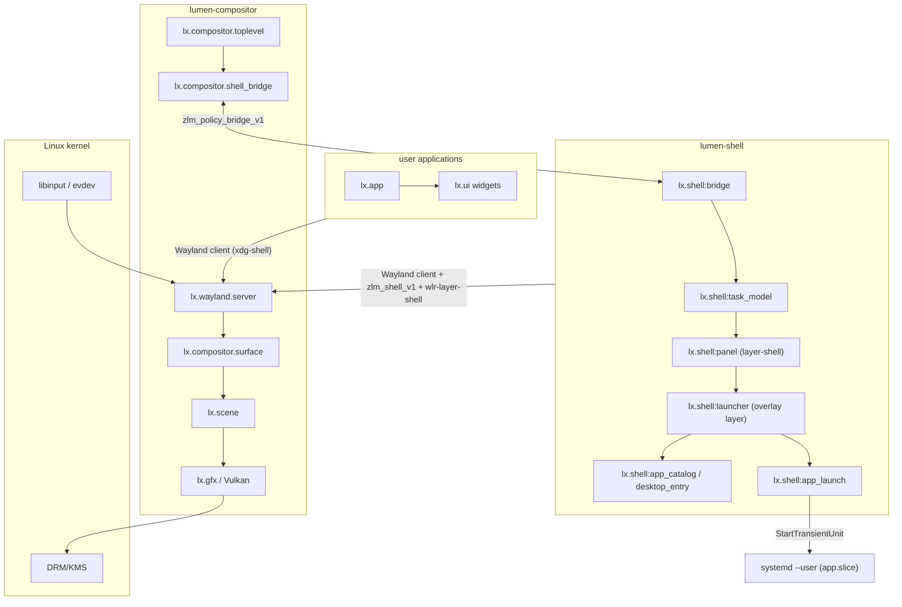
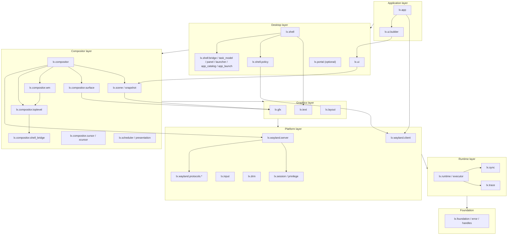
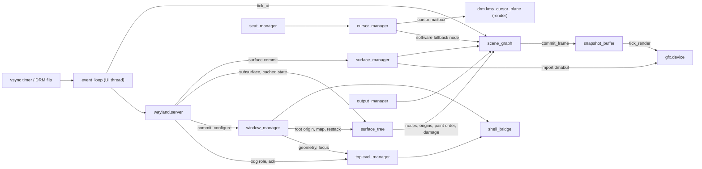
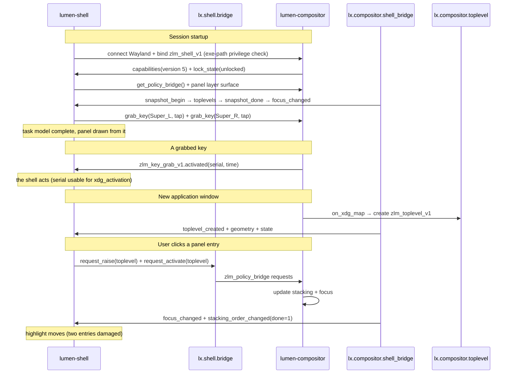
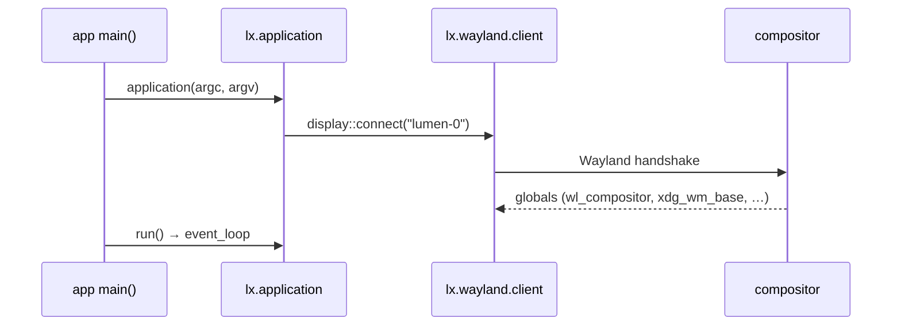
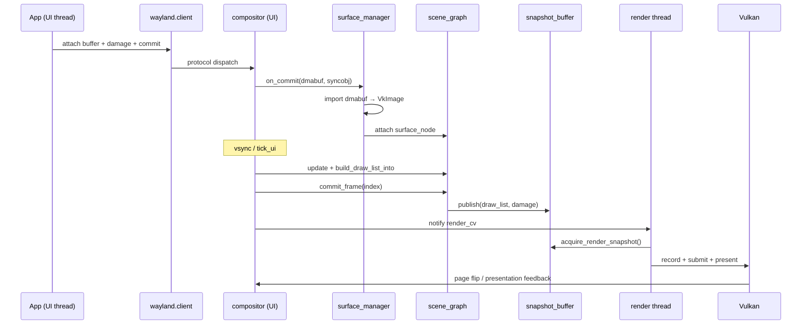
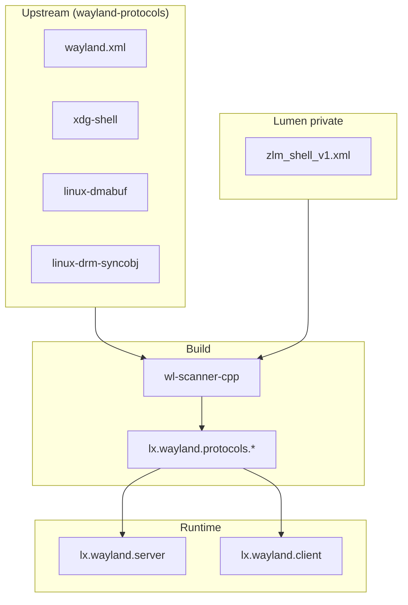
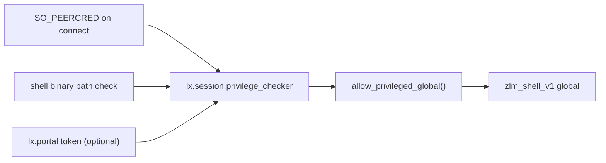
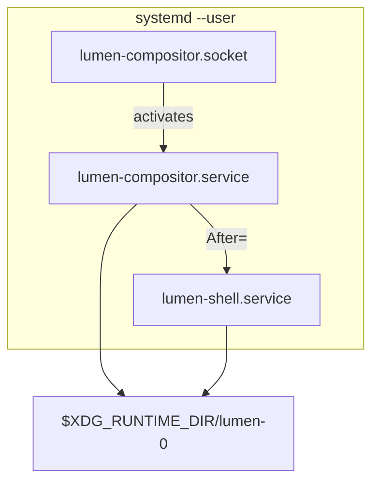

> **Status:** Current (v0.3) — see code for implementation truth

# Lumen Architecture

Detailed overview of the Lumen windowing stack: module layers, process boundaries,
interaction patterns, and runtime workflows.

**Related docs:** [API reference](api/README.md) · [UML diagrams](uml/README.md) ·
[Threading](subsystems/threading.md) · [Rendering performance](subsystems/rendering-performance.md) ·
[Errors & logging](subsystems/errors-and-logging.md) ·
[Shell state sync](subsystems/shell-state-sync.md) · [dmabuf/Vulkan](subsystems/dmabuf-vulkan-import.md) ·
[Memory](subsystems/memory-management.md) · [Health](subsystems/health.md) ·
[UI architecture](subsystems/ui-architecture.md) ·
[AI agent instructions](../AGENTS.md)

---

## 1. What Lumen is

Lumen is a greenfield Linux desktop stack built in **C++26** with **Clang**:

| Component | Role |
|-----------|------|
| **Compositor** (`lumen-compositor`) | Wayland display server, input routing, surface composition, Vulkan present |
| **Shell** (`lumen-shell`) | Desktop chrome — panel, workspaces, window management UI |
| **UI library** (`lx.ui`, `lx.ui.builder`) | Widget toolkit + fluent builders for apps and shell |
| **App framework** (`lx.app`) | Event loop, settings, clipboard for third-party apps |

Design goals:

- **Wayland-only** — no X11 layer
- **Vulkan-first, multi-backend** — Vulkan is the design centre and the default wherever a
  hardware Vulkan driver exists. A GL backend (EGL/GLES on GBM) covers hardware Mesa ships
  no Vulkan driver for, and a CPU backend covers hosts with no hardware renderer at all.
  All three live in `lx.gfx` behind `compositor::config::present`
  ([rendering-performance.md](subsystems/rendering-performance.md) §1.2, [AGENTS.md](../AGENTS.md) §1.1)
- **Multi-process** — compositor owns display; shell and apps are clients
- **Stacking-first WM** — optional tiling plugin via `lx.shell.policy`
- **First-class threading** — UI / render / worker affinities with immutable frame handoff
- **Zero-copy where possible** — dmabuf → Vulkan import, explicit sync via drm-syncobj
- **Performance pipeline** — snapshot v2, direct scanout, import cache, hot-path budgets ([rendering-performance.md](subsystems/rendering-performance.md))
- **Memory strategy** — unified arenas, pressure response, buffer lifecycle ([memory-management.md](subsystems/memory-management.md))
- **Health evaluation** — parts, processes, memory, speed → `health_report` ([health.md](subsystems/health.md))

---

## 2. Process model

Three classes of OS processes cooperate over Wayland:



### 2.1 Compositor process

**Binary:** `lumen-compositor`  
**Modules:** `lx.compositor`, `lx.compositor.*`, `lx.wayland.server`, `lx.scene`, `lx.gfx`, `lx.input`, `lx.drm`, …

Owns:

- Wayland socket (`$XDG_RUNTIME_DIR/lumen-0`)
- All `wl_*` / `xdg_*` / `zwp_*` protocol objects
- **`zlm_toplevel_v1`** handles (compositor-owned WM references)
- DRM master / KMS page-flip
- Scene graph + Vulkan composition
- Input seat and focus
- The logind session: it pauses with it (a VT switch away) and resumes with it, and
  executes the VT switch keys itself (§4, Session pause/resume)
- Key bindings: its own (VT switching, Ctrl+Alt+Backspace) and the key grabs the shell
  registers (§4, Key bindings)

Runs **three logical threads** (see [threading.md](subsystems/threading.md)):

| Thread | Affinity | Work |
|--------|----------|------|
| Main | `ui` | Event loop, vsync timer, `tick_ui()`, Wayland dispatch |
| Render | `render` | `tick_render()`, snapshot acquire, Vulkan record |
| Worker | `worker` | Executor drain — layout assist, I/O |

### 2.2 Shell process

**Binary:** `lumen-shell`  
**Modules:** `lx.shell` (`:bridge`, `:task_model`, `:panel`, `:shm_canvas`, `:launcher`,
`:desktop_entry`, `:app_catalog`, `:app_launch`), `lx.shell.policy`, `lx.text`;
libwayland-client directly (`lx.wayland.client` is still a stub), xkbcommon for the
launcher's keyboard, sd-bus for launching

Acts as a **privileged Wayland client**:

- Connects to the compositor's display like any client (`--display NAME`, else
  `$WAYLAND_DISPLAY`)
- Binds **`zlm_shell_v1`**, which the compositor accepts only from its configured shell
  binary (§9); a refused or disconnected shell exits 1 and `lumen-shell.service` restarts it
- Uses **`zlm_policy_bridge_v1`** for window-management intent ↔ compositor execution: a
  task model fed by the snapshot and deltas, and requests (`request_raise` +
  `request_activate` on a panel click)
- Draws its **top panel** — a task list, one entry per window, the focused one
  highlighted — as a `wlr-layer-shell` surface (layer `top`, exclusive zone 32, so windows
  are placed and maximized below it), with CPU text from `lx::text`
- Draws the **launcher** — installed applications from the XDG `.desktop` files (Desktop
  Entry Specification 1.5: ID shadowing, Hidden, NoDisplay, OnlyShowIn/NotShowIn,
  TryExec, Exec field codes), a search field, keyboard and pointer — as a separate
  overlay-layer surface with `on_demand` keyboard interactivity, which exists only while
  open. The panel's **Apps** button and the Super tap toggle it; it closes on Escape,
  launch, or when it loses the keyboard (a click elsewhere)
- **Launches applications** detached from itself: each launch is its own systemd user
  service, `app-lumen-<id>@<random>.service` in `app.slice`, started with
  `StartTransientUnit` (`Type=exec`, so a failed exec fails the start job, reported through
  `JobRemoved`; below systemd 250, which lacks `ExitType=cgroup`, a double fork held before
  `execve` until it is in its own transient scope `app-lumen-<id>-<random>.scope`); without
  systemd --user, a double fork + `setsid` with a clean signal state
  and fds. The new window gets an `xdg_activation_v1` token made from the triggering input's
  serial (`XDG_ACTIVATION_TOKEN`, `DESKTOP_STARTUP_ID`), so it takes the keyboard.
  Super+Return starts a terminal (`$TERMINAL`, `xdg-terminal-exec`, or the preferred
  TerminalEmulator entry)
- One thread, `ppoll` on the display fd, a signalfd, the catalog's inotify fd, one timerfd
  (armed only while key repeat, a notice, a catalog debounce or a token wait is due) and,
  once a launch opened it, the user bus: asleep when idle
- Owns **key-binding policy**: which combination does what. It registers key grabs over
  `zlm_shell_v1` v4 (`grab_key`) and the compositor reports them: the Super_L/Super_R taps
  (launcher) and Super+Return (terminal)
- Owns **idle and lock policy** (`:idle_policy`): blanking after `--blank-after` (600 s),
  and with a `--lock-command` (Lumen ships no locker) when to start it — Super+L, logind's
  Lock and before-sleep (zlm_shell_v1 v5 `lock_requested`), the blank timeout (lock, then
  blank once `locked`), again when a locker dies (`lock_state` abandoned); a shorter blank
  timeout while locked (`--blank-locked-after`, 60 s)

The shell **does not** own surfaces of other apps or mutate the scene graph directly.
It sends policy requests; the compositor executes geometry, focus, and stacking. The
workspace switcher is not built yet (ADR-005 Phase 1). Details:
[shell-state-sync.md](subsystems/shell-state-sync.md) § The shell.

### 2.3 Application processes

**Typical binary:** user app linked against `lx.app`  
**Modules:** `lx.app`, `lx.ui`, `lx.ui.builder`, `lx.wayland.client`

Each app:

- Connects to the compositor display
- Creates `xdg_toplevel` + `wl_surface` for its windows
- Uses `lx.ui` widgets; optional fluent builder API
- Submits buffers (SHM during dev, dmabuf in production)

Apps never see `zlm_shell_v1` or `zlm_toplevel_v1`.

---

## 3. Module layers

Dependency flows **downward** — higher layers never export to lower ones.
CMake encodes this graph in `cmake/LumenCXXModules.cmake` (`LUMEN_LAYER_*`) and
rejects upward `DEPENDS` at configure time.

Shared WM vocabulary (`lx::toplevel_state`, `lx::placement`) lives in
`lx.foundation` so the compositor can describe toplevel state without depending
on `lx.shell.policy`. Policy implementations stay in the desktop layer.
`lx.ui` is also desktop-layer: shell and apps both consume it; only
`lx.ui.builder` / `lx.app` sit above.




### Layer responsibilities

| Layer | Purpose | Key contracts |
|-------|---------|---------------|
| **Foundation** | Types, errors, handles, WM vocabulary | `result<T>`, `toplevel_id`, `toplevel_state`, `placement` |
| **Runtime** | Event loop, thread routing, logging | `executor`, `event_loop`, `logger` |
| **Platform** | OS / kernel / Wayland wire | `server::bind`, `kms_device::open`, protocols |
| **Graphics** | Vulkan RHI, text, layout | `dmabuf_importer`, `layout_engine`, `scene_graph` |
| **Compositor** | Display server integration | `tick_ui` / `tick_render`, `shell_bridge` |
| **Desktop** | WM policy, shell UI, shared widget toolkit | `policy_bridge`, `stacking_policy`, `lx.ui` |
| **Application** | End-user programs + fluent builders | `lx::application`, `make_window()` |

---

## 4. Compositor internal architecture

Inside `lumen-compositor`, subsystems connect as follows:



### Subsystem roles

| Module | Responsibility |
|--------|----------------|
| `lx.wayland.server` | Socket, client connections, protocol dispatch, global registry |
| `lx.compositor.toplevel` | `toplevel_record` per `xdg_toplevel`, stacking order, configure state machine (one configure in flight, serials matched on ack) |
| `lx.compositor.wm` | The executor of window state: owns `toplevel_record::geometry` (the one source of truth for where a window is), places new windows (centred, cascaded), derives node origin from geometry and node bounds from the buffer, sends configures once per tick. Input routing: hit-testing (one top→bottom pass over the stacking order, surface extents ∩ `wl_surface` input region), enter/leave pairing, the implicit grab while a button is held, click-to-focus and raise-on-press (placeholder policy until the shell drives it), stacking and the shell's activate/raise/lower/restack/close requests. Interactive move/resize grabs (xdg, shell bridge and the placeholder Super+drag binding share one executor): move is an origin change applied once per tick, resize keeps one configure in flight and anchors left/top edges on the matching commit, Escape cancels. The usable area (output minus layer-shell exclusive zones) for placement, move constraints, `configure_bounds` and maximize; keyboard-focus resolution across layer surfaces, popups and toplevels. UI affinity |
| `lx.compositor.surface` | Commit handler: damage, dmabuf desc, syncobj timeline, `content_hint`, content opacity (blend only skipped for a format without alpha or a full opaque region); one scene node per *mapped* surface, created and placed by `surface_tree`. O(1) id → slot index; registry of each surface's `wl_resource` |
| `lx.compositor.surface_tree` | `wl_subsurface` trees, Wayland-free: parentage, the double-buffered child state (position, place_above/below order) pending → cached → current, effective sync, mapping (content + linked + parent mapped, recursively). Each root surface (toplevel, popup, layer surface) owns one container holding its whole tree **flattened in paint order** (an optional underlay below it); restacking a window moves that one container. Node origins stay global: relative positions live here and are pushed into the nodes when a root moves or its tree changes, damaging old and new rects per node. Hit-testing walks the container in reverse paint order (each surface clipped to its own extents and input region). UI affinity |
| `lx.compositor.positioner` | xdg_positioner placement, pure: base rectangle from anchor, offset and gravity; constraint adjustment per axis in the spec's precedence flip → slide → resize |
| `lx.compositor.popup` | xdg_popup state, Wayland-free: configure/ack, placement relative to the parent's window geometry, map/unmap, reposition, the popup grab and dismissal. UI affinity |
| `lx.compositor.layer_shell` | wlr-layer-shell, Wayland-free: layer-surface records, the configure/ack flow, arrangement against the output (`arrange_layers`, pure) and the usable area its exclusive zones leave, keyboard-interactivity queries; each layer surface's tree container sits in one of the four layer-shell scene containers. UI affinity |
| `lx.compositor.decoration` | Server-side frames (xdg-decoration), Wayland-free: frame extents and hit zones, the shared atlas, the frame scene node (underlay of the window's tree container), cached title textures rasterized with `lx.text`. UI affinity |
| `lx.compositor.shell_bridge` | Creates `zlm_toplevel_v1` handles; emits snapshot/deltas (created, destroyed, state, geometry, focus) on `zlm_policy_bridge_v1`; receives WM requests |
| `lx.compositor.cursor` | Pointer image and position (grab override → frame hover → client → default). Hardware cursor plane (`lx.drm:cursor`) by default: pointer motion is a plane update on the next atomic commit — or a cursor-only commit when nothing else changed — and never a composite. Software fallback is a node in the scene's overlay layer, damaged old+new. Images from the Xcursor theme (`lx.compositor.xcursor`) with a compiled-in vector set, `wp_cursor_shape_v1` and `wl_pointer.set_cursor` |
| `lx.compositor.output` | The outputs, in **stable slots** (an output keeps its slot while its connector stays connected): geometry, refresh, name (the kernel's connector name, "Virtual-1"), physical size, scale, transform, present mode, KMS damage flags, and a `generation` that moves only when something a client sees changed. Without a connected connector there is one virtual output, HEADLESS-1 (1920x1080 at 60 Hz). Pure membership helpers: the outputs a rect is on (one bit per slot), the primary output (largest overlap), the preferred buffer scale (ceiling of the largest) and transform. UI affinity |
| `lx.compositor.liveness` | xdg_wm_base.ping/pong liveness, Wayland-free: pings on activation, delivered button and key presses, the configure watchdog and every 10 s to the focused client — one outstanding per client, at least 2 s apart; a ping unanswered past the timeout (`--ping-timeout`, 5 s) marks the client not responding until it answers. Never kills. O(1) per tick unless a deadline passed. UI affinity |
| `lx.compositor.input_router` | Seat event delivery to the focused client's resources (enter/leave pairing, held keys, frames) and the per-client **input serial log**: the serials of input and focus events each client was sent, as compressed ranges — what `set_selection` and xdg-activation tokens quote is checked against it. The focus-client hook runs between a focus change's `leave`s and `enter`s; the user-input hook after a delivered key or button press (liveness pings on it). Pointer motion to a client that is not responding is withheld (keys, buttons and enter/leave are not). UI affinity |
| `lx.compositor.activation` | xdg-activation's focus-stealing-prevention policy, Wayland-free: `decide_grantable` (at token commit) and `decide_activation` (at `activate`, and again at map for a window that asked before mapping) — pure functions over what the wire and the window manager gather; the token table (64 fixed slots, 128-bit random text from `getrandom`, single use, 30 s lifetime, constant-time lookup, eviction of expired then oldest). UI affinity |
| `lx.compositor.data_transfer` | Wayland-free data-transfer pieces: `mime_list` (a source's offered types, inline, never allocating) and drag-and-drop action negotiation (`negotiate_dnd_action`, the modifier-chosen user action) |
| `lx.compositor.dnd` | The drag-and-drop grab, Wayland-free: a third pointer mode beside the implicit grab and move/resize, driven by the window manager's pointer path (hit test, button mask, Escape, modifiers) and calling the wire through `dnd_ops` (focus, motion, drop, cancel, user action). Owns the drag icon's placement (a `dnd_icon` surface-tree root in its own scene layer, moved once per tick with the pointer) and the pointer shape that shows the negotiated action. No allocation per motion. UI affinity |
| `lx.compositor.wire` (internal) | The libwayland glue, one translation unit per protocol area: `wire_surface.cpp` (wl_compositor, wl_surface, wl_region, frame callbacks, the commit), `wire_subsurface.cpp`, `wire_buffer.cpp` (wl_buffer tracking, shm staging, texture retirement), `wire_xdg_shell.cpp` (xdg_wm_base, xdg_surface, xdg_toplevel, xdg_positioner, the window manager's wire ops), `wire_xdg_popup.cpp`, `wire_decoration.cpp`, `wire_layer_shell.cpp`, `wire_dmabuf.cpp`, `wire_seat.cpp`, `wire_cursor_shape.cpp`, `wire_shell.cpp` (zlm_shell_v1, policy bridge), `wire_output.cpp` (wl_output, xdg-output, wl_surface.enter/leave and the preferred buffer scale/transform), `wire_selection.cpp` (the selection model both selection families share), `wire_data_device.cpp` (wl_data_*), `wire_primary_selection.cpp` (zwp_primary_selection_*_v1), `wire_dnd.cpp` (start_drag, drag offers and action negotiation), `wire_activation.cpp` (xdg_activation_v1: token builders, the grant decision at commit, `activate`), `wire_idle.cpp` (ext_idle_notifier_v1, zwp_idle_inhibit_manager_v1), `wire_output_power.cpp` (zwlr_output_power_manager_v1), `wire_session_lock.cpp` (ext_session_lock_manager_v1, lock objects, lock surfaces), `wire_text_input.cpp` (zwp_text_input_manager_v3, text inputs and the events the relay sends them), `wire_input_method.cpp` (zwp_input_method_manager_v2, input-method popups and keyboard grabs, zwp_virtual_keyboard_manager_v1, the relay's installation), and `wire_install.cpp` (every global, in registry order, and the `:protocols_p0` entry points). The implementation partition `:wire` (`wire.cppm`, not exported) holds the wire object records and what more than one unit uses; everything else stays in each unit's anonymous namespace. The Wayland-free state stays in the partitions above. UI affinity |
| `lx.scene` | Scene graph (layers bottom→top: layer-shell background and bottom, windows — per-window tree containers —, layer-shell top and overlay, popups, drag icon, session-lock surfaces, cursor), a clear colour per snapshot (the lock's solid colour), multi-rect damage (`gfx::damage_region`), a per-node tint (the not-responding dim), `build_draw_list_into` |
| `lx.scene.snapshot` | Triple-buffered handoff (v2: index swap, back-pressure policy) |
| `lx.gfx` | Vulkan device, swapchain, dmabuf import, render pass |
| `lx.gfx.gl_renderer` | EGL/GLES composite on GBM — the accelerated path on drivers with no Vulkan driver (vmwgfx/SVGA3D and similar) |
| `lx.gfx.cpu_renderer` | Software composite into a CPU-writable scanout buffer; chosen when no hardware renderer is available ([rendering-performance.md](subsystems/rendering-performance.md) §1.2) |
| `lx.gfx.import_cache` | LRU reuse of VkImage imports; per-client entry cap |
| `lx.compositor.buffer_lifecycle` | import → release → wl_buffer.release loop |
| `lx.runtime.memory` | Per-subsystem arenas, pressure coordinator, overflow policies |
| `lx.input` + `seat_manager` | libinput → pointer/keyboard events (ms wire time plus µs CLOCK_MONOTONIC time for latency) → `lx.compositor.wm` decides focus |
| `lx.drm` + `lx.drm.atomic` | Connectors, modes, atomic commit, KMS damage blobs, dumb scanout buffers |
| `lx.scheduler.presentation` | Page-flip bridge: flip time, vblank sequence, the commit's frame tag |
| `lx.compositor.presentation_feedback` | wp_presentation bookkeeping: sampled → flipped → presented / discarded |
| `lx.compositor.idle` | ext-idle-notify notifications (lazy single timer, real input only) and idle-inhibitor objects, Wayland-free. UI affinity |
| `lx.compositor.display_power` | The output's power state machine (on → off_pending → off / soft_blank → on_pending → on), Wayland- and libdrm-free; the compositor executes its actions (the power gate, the render thread's ACTIVE=0 commit, the resume modeset, `mode` events). UI affinity |
| `lx.compositor.session_lock` | ext-session-lock's state machine (unlocked → awaiting_surfaces → locking → locked; abandoned), the lock surfaces' configure/ack bookkeeping and commit rules, keyboard focus among lock surfaces; Wayland-free, returns actions the compositor and `wire_session_lock.cpp` execute. UI affinity |
| `lx.compositor.text_input` | The text-input ↔ input-method relay: text-input focus (the keyboard's, while an input method is bound), the double-buffered text-input state and commit count, activation and state of the input method, its commit serial rule, input-method popup visibility and placement at the cursor rectangle; Wayland-free, events leave through a sink the wire units implement. UI affinity |
| `lx.scheduler.budget` | Hot-path CPU budgets per tick |

### Content updates and subsurfaces

`wl_surface.commit` is four steps in `wire_surface.cpp`: role pre-checks on the pending
state (xdg rules that reject the whole commit), **merge** pending into the surface's cached
state (later state replaces earlier, damage and frame callbacks accumulate, a buffer
superseded before use is released), let the tree cache the children's pending positions and
order, and then — unless the surface is *effectively synchronized* — **apply**: cached →
current for the surface, its children's positions and order, and recursively the cached
state of every synchronized child, all in the same UI call and so the same snapshot. Then
the root's role finisher (window geometry, configure acks, map) and one `sync_scene` of the
root's container. `apply_cached` is the only path from cached to current, so commit
constraints (fences, transactions) can later hold updates back there without touching the
semantics. A surface that stops being effectively synchronized (`set_desync`, its
`wl_subsurface` or parent destroyed) applies what it had cached, top-down.

Follow-up, recorded: the double-buffered state (`surface_pending`, `merge_pending_into_cached`,
`apply_core`) is meant to become a Wayland-free `:surface_state` partition, unit-tested on
its own. It is not split out yet because its logic is interleaved with wire actions
(`wl_buffer.release`, answering frame callbacks, `wl_shm_buffer` reads) and the queue has no
logic of its own until commit constraints (explicit sync, fences, transactions) hold updates
in the cached state; extracting it now would need an ops table on the commit hot path. The
records already live in `:wire`, so the extraction moves one struct and two functions.

A window's geometry is clamped to the bounding box of its whole tree, so a client-side
title bar drawn as a subsurface above the main surface is part of the window (its origin
may be negative in surface coordinates). Texture updates carry the index of the snapshot
being built when they were queued, and the render thread holds an update back until it
composites that snapshot, so new pixels never show under the previous frame's geometry
(see [rendering-performance.md](subsystems/rendering-performance.md)).

### Popups

Every `xdg_popup` is the root of its own surface tree, with its container in the scene's
popup layer: above every window and every layer-shell surface, below the drag-and-drop icon
layer and the cursor (sway's order — no panel or window ever covers a menu), newest on top. The hit test visits popups
top-down before any window. A popup is placed relative to its parent's window geometry
(`positioner_place`: flip, then slide, then resize, per axis, against the usable area for a
window's popups and the whole output for a layer surface's — Mutter/KWin and sway
respectively — expressed in parent coordinates); the placement a
configure carries takes effect at the commit after its ack, so the popup moves in the same
snapshot as the content drawn for it. When the parent moves or resizes, its popups move in
the same UI call; reactive ones are placed again and reconfigured.

The grab is a stack of one client's grabbing popups (`xdg_popup.grab`). The serial must be
the last button press or key press (or that key's release, Mutter's rule) the client
received; a grab during an interactive move/resize is denied, and a denied grab is an
immediate `popup_done`. While a grab is active the pointer is owner-events (only the grabbing
client's surfaces get it); a press anywhere else dismisses the whole chain top-down and is
consumed, an interactive move/resize or the activation of another client's window ends it,
and destroying the topmost grabbing popup returns the grab to its parent. Keyboard focus is
resolved in one place (`window_manager::resolve_keyboard_focus`): an `exclusive` layer
surface on the top or overlay layer first, then the topmost mapped grabbing popup (unless an
exclusive layer surface holds the keys and the popup is not its own, or the popup's layer
root has interactivity `none`), then a clicked `on_demand` layer surface, otherwise the
focused toplevel; the window manager's toplevel
focus decision (activation, the shell's `focus_changed`) is unchanged by a popup, so a window
whose menu is open stays activated. Errors the spec leaves unnamed are chosen deliberately: a
grab on a child of a popup that took no grab is `xdg_wm_base.invalid_popup_parent`.

### Server-side decorations

`zxdg_decoration_manager_v1` (v2) is advertised unless the compositor runs with
`--decorations=client`. The policy is KWin's and sway's: a client that asks for
`client_side` keeps drawing its own frame; `server_side` or no preference gets the
compositor's. The mode travels in the toplevel's configure (`toplevel_configure::decoration`,
a decoration configure sent before the `xdg_surface.configure` it belongs to) and takes
effect with the commit that answers it, so the frame appears or disappears in the same
snapshot as the content drawn for it. Destroying the decoration object returns to
client-side at the next commit; protocol errors are exact (`already_constructed`,
`invalid_mode`, `orphaned`, version 1's `unconfigured_buffer`).

`toplevel_record::geometry` stays the client's window geometry — what the shell is told —
and everything that is *placement* uses the frame around it: new windows are placed and
moves constrained by the frame rect (the title bar stays on the output), and
`configure_bounds` leaves room for it. The frame is a scene node (`frame_node`), the
underlay of the window's tree container, so it restacks with the window and paints below its
surfaces: four border fills and the title fill sample the centre of colour swatches baked
into one 64x64 atlas texture (identical colours on GL, CPU and Vulkan — no tint), the title
is a cached texture per window and focus state, re-rasterized by `lx.text` only when the
title changes or its ellipsis cut moves, and the close button is a glyph (with a circle on
hover). No backend code was added; damage is the frame's strips, never the client area.

The hit test checks a window's surfaces first, then its frame's zones (close button, title,
then resize bands that extend 8 px outside the visible border, corners within 20 px).
Presses on the frame never reach a client: the title starts a move and the bands a resize
through the same grab executor as `xdg_toplevel.move/resize` and the Super binding
(`grab_source::decoration`), the close button sends `xdg_toplevel.close` on release over it,
and a middle click on the title lowers the window. The pointer shape over a frame comes from
the cursor manager's hover layer, between a grab's override and the client's own cursor. The
window that owns the keyboard (after popup resolution) is drawn with the active colours.

### Layer shell, the usable area and maximize

`zwlr_layer_shell_v1` (v5) is open to every client, as in sway, KWin and niri. Each layer
surface roots a surface tree whose container sits in the scene container of its layer
(background, bottom under the windows; top, overlay above them; all under the popup layer),
appended on map; `set_layer` moves the container, nodes and all. Properties are
double-buffered and validated at commit with the spec's error codes (`invalid_size`,
`invalid_exclusive_edge`, `invalid_surface_state` for a buffer before the first ack).

Arrangement (`arrange_layers`, pure) is wlroots' scene helper: overlay, top, bottom,
background, each in creation order; two passes, surfaces with a positive exclusive zone
first, each shrinking the usable area for the ones after it; a zone of -1 places against the
whole output. Two deliberate deviations: a committed size smaller than the configured span
is centred between two opposite anchors (the spec's text), and a zone counts only once its
surface is mapped (a panel that has not drawn yet does not push windows). It runs on a layer
commit that changed something, on map, unmap and destroy, and on an output mode change;
configures go only to surfaces whose assigned size changed, every moved surface (and its
popups) moves in the same UI call, and a surface left no room is sent `closed`.

The usable area (output minus exclusive zones) is what windows are placed in, how far a move
may push them (a title bar stays below a top panel), what `configure_bounds` reports, what
window popups are constrained to, and what maximize fills. Normal windows are not moved when
it changes (sway, KWin); maximized ones are configured to the new area. Maximize
(`xdg_toplevel.set_maximized`, `zlm_policy_bridge_v1.request_maximize`, a title-bar double
click on a server-side frame) is always answered by a configure (also when nothing changes,
as the spec requires); the configure carries the position (`toplevel_configure::place`), and
the commit answering it applies position, size, state and the maximized frame extents in one
snapshot. Unmaximize restores the geometry the window had, kept reachable if the usable area
changed meanwhile. `wm_capabilities` now lists `maximize`.

Keyboard interactivity: `exclusive` on top/overlay takes the keys from everything but that
surface's own popups (clicking a window changes the window manager's focus decision, not the
keys) and deactivates the toplevel, as sway does; `on_demand` (and `exclusive` below the
windows, where the spec allows normal semantics) is focused by a press on it and released by
a press on a window or on nothing. An `on_demand` surface on the top or overlay layer also
takes the keys when it maps (sway's and Hyprland's rule; not during a move, resize or drag,
and not from a focused surface on a higher layer), so a launcher opened from a key binding
can be typed into at once; `none` is never focused, and its popups grab the pointer
but not the keyboard ("inherited by child surfaces set by the get_popup request"). The hit
test order is popups, overlay, top, windows, bottom, background. A layer surface's popup is
created with a null parent and adopted by `zwlr_layer_surface_v1.get_popup` before its initial
commit; doing that later is `xdg_wm_base.invalid_popup_parent` (the spec names no error).

### Selections: clipboard and primary

`wl_data_device_manager` (v4; v3 without libwayland's `release`) and
`zwp_primary_selection_device_manager_v1` (v1, a P1 protocol built only when its glue is
generated) share one model in `wire_selection.cpp`; each family's unit only marshals. There
is one selection per seat and family, owned by a source.

- **Who may set it.** `set_selection` must quote the serial of an input or focus event the
  compositor delivered *to that client* (`input_router`'s serial log; configure serials do
  not count), not older than the selection in place (wraparound-safe). That is wlroots' rule
  restricted to input serials; keyboard focus is not required, so Ctrl+C followed at once by
  a click elsewhere still copies (Mutter would drop it). A refused source is `cancelled`
  (Mutter) instead of being left dangling (wlroots). A source used twice is
  `wl_data_device.used_source`; one that declared drag-and-drop actions is
  `wl_data_source.invalid_source`. The primary selection has no error enum: a reused source
  is refused and cancelled.
- **Who is offered it.** Every data device of the client holding keyboard focus, on three
  occasions: when focus moves to that client — from the router's focus-client hook, between
  the old surface's `leave` and the new one's `enter`, so the selection arrives "immediately
  before" keyboard focus as the spec says —, when the selection changes, and when the focused
  client creates a device. Each delivery is a fresh offer carrying every mime type, read in
  place from the source's inline `mime_list`. A source whose client is being torn down is
  offered as no selection.
- **Offer validity.** An offer goes inert when its client loses keyboard focus (the spec's
  "valid until … the client loses keyboard focus"; Mutter), when the selection moves on, or
  when its source goes. An unfocused client cannot read the clipboard through an offer it
  kept.
- **Transfer.** `receive` is forwarded as the source's `send` only for a type the source
  offered, from a live offer of a live source (Smithay validates the type too; wlroots does
  not). The compositor closes its copy of the fd in every path; libwayland dups it into the
  message.
- **Lifetimes.** Sources and devices are allocated per request and freed by their destructor
  hooks (wlroots, KWin) — from a shared fixed table, a client that never destroys them would
  make the next client's request fail with `no_memory`, fatal to a client that did nothing
  wrong. Offers, which the compositor creates, are a fixed table of 512 with destructor
  hooks; a source unlinks its offers, so nothing dangles in any destruction order. The owner
  destroying its source (or exiting) clears the selection and tells the focused client
  `selection(NULL)` (wlroots). One client may hold 32 live offers; past that, or with the
  table full, it is sent `selection(NULL)` and one warning per client is logged.
- **Not done (recorded).** The selection does not outlive its owner: keeping it needs
  asynchronous reads into the compositor, whose right home is a clipboard manager on
  `ext-data-control-v1` in the shell.

### Drag-and-drop

`wl_data_device.start_drag` begins a drag; the grab is the Wayland-free `:dnd` partition,
driven by the window manager's pointer path (which already owns hit-testing, the implicit
grab and Escape), and everything with a `wl_resource` — offers, negotiation, events — is
`wire_dnd.cpp` (its `dnd_ops`). The offers come from the selection tables, so the clipboard's
lifetime rules (destructor hooks, inert offers, the per-client cap) hold for drags too.

- **Starting.** The serial must be the last button press delivered to that client with the
  button still held, and no move/resize or drag may be running — wlroots' pointer-grab rule,
  as for `xdg_toplevel.move`. A refused drag's version 3 source is `cancelled`. The icon
  takes the `dnd_icon` role before the serial is checked and keeps it (wlroots); a surface
  with another role is `wl_data_device.role`, a source used before is `used_source`. Touch
  drags are refused (no touch routing yet). When the drag starts, popup grabs end, every
  held button is withheld from clients until its release, the origin gets `wl_pointer.leave`,
  and the surface under the pointer becomes the first target at once.
- **During.** No client has pointer focus. Each motion is one hit test (as any motion) and
  one `wl_data_device.motion` per data device of the target — no allocation, no logging. A
  change of target surface is `leave` to the old one (its offer goes inert, the source hears
  `target(NULL)`) and, per device of the new one, a fresh offer (every mime type, then
  `source_actions`) and `enter`. A drag without a source stays inside its client: other
  clients' surfaces are no target, and `enter` carries no offer. A target surface that
  unmaps or is destroyed is left at once; a window that maps under a still pointer becomes
  the target at the next tick.
- **Actions.** Of what both sides accept, the user's (Shift move, Ctrl copy, Alt ask —
  Mutter's choice and the spec's advice; wlroots ignores modifiers) before the drop, then
  the destination's preferred action, then the lowest bit. A side bound below version 3
  counts as copy, as does a version 3 source that never called `set_actions` (Weston).
  `action` goes to the source and the offer on change only. The pointer shows the outcome
  (copy, move, dnd-ask, no-drop), as in Mutter and KWin; wlroots leaves the source's stale
  cursor, which it cannot update without pointer focus.
- **The icon** is a surface-tree root of kind `dnd_icon` whose container lives in its own
  scene layer, above the popups and below the cursor; its subsurfaces and damage come with
  the tree. Its top-left starts at the hotspot and moves by each commit's offset (attach
  `x,y` or `wl_surface.offset`). It is moved once per tick, with the pointer published at
  the tick too, so icon and cursor reach the display in the same commit — the interactive
  move's pattern. Hit tests never visit the icon layer ("the input region is ignored").
- **The end.** Releasing the last button over a target that accepted an offered type with a
  negotiated action other than none delivers `drop` (and `dnd_drop_performed` to a version 3
  source), then `leave`; the offer stays live for `receive` and `finish`, and a version 2
  target, which never finishes, gets its source `dnd_finished` at once (wlroots, Mutter,
  Weston). Otherwise — over nothing, a frame, a client without a data device, nothing
  accepted, no action — `leave` and `cancelled`. Escape cancels the same way, and its press
  and release reach no client. After the drop an `ask` must be answered by one last
  `set_actions` whose preferred action the source offers; an offer destroyed without
  `finish` (or an `ask` dismissed by destroying it) cancels the source. The source destroyed
  mid-drag, or the origin client of a drag without a source exiting, ends the grab and
  leaves the target; nothing is sent to a client being torn down. `cancelled` and every
  drag-only event go to version 3+ sources only: for older ones the spec allows `cancelled`
  on replacement alone.

### Outputs and output membership

`output_manager` keeps each output in a stable slot (a surface's output set is a bit mask by
slot) and names it after its connector, as wlroots, Mutter and KWin do (`Virtual-1` on
vmwgfx, `DP-1`, `HDMI-A-2`); without a connected connector the virtual HEADLESS-1 stands in,
so headless and nested sessions have an output clients can see. `tick_ui` compares the
manager's `generation` (the hotplug poll refreshes every tick, so values are compared, not
"refreshed"): on a change every bound `wl_output` is sent geometry, mode, scale and `done`
(each `zxdg_output_v1` its logical rect first), and every surface's membership is
recomputed.

- **Membership from node rects** (wlroots' scene does the same). `surface_tree` reports every
  change of a node's global rect — created, moved, resized, dropped — through one hook, at
  the three places it sets them; `wire_output.cpp` turns the rect into a slot mask and sends
  `wl_surface.enter` / `leave` for the difference to every `wl_output` the surface's client
  bound for that output. Toplevels, subsurfaces, popups, layer surfaces and the drag icon
  are all tree nodes; unmapping sends `leave` (wlroots, Mutter). A cursor surface follows
  the pointer's output through the cursor manager's surface hook. A `wl_output` bound after
  mapping replays the enters it missed (wlroots); clients often bind outputs lazily.
- **Preferred scales** (`wl_surface` v6, `wp_fractional_scale_v1`): the integer buffer
  scale is the ceiling of the largest scale among the surface's outputs (wlroots, KWin:
  sharp on every output it shows on), the fractional one that largest scale in 120ths; the
  transform the primary output's (largest overlap, wlroots). Each is sent only when it
  differs from what was last sent, starting from the spec's defaults, so nothing goes out at
  scale 1 on `wl_surface`. The fractional object gets its first value at creation, from the
  output the surface will map on, so the first frame is drawn at the right scale.
- **Per-request objects.** Bound `wl_output` and `zxdg_output_v1` objects are allocated per
  request, kept in intrusive lists and freed by their destructors (so are
  `xdg_activation_token_v1` builders), never taken from a shared table one client could fill
  for all.
- **xdg-output** v3: logical position and size (the mode divided by the scale), name and
  description, closed by `wl_output.done` (v3) or `zxdg_output_v1.done` (v1–2), in wlroots'
  order. `wl_output` v4 carries the same name; make is "Lumen", model the output name, the
  refresh the mode's.
- **Several outputs (D5).** The single `wl_output` global stands for the first output today;
  masks are per slot and enter/leave per resource already, so D5 adds a global per output
  and the leave for an output's bit before its global goes.

### Coordinate spaces and output scale

Four spaces, and the conversions between them live in exactly two places (ADR 007, D1):

| Space | Unit | Who uses it |
|---|---|---|
| Buffer | pixels of a client buffer, before its transform | texture uploads, a draw's source box |
| Surface-local | logical px after buffer scale, transform and viewport | requests and events, regions, subsurface positions, configures |
| Layout | logical px, integer origins | window manager, surface tree, scene nodes, input, output membership |
| Output | device pixels of one output | draw destinations, scene damage, KMS damage, the cursor plane |

- **Surface geometry** (`lx.compositor:viewport`, pure): `wl_surface.set_buffer_scale`,
  `set_buffer_transform` and `wp_viewport` source/destination give a surface its logical
  size and the source box its draw samples (wlroots' `surface_finalize_pending` and
  `wlr_surface_get_buffer_source_box`). `damage` (surface-local) and `damage_buffer` (buffer
  pixels) stay separate until the update is applied, then each is converted into the other's
  space: the scene repaints surface damage, the texture upload copies buffer damage (so a
  scaled or rotated shm client keeps partial uploads). Every error is raised:
  `invalid_scale`, `invalid_transform`, `invalid_offset` (v5 attach), `invalid_size` (not for
  cursor or role-less surfaces, wlroots' exemption), and all of `wp_viewport`'s
  (`bad_value`, `bad_size`, `out_of_buffer`, `no_surface`) and `wp_viewporter`'s.
- **The output projection** (`scene::output_projection`, origin + scale) is applied only
  when the scene emits draw commands and converts damage; the render thread sees output
  pixels and float source boxes and is unchanged by scale. Node edges are rounded relative to
  the window's root origin (`project_node`: `R = round((root − origin)·s)`, each edge `R +
  round(Δ·s)`, wlroots' `scale_box`), so a fractional-scale client that renders
  `round(w·s)` pixels is drawn 1:1 — pixel-exact — and a window's surfaces and server-side
  frame tile without seams. Damage is floored/ceiled and widened by a pixel at a
  non-integer scale, plus half a source texel for resampled content.
- **Output scale**: `--scale` (`config::output_scale`), rounded to n/120. An output's logical
  rect is its mode divided by its scale (rounded, wlroots' effective resolution);
  `output_manager::logical_rect` and `mode_rect` keep the two meanings apart (the window
  manager, layer shell, popups and input use the first, scanout, KMS and the cursor plane
  the second). The pointer moves in logical units; absolute devices span the logical rect.
- **Renderers** sample the source box through an affine basis (origin, +x, +y) built from
  the eight buffer transforms (`gfx::source_basis_for`, shared by GL, Vulkan and CPU): crop,
  scale and transform are one draw. GL takes the basis as uniforms with `highp` UVs; a 1:1
  draw on whole pixels samples texel centres, so linear filtering is exact. The CPU backend
  keeps the row-copy fast path for identity draws and inverse-maps everything else (nearest
  for integer magnification, bilinear otherwise).
- **Compositor-drawn pixels follow the scale**: xcursor themes load at `round(24·s)`,
  client cursor images are resampled once per change to their logical size in output
  pixels, server-side titles are rasterized at `10 pt · s` and drawn 1:1, and lumen-shell
  renders its panel and launcher through `wp_fractional_scale_v1` + `wp_viewporter` like any
  client.

### Presentation feedback and the visibility pass

`wp_presentation` (v2, CLOCK_MONOTONIC) answers each content update with the time its
pixels reached the screen, or with `discarded` (ADR 007, P1–P3). Three pieces, all UI
affinity except the tag the render thread carries:

- **The visibility pass** (`scene::mark_occlusion`, run by `scene_graph::commit_frame`
  before batching): walks the draws top-down keeping up to eight opaque rects (the largest)
  and marks a draw `occluded` when one covers it or it misses the output. Every backend skips
  occluded draws (identical pixels: damage and buffer age untouched). Each surface node with
  a draw on screen records the frame (`surface_node::visible_in`), O(1) to ask. While the
  display is stopped nothing is sampled.
- **The feedback table** (`lx.compositor:presentation_feedback`, pure, 1024 slots, no
  allocation): a feedback rides its content update — pending, cached in a synchronized
  subsurface, queued when applied (`building_frame`). The first published frame that shows
  the surface samples it; the first content flip of a frame at least that new presents it.
  A newer update that was already in the flipped frame makes it `discarded` (superseded);
  so do unmapping, destruction, a cache replaced before its parent's commit, and a stopped
  display (VT switched away: everything in flight at the edge, then what was queued at each
  1 Hz paused tick). Occlusion alone is not a reason: a covered update stays queued until
  it is uncovered or superseded.
- **The flip** carries the frame: render tags its commit with the composited frame index
  (`atomic_commit_request::user_tag`), `kms_atomic_commit` echoes it with the kernel's vblank
  sequence and timestamp in `page_flip_event`, and the UI's flip handler resolves the table.
  Flags: `vsync | hw_completion` for a kernel flip event, plus `hw_clock` and a nonzero MSC
  only when the driver timestamps vblanks (`drmCrtcGetSequence` is not EOPNOTSUPP — vmwgfx
  has no vblank counter: seq 0, flags 0x5); a blocking modeset's software-timed completion
  is `vsync` only; headless publishes count as presented with no flags. Never `zero_copy`
  (no direct scanout yet). `sync_output` names every wl_output the client bound for output 0.

**Frame-callback throttling** reuses the pass: callbacks of surfaces on screen in the last
published frame are answered at the flip as before; the others (covered, off the output,
unmapped) at most once per 995 ms (niri's throttle), and they do not keep the frame clock
running — the 1 s housekeeping timer answers them while it is stopped. Cursor surfaces
always count as on screen. The paused tick still answers everything.

### Idle, inhibition and display power

Mechanism in the compositor, policy in a client, public protocols between them (ADR 007,
I1–I5). The compositor has **no idle timeouts of its own**: without a policy client the
screen never blanks (as in sway, niri, Weston). lumen-shell is the default policy
(`--blank-after 600`); `lumen-shell --idle-policy=none` hands it to an external daemon
(swayidle with wlopm or any zwlr_output_power client). GNOME (gsd-power → Mutter) and KDE
(PowerDevil → KWin) keep timeouts out of the compositor the same way.

- **Activity** (`:idle`, I2) is real input only — key presses and releases, pointer motion,
  buttons, scrolling, touch from libinput, noted in `on_input_*` before any binding or
  routing (a consumed key still counts) — and the VT resume edge. Never key repeat,
  compositor-synthesised motion, a device-removal release, or (Part 5) a virtual keyboard.
  Per input event: one clock read, one store, a branch on the idle count.
- **ext_idle_notifier_v1 v2**: one runtime timer for every notification, armed lazily at
  the earliest deadline (`start + timeout`, `start` = the latest of creation, last activity
  and — for inhibitor-obeying ones — the end of the last inhibition). Activity never re-arms
  it while nothing is idle; it fires early at most once per timeout period and re-arms for
  the moved deadline. `resumed` is sent synchronously from the input event; a zero timeout is
  idle at once and again right after each resume (wlroots). `get_input_idle_notification`
  ignores inhibitors. Fixed tables: 64 notifications, 16 per client (no_memory beyond).
- **zwp_idle_inhibit_manager_v1** (I3): an inhibitor is honoured while its surface is on
  screen in the newest published frame — the visibility pass: not covered by an opaque
  window, on the output, the display running (not VT-paused, not powered off). Evaluated
  after each publish, only while an inhibitor exists. Becoming inhibited never resumes an
  idle notification (the protocol: "isn't honored if the system was already idled"; wlroots
  resumes instead); when inhibition ends, obeying timers restart from that moment.
- **Display power** (`:display_power`, `zwlr_output_power_manager_v1`, I4): *off* is the
  kernel's atomic DPMS off — CRTC `ACTIVE=0` with `MODE_ID` and routing kept, the cursor
  plane off — as one **blocking** `ALLOW_MODESET` commit by the render thread (the only
  committer), after any queued flip has landed. A driver that refuses it is asked again
  with the primary plane detached; refused again, a black frame is committed instead
  (`soft_blank`, a `warn`). From the off edge the display counts as stopped exactly as at a
  VT pause — the **display gate** (`display_gate_`: `gate_vt | gate_power`; every reader
  means "any bit") stops render, the frame clock gives way to the 1 Hz paused tick (frame
  callbacks still answered, nothing composited, nothing committed: one UI and one render
  wakeup a second), toplevels get `suspended` (`window_manager::set_suspend_reason`), and
  in-flight presentation feedback is discarded. Input stays live. *On* is the resume
  procedure: full damage, then a full nonblocking `ALLOW_MODESET` with `ACTIVE=1`; every
  resume, VT or power, takes a generation from one counter so their results route back to
  the right machine.
- **Wake** (I5): real input wakes a dark output inside the compositor, before bindings
  (KWin's `DpmsInputEventFilter`, niri's `activate_monitors`). The waking key press or
  button press is consumed, and so is its release (the forwarded-key rule and the window
  manager's swallowed mask): Enter that wakes the screen does not also confirm a dialog.
  Compositor bindings still act; motion and scroll are delivered. A VT resume is activity
  and powers the output on with its own modeset; a power request while the VT is away only
  changes the target.

### Session lock

`ext_session_lock_manager_v1` (ADR 007, L1–L3): the lock surfaces are the client's, the
guarantee is the compositor's. `:session_lock` holds the state; the compositor and
`wire_session_lock.cpp` execute what it returns.

- **Sequence (L1).** A `lock` request from an unlocked session takes input from normal
  clients **at once** — pointer and keyboard focus leave them, a move/resize ends as Escape
  would, a drag is cancelled, every popup is dismissed (`popup_done`), the releases of held
  buttons reach nobody, shell key grabs and taps stop (`keybindings::set_locked`) — while
  their content is still drawn (`awaiting_surfaces`). Each `get_lock_surface` is configured
  at once to its output's logical size. When every live output has a lock surface with
  content, or after 1 s (niri), the scene locks (`locking`): every layer under the lock
  layer is hidden, the lock surfaces' trees (in `lock_layer_`, above the drag icon, under
  the cursor) and a clear colour (black) are what is drawn, toplevels get `suspended`, and
  the frame the next snapshot will be is noted. `locked` is sent when a **content flip of
  that frame or a later one** completes (the flip handler; the publish without KMS) — or at
  once when nothing of the session can be on screen: the VT is away, the output is powered
  off or blanked black, or nothing of ours was ever committed (`display_dark`). sway sends
  `locked` immediately, which the spec forbids. `SetLockedHint(true)` goes to logind with it.
- **What is reachable while locked.** Hit-testing sees lock surfaces only (`wm_lock_ops`),
  the keyboard goes to the lock surface that first got content, then to the last one
  clicked, and to none while none has content. Compositor-internal bindings stay (VT
  switching, Ctrl+Alt+Backspace: logging out ends the session without revealing it). An
  activation token cannot focus a window behind the lock (it is marked demands-attention),
  and a window mapping meanwhile opens marked, without the keyboard. Hidden surfaces are not
  on screen for the visibility pass: their frame callbacks drop to the 995 ms throttle, their
  presentation feedback is not sampled, their idle inhibitors do not count — lock surfaces'
  do.
- **A locker that dies (L2)** leaves the session locked: `abandoned`, the clear colour dark
  red (#3f0000) where its surfaces were, `warn` once, the shell told (`lock_state`
  abandoned) so it starts the locker again. A new `lock` then takes over and is `locked` at
  once (nothing of the session is visible). One that dies before `locked` fails closed the
  same way; only an explicit `destroy` before `locked` returns to unlocked. logind's
  `Unlock` (`loginctl unlock-session`, polkit-gated) unlocks from any state and sends
  `finished` to a live locker. A second locker while one holds the lock is `finished` at
  once.
- **Unlock** (`unlock_and_destroy` after `locked`) shows the session again in the same
  snapshot as the lock surfaces leave, gives input back (the window decision taken before
  the lock), clears LockedHint, and counts as activity — not as a wake: a dark output stays
  dark until input.
- **logind.** `Lock` (`loginctl lock-session`) and `PrepareForSleep(true)` reach the shell
  as `lock_requested(logind|sleep)`; Lumen ships no locker. Before sleep the compositor holds
  a logind **delay inhibitor** until `locked` or 2 s, whichever is first; `PrepareForSleep
  (false)` is activity and takes the inhibitor again. Only the session's display server
  (logind control) sets LockedHint and holds the inhibitor.
- **Every error** of the protocol is posted: `role`, `duplicate_output` (per lock object),
  `already_constructed`, `invalid_destroy` (after `locked`, unless `finished` came after),
  `invalid_unlock`; on the lock surface `commit_before_first_ack`, `null_buffer`,
  `dimensions_mismatch` (checked on the state the commit produces), `invalid_serial` (an
  unknown, re-acked or older serial). Output changes send a new configure and move the
  surface to its output's origin.
- **Build note.** The machine's bodies live in `session_lock.cpp`, not in the partition:
  compiled into the partition interface they made Clang 23.1 merge the implicit assignment
  operators of the foundation value types they copy badly in every unit importing the module
  (`surface_pending`'s became invalid in wire_surface.cpp — "cannot compile this l-value
  expression yet"). Partitions that copy foundation value types keep their bodies in a unit.

### Text input and input methods

`zwp_text_input_manager_v3` (v2), `zwp_input_method_manager_v2` and
`zwp_virtual_keyboard_manager_v1` (ADR 007, T1–T2). The input method is an ordinary client
(fcitx5, ibus); `:text_input` relays between it and the focused client's text inputs, the
router routes keys, the compositor places the input method's popups.

- **Why input-method-v2.** fcitx5 5.1 and ibus 1.5 speak `zwp_input_method_v2` with
  `zwp_virtual_keyboard_v1` for the keys they do not consume; both protocols come from
  wlroots' `protocol/` directory (a `[wlroots]` source in `protocols/manifest.toml`, tag
  0.20.2). wayland-protocols' experimental `xx_input_method_v1` has no shipping input method
  and is not generated.
- **Focus.** Text-input focus is the keyboard focus (`input_router`'s focus-surface hook),
  and only while an input method is bound (sway): toolkits treat an entered text input as "an
  input method is present" and route text through it, so entering one with no input method
  would cost GTK and Qt their own compose/dead-key handling for nothing. The input method
  binding sends `enter` to the focused client's text inputs; its going sends `leave` (which
  also clears their preedit). While locked the keyboard is a lock surface's, so only a lock
  surface's text input can be active; at a VT switch the keyboard is suspended and text
  inputs are left.
- **State and serials.** Requests edit the pending state; `enable` and `disable` reset it;
  `commit` makes it current and is counted — the count is the `done` serial — even while
  unfocused (requests are ignored then). An enable while another text input is enabled is
  ignored. Version 2's cursor rectangle is two-stage: staged by the text-input commit,
  applied by the next `wl_surface.commit` of the focused surface (`apply_cached` calls the
  relay), so the popup moves with the frame that shows the text.
- **The input method.** Becoming active: `activate`, surrounding text, change cause,
  content type, `done`; each state commit resends them (surrounding text and cause reset at
  every input-method `done`), then `done`; a new field in the same surface (enable while
  enabled) is `deactivate` + `activate` in one `done`. Its `commit(serial)` counts only when
  the serial equals the `done`s sent (else its pending state is dropped, wlroots); a valid
  one sends the active text input the preedit, commit string and deletion it set, then
  `done(commits)`. A second input method on the seat gets `unavailable` and is inert.
- **Keys (T2).** While the input method is active and holds a keyboard grab, physical keys go
  to the grab — after the compositor's bindings, the window manager's keys, shell grabs and
  tap observation — and nowhere else; a release goes where its press went (`to_input_method`
  vs the forwarded-key set), so activation changing mid-key never unbalances either side.
  The grab gets the seat's keymap (the same sealed memfd), repeat info 40/400 and the
  physical modifiers; the client then gets modifiers from the input method's virtual
  keyboard, and the seat's again when routing ends. Virtual-keyboard keys go to the focused
  client like a physical keyboard's, never into the grab, never through bindings, never as
  activity (I2). A virtual keyboard's keymap is read from the client's fd with `pread`
  (never mapped: a file shorter than its claimed size would raise SIGBUS in the compositor),
  then compiled and re-serialized (`lx::input::normalize_keymap_fd`); when it is the seat's byte for byte (fcitx5 and ibus
  forward the grab's unchanged) keys go out with no switch, otherwise the focused client's
  keyboards are sent it first and the seat's is restored before the next physical key.
- **Popups.** A `zwp_input_popup_surface_v2` (role `input_popup`, a tree root of kind
  `input_popup`) is shown while the input method is active and it has content, in
  `ime_popup_layer_` — above the lock layer, under the cursor — at the cursor rectangle in
  global logical coordinates, placed through `:positioner`: below the rectangle from its left
  edge, flipped above and/or to end at its right edge when that does not fit the output
  (sway), slid as the last resort; without a rectangle the whole surface is the anchor; a
  first v2 rectangle still staged keeps it hidden until applied (no jump). It follows the
  surface as it moves (the tree's rect hook) and is told `text_input_rectangle` on every
  change. It takes the pointer (candidates are clicked) but never the keyboard and never
  dismisses the focused client's popup grab.
- **Every error.** `zwp_text_input_v3.invalid_action` (`none`, a duplicate or a non-action in
  `set_available_actions`), `zwp_input_method_v2.role`, `zwp_virtual_keyboard_v1.no_keymap`
  and `invalid_keymap_format` (value 1, from wlroots main), and wl_surface's
  `defunct_role_object` for a popup surface destroyed before its object. `action`,
  `language` and `preedit_hint` are never sent (input-method-v2 cannot produce them);
  `show/hide_input_panel` are hints with no on-screen keyboard to act on.
- **Cost.** One branch per key while no input method is active; strings are fixed 4 KiB
  buffers in records allocated per protocol object (client-driven, never per frame).

### Liveness: ping/pong and "not responding"

`liveness_tracker` (Wayland-free) decides when to ping and when a client is not responding;
the wire sends `xdg_wm_base.ping` and feeds `pong` back. Pings go out on suspicion, not to
everyone on a schedule (Mutter): when a toplevel is activated, when a button or key press is
delivered, when a configure goes unanswered past the 200 ms watchdog, and every 10 s to the
client with the keyboard — one outstanding per client, at least 2 s apart. A ping unanswered
for the timeout (`config::ping_timeout_ms`, `--ping-timeout MS`, 5000 ms: Mutter's default;
0 disables) marks the client not responding; its pong, whenever it catches up, clears it.
A ping is tied to the `xdg_wm_base` it went out on: destroying that object drops the ping
(nothing can answer it any more) and clears "not responding" — the client is dispatching
(Mutter drops a window's ping with the window).

- **Shown, never acted on.** Each of the client's toplevels: the server-side title reads
  "<title> (Not Responding)", the suffix always visible and the title ellipsized to the room
  left (KWin's wording); the whole tree and its frame are drawn through a 0.65 grey tint
  (every backend applies `draw_command::tint`; Mutter and KWin dim too); the shell gets
  `zlm_policy_bridge_v1.toplevel_flags` (v2) with `not_responding`, so it can offer "wait /
  force quit" — the compositor never kills a client and never posts
  `xdg_wm_base.error.unresponsive`.
- **Not fed what it cannot read.** Pointer motion (and drag-and-drop motion) to a
  not-responding client is withheld — coalescable state a hung client would only queue up
  (Mutter stops pointer events to an unanswered client too); keys, buttons and enter/leave
  keep flowing, because a client that catches up must see them. On recovery a client that
  has pointer focus gets one motion at the current position.
- **Not killed by the protocol library either.** libwayland disconnects a client whose
  connection buffer fills (4 KiB by default, about a hundred motions); the server raises it
  to 1 MiB per client (`wl_display_set_default_max_buffer_size`, as KWin does), so a stopped
  client survives long stalls.

### Session pause/resume (VT switching)

The compositor follows its logind session (`lx.session`: PauseDevice, ResumeDevice and
`Session.Active` signals; `Seat.SwitchTo` for Ctrl+Alt+F*n*). The decisions live in a pure
state machine, `:session_state` (`active → paused → resuming → active`, plus a terminal
`display_lost` for a DRM `gone`), which `compositor_impl` feeds and whose actions it executes.

- **Pause edge** (the first of: a DRM PauseDevice, `Active`=false): render is gated
  (`display_gate_`'s `gate_vt` bit, read at tick start and again before every commit ioctl — logind drops
  master before it signals, so a commit can still lose that race with EACCES, which is
  classified as paused, not logged); the frame clock stops and a 1 Hz *paused tick* takes
  over; a move/resize ends as Escape would and a drag is cancelled; `libinput_suspend` closes
  every device (each goes back to logind with **ReleaseDevice**, or the resume's TakeDevice
  would fail) and its neutral-state releases are drained through the normal path at once; a
  sweep releases any forwarded key or button left, resets xkb to the locks, and the focused
  client gets `wl_keyboard.leave`; every toplevel gets the `suspended` state (xdg_wm_base v6).
  A `pause` (seats without VTs) is acknowledged with PauseDeviceComplete only after the
  render thread confirms it stopped committing; `force` and `gone` never are.
- **While paused** clients keep running: buffers are applied and released, pings and
  protocol work go on, and frame callbacks are answered once a second, so a client blocked
  in `eglSwapBuffers` never wedges (niri's 995 ms throttle). Nothing is composited or
  committed. A release libinput makes because its device is going away (`device_removed`)
  is never read as a Super tap, a window drop or a drag drop.
- **Resume edge** (DRM ResumeDevice; or `Active`=true while `drmIsMaster` holds; or the
  paused tick seeing both): `libinput_resume` re-takes the devices (LEDs re-synced from xkb),
  the focused client gets `enter` with no keys and the locked modifiers, windows lose
  `suspended`, the scene is fully damaged. Render runs the *resume procedure* first: flip
  events of older commits are disowned (a generation cookie), the cursor plane and every
  scanout slot's buffer-age history are invalidated, and the next commit is a full
  nonblocking `ALLOW_MODESET` — connector, mode, the primary plane with its in-fence, the cursor plane in full, and any other plane left on
  the CRTC disabled, and everything a previous master may have left (gamma/degamma/CTM,
  VRR, link-status, Colorspace, HDR_OUTPUT_METADATA, max bpc, Broadcast RGB, plane rotation,
  alpha, blend mode, zpos) back at the driver's initial value. The result returns to the
  state machine: a refused mode (EINVAL, e.g. a
  resized VM window) keeps the display off until the next switch back.

### Key bindings

`:keybindings` (Wayland-free, allocation-free) decides every key in this order:

1. **Compositor-internal** — `XF86Switch_VT_1…12` (Ctrl+Alt+F*n* under the default keymap;
   keysyms, so `srvrkeys:none` disables it) → `Seat.SwitchTo`, and Ctrl+Alt+Backspace →
   logout. Always on, also during grabs and with no shell: the keyboard ways out.
2. The window manager's own (Escape during a move, resize or drag).
3. **Shell key grabs** (zlm_shell_v1 v4 `grab_key` → `zlm_key_grab_v1.activated(serial,
   time)`): exact modifiers, Caps/Num Lock ignored, the keysym at level 1 of the active
   layout or, when that layout has no key for it, of layout 0. Not during a grab or drag,
   not while paused, not while the session is locked (taps neither). The serial is noted as a key press delivered to the shell, so an
   activation token it requests from it grants focus.
4. **Tap grabs** (a bare modifier pressed and released alone) are observed, not taken: the
   key still reaches the client, and the grab fires on release if no other key, button or
   scroll came between.
5. **The input method's keyboard grab**, while the input method is active (a focused text
   input is enabled): the key goes there and nowhere else; its release follows its press
   (see "Text input and input methods").
6. The focused client — through the router's **forwarded-key rule**: a release is sent only
   for a key whose press was, and `wl_keyboard.enter` lists only forwarded keys. Every
   consumed press has its release swallowed by that rule alone.

### Activation: xdg-activation and focus-stealing prevention

A client that wants another window focused — a launcher starting an application, a terminal
whose link opens a browser, a notification's "open" — asks for an `xdg_activation_token_v1`
and hands the token over; the window presents it with `xdg_activation_v1.activate`. Whether
that focuses the window is the compositor's decision, made in two places:

- **At commit, by the wire** (`decide_grantable`): a token can grant focus only when its
  serial (`set_serial`) is an input or focus serial the issuer was really sent (the per-client
  serial log — configure serials do not count) **and** the issuer holds the keyboard or the
  serial is its own last button or key press. The second clause lets a layer-shell launcher,
  which never takes the keyboard, issue from a click. The token is 32 hex characters of
  `getrandom` (unguessable, like Mutter's UUIDs, unlike KWin's counter); logs show 8.
- **At `activate`, by the window manager** (`decide_activation`, rows in order): not a
  toplevel's surface (a subsurface counts as its root's) → ignored; unknown or expired (30 s)
  token → urgent; window not mapped yet → pending, decided again at map; window already
  focused → granted; no serial → urgent (foot's bell); not grantable → urgent; the user
  pressed a key or button in a third client after the token's serial (the X11 user-time
  rule, as Mutter applies it) → urgent; otherwise granted — focus and raise.

*Urgent* sets `toplevel_record::demands_attention` (never on the window that has the
keyboard) and sends `toplevel_flags` with `demands_attention` to the shell (zlm v2), which
highlights the task; focusing the window or unmapping it clears it. A window that presented a
token before mapping is decided at map (`decide_activation_at_map`) with the time of the
request — a token valid when presented stays valid however long the window takes to appear.
A new window takes the keyboard (the new-window policy) unless the token is positive
evidence that this would steal it: the user moved on since it was issued, or it expired.
Then the window opens without the keyboard, marked, just below the focused window (Mutter,
KWin). A token that proves nothing — unknown, serial-less, or self-issued from a serial that
was never the issuer's input, as GTK does with serial 0 for every new window it presents —
leaves the window no worse off than one that presented none; with no window holding the
keyboard there is nothing to steal from either. Tokens are
single use and outlive their issuer (a launcher may exit before what it launched maps); the
requesting surface's destruction only clears the token's reference to it. A window that
presents no token at all keeps the placeholder policy (a new window takes the keyboard); real
focus-stealing prevention for those belongs in shell policy.

---

## 5. Shell ↔ compositor workflow

Window management is split: **shell decides intent**, **compositor enforces state**.



### Policy direction

| Direction | Mechanism | Examples |
|-----------|-----------|----------|
| Compositor → Shell | `zlm_policy_bridge_v1` events | `snapshot_*`, `toplevel_created`, `toplevel_geometry`, `focus_changed` |
| Shell → Compositor | `zlm_policy_bridge_v1` requests | `request_activate`, `set_toplevel_stacking_index`, `request_close`, `request_move`, `request_resize` |
| Shell → Compositor → Shell | `zlm_shell_v1.grab_key` (v4) / `zlm_key_grab_v1.activated` | which key combination the shell wants; the compositor sees keys first and reports it |
| Compositor → Shell | `zlm_shell_v1.lock_state` / `lock_requested` (v5) | the session lock's state (the shell closes the launcher, restarts a dead locker); logind Lock and before-sleep (the shell starts its locker) |

Interactive move/resize has one executor in the compositor (`window_manager::begin_grab`)
and three entry points: the client's `xdg_toplevel.move`/`.resize`, the shell's
`request_move`/`request_resize`, and a placeholder Super+left/right-drag binding. The shell
decides *that* a window is dragged; the compositor runs the grab, because pointer motion,
configure throttling and the scene origin are all compositor state on the UI thread. The
keybinding is temporary and moves to shell policy over the bridge.

C++ API mirrors the wire protocol:

- Server: `lx::compositor::shell_bridge`
- Client: `lx::shell::policy_bridge`

See [shell-state-sync.md](subsystems/shell-state-sync.md) for the full event list.

---

## 6. Application workflow

### 6.1 Startup



### 6.2 UI construction (declarative)

UI is described as a function of state. A build function returns arena-allocated
descriptors, the reconciler folds them onto the retained node tree, and modifiers compose
with `operator|`:

```cpp
import lx.app;
import lx.ui;

child settings_body(const settings_state& s, host& h) {
    return vflow(
        label(s.title),
        checkbox(s.dark_mode, bind(h, toggle_dark{}))
    ) | insets(12) | grow();
}
```

Internally: `window` owns or wraps a `xdg_toplevel` + `wl_surface`; retained nodes run
measure/arrange and then **emit draw commands** into the scene graph — they never
rasterize. Commits go to the compositor on the UI thread.

The `lx.ui.builder` fluent API is superseded by decorators; see
[ui-architecture.md](subsystems/ui-architecture.md) §9 for migration status.

### 6.3 Frame commit (client → screen)



Details: [threading.md](subsystems/threading.md), [dmabuf-vulkan-import.md](subsystems/dmabuf-vulkan-import.md).

---

## 7. Threading and frame handoff

Golden rule: **UI mutates, render reads immutable snapshots.**

```
┌──────────────── UI thread (affinity::ui) ─────────────────┐
│  event_loop → vsync → tick_ui()                         │
│    wayland.dispatch()                                   │
│    scene.update() → build_draw_list_into(write_slot)    │
│    scene.commit_frame() → snapshot_buffer.publish()     │
└────────────────────────────┬──────────────────────────────┘
                             │ atomic index swap
┌──────────────── Render thread (affinity::render) ───────┐
│  render_cv.wait → tick_render()                         │
│    snapshot.acquire()  // immutable                     │
│    gfx.record + submit + present                        │
└─────────────────────────────────────────────────────────┘

┌──────────────── Worker thread (affinity::worker) ───────┐
│  executor.drain(worker) — layout assist, I/O, decode    │
│  results posted back: executor.post(ui, callback)       │
└─────────────────────────────────────────────────────────┘
```

Cross-thread work routing: `lx.runtime.executor` + `lx.sync.spsc_queue`.

**Session pause gate.** The UI thread owns logind and libinput; render owns every KMS
commit. UI publishes `display_paused_` (release) and, before un-pausing, the resume
generation (release); render loads them in the opposite order (acquire), so it can only see
"unpaused" together with the new generation and never commits before its resume procedure.
A `pause` acknowledgement is one round trip UI → render → UI through the executor strands.
The flip handler only ever runs on the UI thread: a failed commit is reported by its return
value, and a blocking modeset's completion is posted to UI. Details:
[threading.md](subsystems/threading.md) § Session pause and resume.

Presentation timing: the frame clock is phase-locked to DRM page flips
(`lx.scheduler.presentation`), and each flip event carries the frame index render tagged its
commit with, so the UI resolves `wp_presentation` feedback against exactly the frame that
reached the screen (§4 Presentation feedback).

---

## 8. Wayland protocol stack

Protocols are declared in `protocols/manifest.toml` and codegen'd by `wl-scanner-cpp`
into `lx.wayland.protocols.*` modules.

| Priority | Protocols | Consumer |
|----------|-----------|----------|
| **P0** | `wayland`, `xdg-shell`, `linux-dmabuf`, `linux-drm-syncobj`, `xdg-output`, output-management | Compositor boot |
| **P1** | `presentation-time`, `xdg-decoration`, `viewporter`, `fractional-scale-v1`, `ext-idle-notify-v1`, `idle-inhibit-unstable-v1`, `wlr-output-power-management-unstable-v1`, `ext-session-lock-v1` and `text-input-unstable-v3` (generated with P0), `input-method-unstable-v2` and `virtual-keyboard-unstable-v1` (wlroots' `protocol/`), … | Frame timing, decorations, scaling, idle, display power, screen locking, input methods |
| **Private** | `zlm_shell_v1` (+ bridge, workspace, layer, rules) | Shell only |



Regular clients: **xdg-shell** only.  
Shell: **xdg-shell** + **zlm_shell_v1** (privilege-gated).

### Decision: wrap libwayland-server

**Choice:** wrap **libwayland-server** behind `lx.wayland.server` — do not rewrite the wire
protocol from scratch for P0.

**Rationale:** the Wayland wire layer is not the compositor bottleneck. Frame cost lives in
dmabuf import, scanout evaluation, Vulkan composite, and KMS present. A from-scratch
marshaller would delay P0 (“one client → one dmabuf → one frame”) without improving those
paths.

**Seam:** `lx.wayland.server` remains the only module that talks to `wl_display` /
`wl_client` (when `LUMEN_HAS_WAYLAND` is defined). Callers see typed Lumen APIs
(`bind`, `dispatch`, `add_global`, `allow_privileged_global`). A from-scratch wire layer
is deferred indefinitely unless a concrete need appears.

---

## 9. Security and privilege



Default build: Unix session permissions — same UID, known shell binary.  
Optional Flatpak build: `lx.portal` validates capability tokens before exposing
privileged globals.

The binary check is real: `allow_privileged_global()` reads the peer's `/proc/<pid>/exe`
(the pid `SO_PEERCRED` recorded; the connection keeps it alive) and
`privilege_checker::check_shell_bind` compares it with the configured shell binary
(`lumen-compositor --shell PATH`; by default `lumen-shell` next to the compositor's own
executable, resolved once with `realpath`). A mismatch is refused with the display's
`implementation` error and a warning naming both paths, so a same-UID client can no longer
bind `zlm_shell_v1` and replace the shell's bridge. KWin restricts its privileged
interfaces the same way. It is not a defence against a same-UID process that can ptrace the
shell. See [shell-state-sync.md](subsystems/shell-state-sync.md) § Privilege model.

Window rules (`zlm_window_rules_v1`) load from `$XDG_CONFIG_HOME/lumen/window-rules.toml`.

Key grabs (`zlm_shell_v1.grab_key`, v4) exist only on the privileged global: an application
cannot take keys from other clients.

**Exposure of the everyday globals (ADR 007, X1).** `ext_idle_notifier_v1`,
`zwp_idle_inhibit_manager_v1`, `zwlr_output_power_manager_v1` and
`ext_session_lock_manager_v1` are public to every session-UID client, as in sway and niri:
same-UID processes are not isolated from each other today, and the idle and lock policy is
meant to be replaceable by ordinary clients (swayidle, swaylock).
`zwp_input_method_manager_v2` and `zwp_virtual_keyboard_manager_v1` are public the same way
(fcitx5 and ibus are ordinary clients); the input method's grab narrows what it sees to keys
typed while a text input it serves is active (T2), and a virtual keyboard never reaches
compositor bindings or counts as activity. When sandboxing arrives
(`wp_security_context_v1`), sandboxed clients lose idle notification, output power, session
lock, input method and virtual keyboard (`zwp_text_input_manager_v3` stays public); the list
is recorded so that change is mechanical. The lock itself does not trust its client: a
locker that dies leaves the session locked, and only another locker or logind's
polkit-gated `Unlock` can end it.

Applications the shell launches run as the user, each in its own transient service under
`app.slice` of the user's systemd instance: resource-tracked, outside the shell's cgroup,
and with nothing inherited from the shell but the environment it passes explicitly (minus
`DISPLAY`, `LUMEN_*` and per-service systemd variables). The compositor's own bindings (VT switching,
Ctrl+Alt+Backspace) cannot be grabbed (`refused(reserved)`), and a grab dies with the
shell's connection, so a dead shell can neither hold keys nor lock the user in.

---

## 10. Session deployment (systemd)

Typical user session:



Unit files: `deploy/systemd/`

| Unit | Role |
|------|------|
| `lumen-compositor.socket` | Creates `$XDG_RUNTIME_DIR/lumen-0` |
| `lumen-compositor.service` | Starts compositor, holds DRM lease |
| `lumen-shell.service` | Starts after compositor; `Requires=lumen-compositor`; `Slice=session.slice` |
| `app-lumen-<id>@<random>.service` | One per launched application (transient, `app.slice`); `journalctl --user -u 'app-lumen-*'` |

---

## 11. Errors and observability

All fallible APIs return **`lx::result<T>`**. Platform stubs return
`lx::not_implemented("fully::qualified::name")` until wired.

| Concern | Module | Behavior |
|---------|--------|----------|
| Typed errors | `lx.foundation.error` | Domains, codes, `LX_RETURN_IF_ERROR` |
| Logging | `lx.trace` | stderr default, `LUMEN_LOG` env, `log_error()` |
| Spans | `LX_TRACE_SCOPE` | Frame hot-path tracing at `trace` level |

Orchestration boundaries (e.g. `compositor::start()`) log failures once via
`log_error` before returning. See [errors-and-logging.md](subsystems/errors-and-logging.md).

---

## 12. Build and codegen pipeline

```
protocols/manifest.toml
        │
        ▼
scripts/fetch-protocols.sh  →  protocols/upstream/*.xml
        │
        ▼
scripts/protocol_manifest.py  →  GeneratedProtocols.cmake
        │
        ▼
wl-scanner-cpp  →  lx.wayland.protocols.* (C++26 modules)
        │
        ▼
CMake lumen_add_module_library  →  liblx.* + executables
```

Tools: `wl-scanner-cpp` (protocol codegen), `lumen-theme` (theme compiler stub).

---

## 13. Implementation status (scaffold vs P0)

The **architecture and API contracts** are in place; most **platform bodies** are stubs
returning `not_implemented` until P0 lands.

| Area | Status |
|------|--------|
| Module graph, protocols, docs | Complete |
| Threading model + snapshot handoff | Scaffold wired in compositor |
| Wayland server bind/dispatch | P0 — stub |
| dmabuf → Vulkan import | P0 — stub |
| Shell snapshot/delta wire-up | Done — lumen-shell consumes it (panel task list) |
| VT switching, logind pause/resume | Done — Ctrl+Alt+F*n*, `chvt`, resume modeset, paused clients at 1 Hz |
| Key bindings, shell key grabs (zlm v4) | Done — Super tap (launcher), Super+Return (terminal) |
| Launcher, detached app launching | Done — XDG desktop entries, systemd transient services, activation tokens |
| DRM page-flip vsync | P1 — timer stub today |
| Fractional output scale, wp_viewporter, wp_fractional_scale_v1 | Done — `--scale`, pixel-exact 1:1 draws (scale-smoke), every protocol error |
| wp_presentation, occlusion culling, frame-callback throttling | Done — kernel flip time and MSC per commit, discarded when superseded/unmapped/stopped (app-smoke P) |
| ext_idle_notifier_v1, idle inhibitors, display power | Done — lazy idle timer, visibility-gated inhibitors, atomic ACTIVE=0 with wake on input; lumen-shell blanks after 600 s (app-smoke K) |
| ext_session_lock_v1, logind Lock/Unlock/LockedHint/before-sleep, zlm v5 | Done — `locked` after the locked frame, abandoned stays locked (dark red), every protocol error; lumen-shell's `--lock-command` (Super+L, lock on blank, relaunch) (app-smoke L) |
| zwp_text_input_v3 v2, zwp_input_method_v2, zwp_virtual_keyboard_v1 | Done — relay, keyboard grab routing, popups at the cursor, every protocol error; fcitx5, foot and GTK 4 live (app-smoke M) |

**First milestone:** one client → one dmabuf → one frame on screen.

---

## 14. Document map

| Topic | Document |
|-------|----------|
| Public API index | [api/README.md](api/README.md) |
| All UML diagrams | [uml/README.md](uml/README.md) |
| Threading | [subsystems/threading.md](subsystems/threading.md) |
| Rendering performance | [subsystems/rendering-performance.md](subsystems/rendering-performance.md) |
| Memory management | [subsystems/memory-management.md](subsystems/memory-management.md) |
| Health evaluation | [subsystems/health.md](subsystems/health.md) |
| Errors & logging | [subsystems/errors-and-logging.md](subsystems/errors-and-logging.md) |
| Shell state sync | [subsystems/shell-state-sync.md](subsystems/shell-state-sync.md) |
| dmabuf / Vulkan | [subsystems/dmabuf-vulkan-import.md](subsystems/dmabuf-vulkan-import.md) |
| UI architecture | [subsystems/ui-architecture.md](subsystems/ui-architecture.md) |
| Protocol registry | [../protocols/README.md](../protocols/README.md) |
