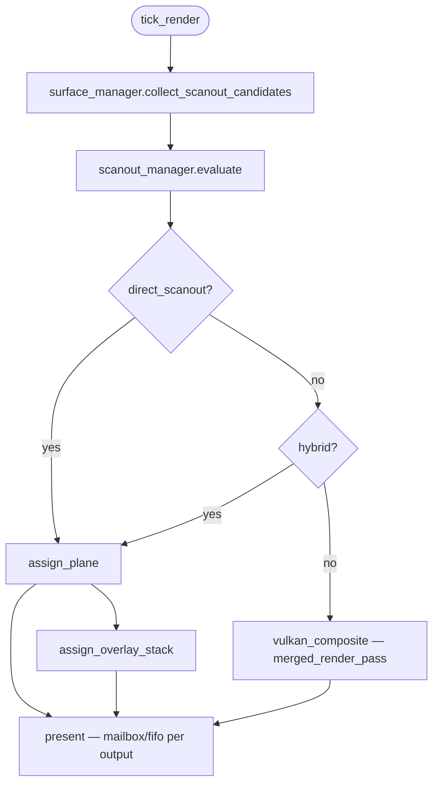

> **Status:** Current (v0.3) — see code for implementation truth

# Rendering Performance

High-efficiency compositor pipeline: zero-copy handoffs, direct scanout, present
timing, import caching, GPU resource pooling, and hot-path CPU budgets.

**Related:** [architecture.md](../architecture.md) · [threading.md](threading.md) ·
[dmabuf-vulkan-import.md](dmabuf-vulkan-import.md) · [errors-and-logging.md](errors-and-logging.md)

---

## 1. Design goals

| Goal | Mechanism |
|------|-----------|
| Zero-copy client pixels | dmabuf → Vulkan import |
| Zero-copy frame handoff | `snapshot_buffer` v2 — index swap, const ref acquire |
| Zero-copy draw build | `build_draw_list_into(write_draw_list())` — no interim copy |
| Low latency (discrete) | `present_mode::mailbox` + `backpressure_policy::triple_buffer` |
| Tear-free (integrated) | `present_mode::fifo_relaxed` + direct scanout |
| Minimal GPU state change | `batch_for_render()` + `pipeline_cache` + import cache |
| Bounded CPU work | `hot_path_budget` + `budget_tracker` |
| Accurate pacing | DRM page-flip + `presentation_tracker::bind_page_flip` |
| Partial KMS updates | `kms_damage_region` → `presentation_feedback.kms_damage` |
| Video/game priority | `content_hint` on `surface_commit` → scanout evaluation |
| Color-correct compositing | Linear-light workspace; encode once at output |

---

## 1.1 Color compositing space

All GPU compositing runs in **linear light** (`transfer_function::linear`). Surface
colors are decoded using each draw command's `src_space` and tagged `encoding`; the
output transfer function is applied **once** at the end of the render pass (before
KMS scanout or swapchain present). This prevents the sRGB-in-linear-space blending
errors common in legacy compositors.

---

## 1.2 Present backend selection

Chosen **once at startup**, in `compositor::start`, from `config::present`:

| `present_backend` | Composite | Scanout buffer |
|-------------------|-----------|----------------|
| `vulkan` | `gfx::vulkan_compositor` — GPU render pass | Vulkan image exported as dma-buf → `drm::kms_framebuffer` |
| `gl` | `gfx::gl_compositor` — GLES 2 quads via EGL on GBM | `gbm_bo` (SCANOUT\|RENDERING) → `EGLImage` → FBO, exported → `drm::kms_framebuffer` |
| `cpu` | `gfx::cpu_compositor` — damage-limited row blitter | `drm::kms_dumb_framebuffer` (CREATE_DUMB + mmap) |
| `automatic` (default) | hardware Vulkan → hardware GL → CPU; no KMS → headless | |

`automatic` reads `gfx::device_info::is_software_rasterizer`
(`VK_PHYSICAL_DEVICE_TYPE_CPU` — llvmpipe, SwiftShader) and, for GL,
`egl_device::is_software_renderer()` (`GL_RENDERER` naming llvmpipe/softpipe/swrast). Each
backend declines itself rather than accepting a downgrade.

**Why GL exists alongside Vulkan.** Mesa ships hardware drivers for devices it has no
Vulkan driver for — vmwgfx/SVGA3D under VMware being the case this was built for, but also
older radeon/nouveau and many SoCs. On those, EGL/GLES is the only accelerated path, and
without it the compositor falls back to software on hardware that is perfectly capable.

**Why the CPU path exists alongside both.** With a software Vulkan device the GPU path
still runs, but each frame then makes several passes over the whole surface to do the work
of one:

```
client shm ──swizzle──▶ staging ──memcpy──▶ VkBuffer ──copy+tile──▶ VkImage
                                                                      │
                                                       fullscreen fragment shader
                                                                      ▼
                                                            linear scanout image ──flip──▶
```

The CPU path collapses that to a single pass:

```
client shm ──memcpy (native order)──▶ staging ──blit (damage-limited)──▶ dumb FB ──flip──▶
```

Scanout is allocated **XR24**, which is already the byte order `wl_shm` clients use, so an
unscaled opaque surface reaches the display with no channel conversion at all.

`tests/bench_composite.cpp` prints the per-pass cost on the host in question — run it
rather than assuming these ratios transfer.

### Measured: VMware SVGA3D, 1918×928

Render-thread cost per frame — how long the tick is occupied, which is what the budget
cares about:

```
CPU   composite, opaque fullscreen             1.8 ms
GL    composite, dmabuf client (no upload)     0.1 ms
GL    composite, shm client (full upload)      2.7 ms
```

The GL figures are **submission** cost, not GPU wall time. The composite exports a fence
instead of blocking (see below), so the GPU work overlaps the rest of the tick and the flip
waits on the fence rather than the compositor waiting on the GPU. The GPU still needs
roughly 1.7 ms for a fullscreen quad; it just has a whole refresh period to do it in. Before
the fence, the same two lines measured 5.3 ms and 11.4 ms, all of it the render thread
sitting in `glFinish`.

Two things follow, and neither is intuitive:

**The client's buffer type dominates, not the backend.** A dma-buf client is sampled where
it already lives; an shm client has to be uploaded every frame, and on a virtualised GPU
that upload costs more than the composite. This is why `zwp_linux_dmabuf` matters more for
frame rate than any backend choice.

**For shm clients the two backends are close; for dma-buf they are not.** GL's shm figure
(2.7 ms) is dominated by the upload, which puts it in the same range as the CPU blitter
(1.8 ms) — and before the fence landed it was four times worse. For dma-buf clients there is
no contest: 0.1 ms of render thread, because nothing is copied at all. The CPU backend
cannot composite a dma-buf client without mapping tiled GPU memory, so a desktop running
real applications wants GL or Vulkan regardless. Set `config::present` explicitly if a
specific deployment measures otherwise.

### GL → KMS synchronisation

Nothing synchronises GL against the page flip that reads the scanout buffer. Rather than
block the render thread until the GPU is done, the composite exports the frame's completion
as a **sync_file** and the atomic commit waits on it — the display controller holds the flip
back instead of the compositor holding the frame back.

```
composite ─ eglCreateSyncKHR(EGL_SYNC_NATIVE_FENCE_ANDROID)
          ─ glFlush                     (the fence needs its commands submitted)
          ─ eglDupNativeFenceFDANDROID  → sync_file
                                          │
                     atomic_commit_request::in_fence_fd
                                          ▼
                            KMS holds the flip until the GPU signals
```

The FD is **owned by the caller** (`gl_composite_stats::out_fence_fd`) and must reach a
commit or be closed. In `compositor_impl` it travels with `composited_slot_` in
`composited_fence_fd_`, because a commit can be deferred a tick and the fence belongs to the
frame in that slot, not to the tick that commits it. Superseding an uncommitted frame, or
shutting the render loop down, closes it.

Without `EGL_ANDROID_native_fence_sync` the composite falls back to `glFinish`. Committing
unsynchronised would show a partly-drawn frame, so the stall is the correct fallback — it is
not optional.

### GL composite properties

| Property | Behavior |
|----------|----------|
| Context | EGL on `EGL_PLATFORM_GBM_KHR`, surfaceless, GLES 2 — the floor every driver supports |
| Thread | Built on the UI thread during `start()`, released, then claimed by the render thread in `render_loop`. An EGL context is current on one thread at a time |
| Scanout | 3 × `gbm_bo` (SCANOUT\|RENDERING) → `EGLImage` → renderbuffer → FBO, same slot rotation as the other backends |
| dma-buf clients | `EGL_EXT_image_dma_buf_import` → sampled in place, no copy. Imported **on the render thread** (where the context lives) against a compositor texture id per `wl_buffer` (`surface_manager::set_render_thread_import`); the UI-side Vulkan import cache is not used, since on hosts that pick GL its only Vulkan device is usually a software rasterizer that cannot import at all. The `EGLImage` is made once per buffer and reused while the client re-commits it |
| shm clients | `glTexSubImage2D` in RGBA (BGRA measured slower on SVGA3D) of only the **buffer-age region**: the union of surface damage since that buffer's texture was last written, plus the previous upload's damage (the other GL name missed it). Staged through `shm_upload_pool` — a transient block per update, sized by the region, returned right after the upload |
| Upload hazard | Each texture keeps **two** GL names and alternates. Uploading into the texture the previous frame is still sampling stalls the driver — measured 48 ms vs 22 ms per frame on SVGA3D. Each name tracks its own storage size: a client resizing every frame (interactive resize) alternates sizes across the names, and a sub-image upload into storage of another size is a GL error that leaves stale pixels on screen |
| Damage | `glScissor` over the damage rect, unflipped: the target is a framebuffer object over the scanout buffer, where window y = 0 is memory row 0, the top line KMS scans (GL's bottom-left origin applies only to window-system framebuffers) |
| Blending | `GL_ONE, GL_ONE_MINUS_SRC_ALPHA` — sources are premultiplied |
| Sampling | The source box (float, wp_viewport) and the buffer transform as an affine basis in three uniforms (`gfx::source_basis_for`, shared with Vulkan and CPU); UVs `highp` where the fragment stage has it (mediump cannot address texels past ~2048); `GL_LINEAR` throughout — a 1:1 draw on whole pixels samples texel centres exactly; a half-texel clamp keeps crops from bleeding |
| GPU sync | `EGL_ANDROID_native_fence_sync` → sync_file → `atomic_commit_request::in_fence_fd`; `glFinish` only as fallback |

**Modules:** `lx.gfx.gl_renderer` — `egl_device`, `gl_scanout_target`, `gl_compositor`

Errors use `error_domain::gl` with `lx::gl_err`, so a log line names the renderer that
actually failed.

### CPU composite properties

| Property | Behavior |
|----------|----------|
| Occlusion cull | Topmost opaque draw covering the damage rect skips the clear **and** every draw beneath it |
| Fast path | Identity (whole-texel source the size of dst, normal transform) + opaque + compatible format → row `memcpy` |
| Conversion | Fused into the blit (`copy` / `swap_rb`); no separate pass |
| Scaling, crop, transform | Every non-identity draw inverse-maps pixel centres through the shared source basis, 16.16 fixed point, two adds per pixel: nearest for an integer magnification of whole texels (exact), bilinear otherwise, taps clamped to the source box |
| Damage | Composite is clipped to `snapshot.damage()` |
| Parallelism | `row_band_pool` — disjoint row bands, render thread participates |
| Write-combining | Opaque draws never read the destination back; blending does, and is slow on a scanout mapping |

`config::composite_thread_count` defaults to **0**. The fullscreen opaque case is a row
memcpy, which one core already saturates memory bandwidth with, so bands only add dispatch
latency there; raise it for scenes dominated by blended or converting draws.

**Modules:** `lx.gfx.cpu_renderer` — `cpu_compositor`, `pixel_surface`, `row_band_pool` ·
`lx.drm` — `kms_dumb_framebuffer`

### SHM staging

Two strategies, because the consumers differ:

| Consumer | Staging | Lifetime |
|----------|---------|----------|
| Vulkan upload (copies pixels out during drain) | `shm_staging_ring` — one FIFO for all surfaces | Slot free once the upload is recorded |
| GL upload, driver takes BGRA at any stride (`GL_EXT_texture_format_BGRA8888` + `GL_EXT_unpack_subimage`) | None: `shm_direct_uploads` — the render thread uploads the damaged region straight from the client's buffer | The `wl_buffer` is held, with an external `wl_shm_pool` reference, until the upload; released from `tick_ui` after it |
| GL upload, otherwise (and compositor images) | `shm_upload_pool` — a block per in-flight update, sized by the damaged region | Block returned right after `glTexSubImage2D`; blocks idle 1 s are unmapped |
| CPU composite (samples staged rows in place) | `shm_pixel_store` — two slots per texture | Slot held until a later commit supersedes it; a retired texture's storage is freed once neither slot is in flight |

**GL uploads from client memory.** Staging copied every damaged pixel on the UI thread
(with an RGBA swizzle) and the driver then copied it again. Where the driver takes the
client's BGRA rows at the client's stride, the render thread uploads them in place, inside
`wl_shm_buffer_begin_access`/`end_access` against a truncated pool. Two rules keep this sound:

- **Release timing.** The release that went out at commit now waits until the upload.
  A buffer committed again before that is released once, after the last read.
- **Early destroy.** A client may destroy the `wl_buffer` before the upload. Its destroy
  listener runs while the buffer is still readable and copies the region out under the
  table's lock. The render thread never reads a dead buffer, and the UI thread never waits
  on a frame.

Measured on vmwgfx across an interactive resize of `foot`, A/B in one build with two runs
each:

- The UI thread's share fell from 4.3–4.8% to 2.4–2.8%: `shm.stage` is gone.
- The render thread's `texture_update` rose from 3.8–4.4% to 5.7–7.3%. The copy now happens
  in the driver, so total CPU is about the same on SVGA.
- The median flip gap went from 19.3 ms to 16.3 ms. The resize now lands on vblank.

A shared FIFO cannot serve the CPU path: the composite reads the rows well after the
drain, so another surface's commits would recycle the slot underneath and the texture would
start showing the wrong pixels. GL left the shared 8-slot ring when subsurfaces arrived: a
client-side-decorated window commits about nine surfaces in one frame, the ring ran out,
and the updates it refused were never shown.

It then used per-texture staging, and that leaked in practice: nothing retired an entry
when its texture went, `vector::clear` kept the capacity even when something did, and
slots only grew. Every buffer the compositor had ever seen kept two window-sized copies
resident — a session's heap grew by about 120 MB in minutes of normal use (measured: glibc
reported 169 MB of a 174 MB heap in use). GL now stages through `shm_upload_pool`: blocks
live only from commit to upload, carry only the buffer-age region, are mmap'd directly
(large freed malloc blocks raise glibc's dynamic mmap threshold and fragment the brk heap),
recycle in steady state without syscalls, and are unmapped after 1 s idle. One busy client
still cannot starve another: blocks are per update, not a fixed shared ring.

Buffer age, not plain damage: Wayland damage is relative to the surface's previous
content, whichever buffer held it, while a texture belongs to one buffer. A client cycling
three buffers would otherwise leave each texture missing what changed while the others were
shown. `shm_upload_region` keeps an 8-commit damage history per surface; a buffer moved to
another surface, or one not shown for longer than the history, is staged whole, as are a
texture's first two uploads (both GL names). The CPU and Vulkan paths still stage whole
buffers: the CPU store *is* the texture, and the Vulkan upload takes whole images.

### Texture updates wait for their snapshot

Every `texture_update` carries `visible_from_frame`: the index of the snapshot that was being
built when it was queued (`p0_protocol_context::building_frame` — the tick's frame during
its dispatch, the next one once that frame is published, unchanged when a publish is
dropped). The render thread applies an update only when it composites a snapshot at least
that new; anything newer waits in a fixed 256-entry ring, and so does everything queued
behind it, which keeps FIFO order across a forget and a re-registration. Without it, a
buffer re-committed under the same texture id between two ticks was uploaded before the
*previous* snapshot composited, and its new pixels showed under the previous frame's
geometry — a window drawn at its new size inside its old frame, a synchronized subsurface
ahead of its parent. A full ring applies the oldest early (one warn).

### Blend from content

`surface_node` draws with `blend_mode::opaque` only when the content is opaque — a client
format without alpha (`XRGB8888`, `XBGR8888`, …), or an opaque region covering the whole
buffer — and the node opacity is 1. Everything else blends (premultiplied). Blending used
to be chosen from opacity alone, which drew every ARGB client's transparent pixels (GTK
shadows, rounded corners, CSD borders) as black. The CPU occlusion cull and `memcpy` fast
path still apply to XRGB and fully opaque ARGB windows. Opaque-region sub-rects (splitting a
draw into an opaque and a blended part) are a follow-up.

**Opacity is applied once.** The node's opacity (alpha-modifier-v1) rides
`draw_command::opacity` only; every backend multiplies it with the tint's alpha. The scene
used to fold it into the tint as well, so a surface at alpha 0.5 came out at 0.25 — dormant
while every opacity was 1. A draw whose effective alpha is 0 is skipped by every backend
(`draw_invisible`) but still counts for the visibility pass, so a surface fading in from 0
keeps its frame callbacks.

### Solid colours: no texture, no upload

A `wp_single_pixel_buffer_v1` is a colour, not pixels: the surface node emits a solid draw
(`draw_command::solid`, the premultiplied encoded colour) of its logical size, the buffer is
released at apply, and nothing is staged, uploaded or sampled. GL draws an opaque untinted
one as a scissored `glClear` (no shader, no blend), anything else through the composite
shader with the colour in place of the sample (`use_solid`), so it is decoded, tinted and
faded exactly like a texel; the CPU path fills spans (no destination read when opaque) or
blends per pixel; Vulkan substitutes the colour in the shader (a push constant flag; a 1x1
descriptor keeps the pipeline's sampler set bound when a frame has no other). An opaque one
occludes for the visibility pass and the CPU clear cull like any opaque draw.

### Content updates wait off the frame path

An update that cannot apply yet (a fifo barrier, a commit-timing target, an unsignalled
fence) waits in the content-update queue, not in the composite: render never waits on a
client's GPU work, and a slow client delays only itself. Costs: an unblocked dma-buf commit
does one `poll(…, 0)` per distinct plane (the implicit-readiness check) and nothing else; a
blocked one takes a pool record and, per fence, one epoll add and remove; a tick with nothing
queued checks one counter. Frame callbacks moved from an inline 64-entry array per update to
a shared node pool, which halves what a commit copies. fifo pacing clears barriers right
after each output's publish, so a FIFO client gets exactly one update per refresh; a
commit-timing target arms a stopped clock for exactly the tick that presents it (an idle
desktop with a timed update wakes once). See [architecture.md](../architecture.md) "Explicit
sync, buffer readiness and the commit-path protocols".

### Server-side frames: no new draw type

A window frame (`lx.compositor:decoration`) is drawn with the existing textured-quad path on
every backend: there is no solid-fill draw, and none was added. Border and title fills
stretch the centre 2x2 of a 4x4 colour swatch in one 64x64 atlas texture (the GL path's
half-texel inset keeps linear filtering inside the swatch; CPU nearest sampling is exact),
with `blend_mode::opaque`, so the CPU occlusion cull and the GL blend-off path still apply.
Colours are baked into the swatches rather than produced by `tint`, whose encoding semantics
would have to be proven identical on GL, CPU and Vulkan. The title is one premultiplied
texture per window and focus colour, rasterized on the UI thread by `lx.text` when the title
changes or its ellipsis cut moves (≈0.1–0.3 ms, not per frame); a focus change swaps the
texture id, a move or a resize that keeps the cut costs no texture work. 7–8 draws per
decorated window. Title texture ids are allocated upward and never reused, so a dated
retirement can never drop a later texture that happened to get the same id. Damage is the
frame's four strips (title bar plus borders, old and new apart), never the client area,
which the window's own nodes account for; a hover or press repaints the close button only.

### Screen capture: copies ride the composite

A capture (ext-image-copy-capture, wlr-screencopy) costs nothing while no session exists: one
counter test per tick and per composite. An output session with a pending frame copies the
frame the output has just composited, on the render thread, right after the composite —
only the damage since the composite it last copied (a per-output ring of the last eight
composites' damage, reset when the targets are made again) plus what the client damaged.
A requested frame starts no clock: it waits for its output to composite something new, so
an idle desktop with an idle screencast costs no wakeups (10 s idle with wf-recorder
running: 25 context switches, the same as without it).

| Copy into | GL path | Render time per frame (1914x924, SVGA3D) |
|-----------|---------|------------------------------------------|
| nothing (an animating window) | — | 0.34 ms median |
| client dma-buf (LINEAR XRGB) | one `glBlitFramebuffer` per damage rect into the buffer, imported once as a framebuffer; a native fence the UI's poller waits on | 0.50 ms |
| client shm | the same blit into the session's LINEAR GBM buffer behind a native fence; a worker waits on it, maps the buffer and copies the damaged rows into the shm | 0.50 ms (was 12.1 ms with a `glReadPixels` into a pixel-pack buffer mapped on render: SVGA3D has no asynchronous read-back, the map stalls) |
| wf-recorder (screencopy, shm) | as shm | 0.54 ms (was 11.5 ms) |

The pointer is drawn onto the copy for `paint_cursors` (a GL quad, or a CPU blend after the
shm copy) — the hardware plane is not in the scanout. The CPU backend composites the
frame's draws for the damaged rects straight into the client's shm; Vulkan reads its target
back synchronously (shm only). A window session composites its own capture view (scene
views 16–23), built only when a frame is pending and the view has damage. See
[architecture.md](../architecture.md) "Screen capture".

**Through the portals (ADR 009 Part 5).** A ScreenCast is xdg-desktop-portal-wlr's
ext-image-copy-capture session: per delivered frame the compositor's one copy into xdpw's
PipeWire buffer, nothing else in the compositor (measured: 54 frames/s of a moving client
at 1914x924 into shm buffers; pw-dump shows xdpw's `Video/Source` node linked to the
consumer). Idle, xdg-desktop-portal-lumen and xdpw do not wake (0 context switches in
10 s); a cast delivers frames only when the output changes, so its idle cost is the
compositor's per-frame copy machinery times the desktop's own damage rate — with
lumen-shell's panel repainting about once a second here, 24 → 154 compositor context
switches per 10 s (UI ≈ 6.5, render ≈ 4, worker ≈ 3 per copied shm frame). A screenshot
is one shm capture per output (60–90 ms per request end to end at 1914x924, the PNG included) and a PNG
written at zlib level 1 with the Sub filter: 30 ms against grim's default 114 ms for 16 %
more bytes.

### Texture retirement is dated, not immediate

`texture_update::forget` carries `retire_after_frame` — the first frame index whose
snapshot is guaranteed not to reference the texture (the frame after the buffer was
destroyed; the surface node is detached before the next `commit_frame` publishes). The
render thread queues the retirement and applies it only once it has composited a frame that
recent.

Queue order alone is not enough. A snapshot published while the buffer was still alive can
still be waiting to composite, and it references the texture **by id**:

```
tick_ui(N)      commit → draw list references texture T, snapshot N published
   (between ticks)  client disconnects → forget(T), retire_after_frame = N+1
tick_render     acquire snapshot N → drain → composite
                 forget applied here ⇒ snapshot N draws a texture that is gone
```

On the Vulkan path that surfaces as `draw referenced an unregistered texture`. On the CPU
path it is worse than a warning: the retirement releases the `shm_pixel_store` slot the
draw is still sampling, so the surface can render another client's pixels.

A texture is retired when its `wl_buffer` is destroyed and no surface shows it, or — when
the buffer object went first — when the surface stops showing it (a new buffer, or the
surface destroyed). The surface manager's buffer record goes with the `wl_buffer` object
(`forget_buffer`); it used to be kept forever, and after 256 buffers every later commit
failed.

---

## 2. Render path decision tree

Evaluated **every frame** on the render thread (after snapshot acquire):



### Direct scanout eligibility (all required)

- Single fullscreen opaque surface on output
- Format/modifier supported by primary plane
- No overlapping translucent windows above (hybrid uses overlay stack)
- `config.enable_direct_scanout == true`
- `content_hint::video` / `content_hint::game` preferred when multiple candidates
- `lx.drm::plane_manager::can_direct_scanout(output)`

**Module:** `lx.compositor.scanout` — `scanout_manager`, `scanout_plan`, `overlay_layer`

See [../uml/26-scanout-decision.mmd](../uml/26-scanout-decision.mmd), [../uml/31-hybrid-scanout-overlays.mmd](../uml/31-hybrid-scanout-overlays.mmd).

---

## 3. Snapshot buffer v2 + back-pressure

**Problem (v1):** `publish(draw_list)` copied up to 4096 `draw_command` structs per frame.

**Solution (v2):** UI writes into the **write slot** in place; `try_publish()` swaps atomic
read index only; render holds a **const reference** (no copy).

```
UI thread                          Render thread
─────────                          ─────────────
write_draw_list()  ──mutate──▶  slot[(read+1) % 3]
build_draw_list_into(slot)         (no interim copy)
batch_for_render()
try_publish(d, idx) ──swap──▶   read_idx
  drop / stall if full             acquire() → const&
                                   record Vulkan
                                   release(idx)
```

**One snapshot buffer per output view** (ADR 008 M3). Damage is noted once in layout
coordinates and fanned out to the pending region of every view it touches (≤ 16 rect tests,
no allocation), projected per view and clipped to the view's pixels; a tick builds and
publishes only the views of the outputs that are due *and* damaged, each with its own
projection, so a flip-pending output never holds another output's slots, and an output
nothing happened on costs nothing. A view's draw list holds only draws that reach its
pixels (each surface node culls itself against the view's rect when it emits).

### Back-pressure policies

| Policy | Behavior |
|--------|----------|
| `drop_latest` | Skip publish when `in_flight >= max_in_flight` — lowest latency |
| `stall_ui` | `try_publish` returns `false` — UI waits for render slot |
| `triple_buffer` | 3 slots, default `max_in_flight = 2` — mailbox-friendly |

Configure via `compositor::config::snapshot`:

```cpp
compositor::config cfg{
    .snapshot = {
        .backpressure = scene::backpressure_policy::triple_buffer,
        .max_in_flight = 2,
    },
};
```

| API | Thread | Cost |
|-----|--------|------|
| `write_draw_list()` | UI | O(1) slot access |
| `try_publish()` | UI | O(1) atomic index swap |
| `acquire()` | Render | O(1) const ref |
| `release()` | Render | O(1) in-flight counter |

**Module:** `lx.scene.snapshot` — `snapshot_buffer`, `backpressure_policy`, `snapshot_config`

See [../uml/27-snapshot-v2-handoff.mmd](../uml/27-snapshot-v2-handoff.mmd), [../uml/30-backpressure-policy.mmd](../uml/30-backpressure-policy.mmd).

### Draw list build (R1 — scaffold complete)

`scene_graph::commit_frame` calls `build_draw_list_into(write_draw_list())` directly.
No interim `draw_list` copy.

### Damage: multi-rect, buffer age, idle skip

Damage is a `gfx::damage_region`: up to 16 rects, the same capacity as `kms_damage_region`,
held inline. `add` merges two rects only when their bounding box wastes at most 25 % over
their union, so a window dragged a few pixels stays one rect while a window moved across
the screen stays two (old and new position) instead of one bbox spanning both. On overflow
the pair whose merge wastes least is merged. wlroots gets the same shape from a pixman
region in a `wlr_damage_ring`; this allocates nothing, and its rect count is exactly what
FB_DAMAGE_CLIPS takes.

| Stage | Damage used |
|-------|-------------|
| Scene → snapshot | Global rects noted by the window manager (old + new node rect on a move or resize) and by surface commits (client damage translated by the node origin). Carried forward over snapshots render never acquired |
| Composite | `frame damage ∪ age(slot)`: each of the three scanout slots records what it missed since it was last drawn into. Without this a damage-limited composite into a slot two frames old leaves ghost trails behind a moving window |
| GL | `gl_compositor::composite_region` — state set once, then per rect: scissor, clear, draw only the draws whose dst meets the rect; one fence per frame |
| CPU | `cpu_compositor::composite_region` — the existing per-rect path (with its occlusion cull) once per rect |
| Vulkan | Full repaint whenever anything is damaged — correct for any buffer age |
| KMS | Every rect since the last successful commit, as separate FB_DAMAGE_CLIPS: the plane's previous framebuffer predates this frame |

A tick whose snapshot carries no damage composites nothing and commits nothing. On this
host (vmwgfx, GL path) an idle compositor with no clients went from 47 to 24 scheduler ticks
of CPU per 5 s (9.4 % → 4.8 % of a core); the remainder was the 1 ms Wayland poll and the
free-running 60 Hz tick, not compositing. Both are gone: the loop waits on its fds and the
frame clock stops when idle, so an idle desktop (shell and a terminal) now costs no
measurable CPU (0 ticks per 5 s, 5 wakeups/s).

### Output scale: projection, edge rounding, pixel exactness

The scene is laid out in logical coordinates; `scene::output_projection` (origin, scale
n/120) is applied only when draws are emitted and damage is noted, so snapshots carry
output pixels and the render thread does no scale arithmetic (ADR 007, D1). Costs: a few
multiplies per draw in `project_node`, none per pixel; nothing allocates.

- **Edge rounding relative to the window** (D2): a window's tree container is an anchor; its
  root lands on `round((root − origin)·s)` and every node (subsurfaces, the server-side
  frame) rounds both edges relative to it. A fractional-scale client renders `round(w·s)`
  pixels, which is exactly the root's projected width wherever it sits: **1:1, no
  resampling**. Measured, not asserted: `test_viewport_geometry` checks the property for
  every root offset 0..119 and width 1..2000 at six scales; `test_gl_composite` draws a
  1949-pixel one-pixel checker 1:1 and reads it back bit for bit; `scripts/scale-smoke.sh`
  screenshots the live frame at 1.25, 1.5, 1.75 and 2 and finds every pixel of a probe's
  checker in place (0 pixels off, foot and GTK 4 buffers `round(size·s)`).
- **Damage** is projected by flooring the start and ceiling the end, widened by one pixel at
  a non-integer scale (edge rounding moves an edge by up to half a pixel either way); a
  resampled surface's content damage is widened by half a source texel in output pixels
  (`surface_manager::resample_margin`, wlroots' buffer-bleed rule). Whole-node damage (map,
  move, resize) needs no margin: a draw never paints outside its destination.
- **Buffer damage stays partial at any scale**: `damage` and `damage_buffer` are converted
  into each other's space at apply (`:viewport`), so the shm upload copies the buffer
  region that changed, not the whole buffer, for scaled, cropped and rotated clients.
- **Compositor-drawn pixels**: titles rasterized at `10 pt·s` and drawn 1:1, xcursor themes
  loaded at `round(24·s)`, client cursor images resampled once per change — never per frame.
  A scale that appears later (an output configuration) loads its theme then, once.
- **Output transform** (ADR 008 §C.4): emitters draw in the untransformed content space;
  the view turns each draw once after emission (`gfx::transform_rect` on its rect and clip,
  `gfx::compose_output_transform` on its buffer transform — integer arithmetic, a table
  lookup) and `project_damage` turns damage. Cost: a few integer operations per draw per
  turned output, nothing at normal transform; no renderer changed (every backend already
  samples through `source_basis_for` for all eight transforms), occlusion and KMS damage
  stay axis-aligned rects. A rotated output with a fractional scale is still 1:1: the
  turned rect of a whole-pixel rect is whole pixels. The cursor plane's image is turned
  once per image change on render, not per motion.

### Occlusion culling and frame-callback throttling (the visibility pass)

`scene_graph::commit_frame` runs one top-down pass over the draws of each published frame
(`scene::mark_occlusion`, ADR 007 P3), in paint order before batching:

- Up to **eight opaque rects** are kept, seeded from draws that cover their destination with
  full alpha: `blend_mode::opaque` (a format without alpha or an opaque region over the whole
  buffer), opacity and tint alpha 1, translation only. When more are found the eight largest
  stay. A draw inside one of them, or outside the output, is marked `occluded`; GL, Vulkan
  and CPU skip it (`draws_culled`). The pixels are identical, so damage and buffer age are
  untouched — what is saved is the GPU fill of windows under a maximized one.
- Cost: O(draws × 8) compares per published frame, a parallel `scene_node*`/`bool` scratch
  array of `k_max_draw_commands` in the scene graph (no allocation), one virtual call per
  on-screen node. Conservative by construction: overlaps the eight rects cannot express count
  as visible.
- Each surface node with a draw on screen records the frame; `surface_node::visible_in(f)`
  is an O(1) compare. **Presentation feedback** samples by it (a covered surface's update is
  not "shown"), and **frame callbacks** are paced by it: surfaces on screen in the last
  published frame are answered after the flip (held to the repaint deadline, §6.1), the
  others at most every 995 ms (niri's
  `FRAME_CALLBACK_THROTTLE`). Those throttled callbacks do not keep the frame clock running;
  the 1 s housekeeping timer answers them while it is stopped. Measured on SVGA3D: a probe
  covered by a maximized opaque window drops from ~30 commits/s to one per 1.00 s (app-smoke
  P3) and is back at the display rate the frame it is uncovered.

### Cursor: hardware plane, cursor-only commits, software fallback

The pointer is a KMS cursor plane (`lx.drm:cursor`), so moving it costs plane properties on
an atomic commit and **no composite**:

| Piece | Choice |
|-------|--------|
| Plane | `type == CURSOR`, reachable from the CRTC's index, scans out ARGB8888. The primary plane is likewise chosen by `type` now — with cursor planes exposed, taking the first plane on the CRTC is no longer safe |
| Size | First `SIZE_HINTS` entry the largest theme image fits; else `DRM_CAP_CURSOR_WIDTH/HEIGHT` (64 when absent). Images are padded to it: vmwgfx accepts nothing else |
| Hotspot | `DRM_CLIENT_CAP_CURSOR_PLANE_HOTSPOT` set at open, `HOTSPOT_X/Y` on every commit when the plane has them. Virtualised drivers (vmwgfx, virtio-gpu, qxl) hide the cursor plane from atomic clients without the cap, and draw the host pointer from the hotspot |
| Buffers | Two dumb buffers; a new image goes into the one not on screen, shown by the commit that switches `FB_ID` (drivers re-read the image on an FB change) |
| Validation | One `TEST_ONLY` commit before the plane first rides a frame; rejection → software for the session, never a failed frame. A content commit that fails with the cursor on it is followed by a cursor-only `TEST_ONLY` to tell which half was refused |
| Timing | Render reads the cursor mailbox right before it builds the commit (latest position). The cursor rides the content commit when there is one — pointer and the frame under it change on the same vblank — otherwise a cursor-only commit goes out on the deadline-aligned tick. Its flip re-arms the frame clock but is not a content present: it answers no frame callbacks and does not rotate scanout slots |
| Rule | A cursor-only commit needs the plane's CRTC in the state (`involves_crtc()`): a commit with no CRTC cannot carry a flip event (EINVAL). Turning on an off plane, moving it, or turning it off all qualify |

`LUMEN_CURSOR=software` skips the plane (debugging, screenshots of the composite). The
software cursor is a node in the scene's overlay layer: a fixed power-of-two square texture
(`k_cursor_texture_id`, so every image change is an in-place update on every backend),
`blend = premultiplied`, old and new rects damaged separately.

Measured on this host (vmwgfx, GL path, 1918×928), 3 s of 125 Hz absolute motion with no
clients, `render_us` from the `compositor.render` debug line:

| Cursor | Render tick per frame (mean / max) | Compositor CPU during motion |
|--------|------------------------------------|------------------------------|
| Hardware plane | 211 µs / 3.0 ms, `composite=0 commit=cursor` on every frame | 26 ticks / 3 s |
| Software (`LUMEN_CURSOR=software`) | 675 µs / 9.9 ms, `composite=1` (≈1.9 kpx) every frame | 42 ticks / 3 s |

---

## 4. Per-output present mode

| Mode | GPU tier | Behavior |
|------|----------|----------|
| `mailbox` | Discrete | Latest frame, may drop — **lowest latency** |
| `fifo_relaxed` | Integrated | Adaptive vsync — **balanced** |
| `fifo` | Integrated | Strict vsync — **no tear** |
| `auto_select` | Any | discrete→mailbox, integrated→fifo_relaxed |

**Module:** `lx.compositor.output` — `output_manager`, `present_mode`, `output_state`

---

## 5. dmabuf import cache + LRU

**Cache key:** `(client_id, buffer_id, modifier)`

```
on_commit → import_cache.acquire(key, desc)
         → hit: reuse VkImage
         → miss: importer.import + store (evict LRU if at cap)
each frame → tick(frame_index): evict stale (use_count==0, age > threshold)
client disconnect → evict_client(client_id)
```

Configure via `compositor::config::import_cache`:

```cpp
gfx::import_cache_config{
    .max_entries = 512,
    .stale_frame_threshold = 120,
};
```

**Module:** `lx.gfx.import_cache` — `dmabuf_import_cache`, `import_cache_key`, `import_cache_config`

See [../uml/28-import-cache-sequence.mmd](../uml/28-import-cache-sequence.mmd).

---

## 6. Draw batching + pipeline cache

Before publishing, `draw_list::batch_for_render()` sorts the surface draws into strict
painter's order (sort key, then texture id as a tie-break; no opaque-first partition —
there is no depth buffer), then builds the primitive stream of ADR-010 §4.3 over the
surfaces and the UI primitives (`lx.gfx:primitives`) emitted into the same list: every
primitive took an `order` from the list's overlap grid at emission (one more than the
highest order under its bounds, so non-overlapping primitives share an order), a surface
draw takes one at push once the list has a primitive stream (those pushed before it starts
take theirs back to front when it does), and the stream is stable-sorted by `(order, kind,
page)` on packed 64-bit keys in a preallocated scratch and cut into batches wherever the
kind or atlas page changes, with the union of each run's clipped bounds kept for damage
skipping. One instanced draw per batch is the target for the UI backends (≤ 8 for the
10 000-quad scene, ADR-010 G3); the compositor's backends still take the sorted
`draw_command` array as before. A list without primitives — the compositor's scene — has
no stream: it is only sorted, never touches the grid, and its `refs()` / `batches()` are
empty.

`pipeline_cache::acquire(pipeline_key)` returns cached pipeline handle (stub until P0 Vulkan).

`merged_render_pass` batches `textured_quad` draws in a single pass when scanout is not used.

**Module:** `lx.gfx.pipeline` — `pipeline_cache`, `merged_render_pass`, `textured_quad`

See [../uml/33-gpu-resource-pools.mmd](../uml/33-gpu-resource-pools.mmd).

### UI primitives: the atlas and the CPU reference renderer (ADR-010 Phase 1)

`lx.gfx:ui_cpu` rasterises the sorted primitive stream into an XRGB8888/ARGB8888 buffer,
inside the damage rects only, in row bands of about 128 KiB of target so every primitive
crossing a band is drawn while the band is in L2 (drawing a 1919×1080 frame rect by rect,
the destination load was the hottest instruction in `perf`). The partition states the pixel
rules the GL and Vulkan backends copy; its own output is deterministic (no FMA, no libm
transcendental) and is pinned by `tests/golden/ui/*.png` (`test_ui_golden`, bit-exact).
A quad's fully covered interior is written without the SDF, and the clear under an opaque
square quad covering a band is skipped — both proven bit-identical by the tests.

`lx.gfx:atlas` packs tiles on bucketed shelves into CPU-owned pages; GPU backends upload
each page's dirty-rect list. A page above 85 % occupancy with tiles unused for 120 frames
is repacked synchronously when an allocation finds no room.

Measured on the F8 host (VMware SVGA3D VM, 2 vCPUs, release preset; load 0.6–0.9;
`./scripts/ui-bench.sh --backend cpu`, `test_atlas`):

| | Value |
|--|--|
| Glyph packing (10–20 px UI glyph boxes) | 89.0 % of a 1024² page live when it first has to grow |
| Page rebuild, 2 000 live glyphs repacked | 0.62 ms |
| Page rebuild, 1 024 tiles of 64² on a 2048² page | 1.3 ms |
| S2 raster (one 784 px clock cell) | p50 13 µs, p95 63–113 µs |
| S3 raster (10 000 bordered rounded quads, full 1919×1080 repaint) | p50 25.6–27.5 ms, p95 36–69 ms |

The two `cpu` runs differ by more than 5 % at p95, so no `iritur-cpu` baseline is committed
yet; `none` stays the regression gate.

### UI primitives on GLES 3.1 (`lx.gfx:ui_gl`, ADR-010 Phase 1)

`lx.gfx:ui_gl` draws the same stream into a framebuffer object of any current GLES 3.1
context. The vertex stage turns each instance into its whole-pixel raster window (`ui_cpu`'s
pixel-centre rule), so the content mask costs no fragment work and the scissor is left to
the damage rects; the fragment programs transcribe `ui_cpu`'s functions. Against the CPU
references every golden case is within 1/255 on SVGA3D (and within 2/255 on llvmpipe), G10
asking for 3.

Instances go into a 3 × 2 MiB ring — one persistent coherent mapping with
`GL_EXT_buffer_storage`, mapped ranges otherwise, a fence per slot — and the vertex stage
reads them as a std430 storage buffer at a per-batch uniform offset. The ring is bound whole,
once per frame, with the slot in the offset: rebinding per slot with `glBindBufferRange`
made SVGA3D keep reading the previous slot's offset (stale quads on screen). Per-instance
attributes (`ui_gl_fetch::attributes`, for contexts without vertex-stage storage blocks)
measure the same here.

What the host offers and does not: SVGA3D exposes `GL_EXT_disjoint_timer_query` but answers
every query with 0, so `initialize` calibrates once and falls back to "fence-wall" (flush to
fence signalled); `GL_OES_get_program_binary` is listed with zero binary formats, so the
program cache (`$XDG_CACHE_HOME/lumen/gl-program-<hash>.bin`) is inactive and every start
compiles the five programs, 95–155 ms. llvmpipe has a format: 22.5 ms cold, 11.1 ms from the
cache (correctness host only; not a performance number).

Measured on the F8 host (`./scripts/ui-bench.sh --backend gl`):

| | S2 (one 784 px clock cell) | S3 (10 000 bordered rounded quads, full 1919×1080) |
|--|--|--|
| Draw calls, instance bytes | 1, 3 920 B | 1, 800 080 B |
| `submit` (CPU, `ui_gl_renderer::draw`) p50 / p95 | 373–385 µs / 2.4–3.5 ms | 0.70–0.83 ms / 1.7–5.9 ms |
| `gpu` (fence-wall) p50 / p95 | 1.6–1.9 ms / 3.4–5.4 ms | 8.75–9.26 ms / 10.5–13.6 ms |
| CPU reference (`raster`, above) p50 | 13 µs | 25.6–27.5 ms |

Three runs, load 1.0–1.8 (another worktree was benchmarking); they differ by more than 5 % at
p95, so no `iritur-gl` baseline is committed. Where the time goes on this host:

- `submit` is mostly the driver: a frame is about six vmwgfx ioctls, and `glFenceSync` (the
  ring slot's fence) is where Mesa's svga driver flushes its command buffer. For S3 the
  gather of 800 KB into the coherent mapping is ~0.5 ms against 0.2 ms into host memory (the
  bench's own `encode`); the mapped-range ring (`--gl-ring mapped`) measured a lower p50
  (0.51 ms) and a higher p95 (2.4 ms) in one 300-frame pair, not enough to change the default.
- `gpu`: with trivial shaders S3 still costs 4.3–4.6 ms (2.3 ms without any instance fetch),
  so a third of the frame is per-instance fixed cost on SVGA3D; the shading itself is the
  other half. Six-vertex triangles and four-vertex instanced strips measure the same.
- The UI-thread stages run 40–50 % slower beside the GPU work than with `--backend none` in
  the same minutes (S3 emit+order+encode p50 1.44–1.55 ms against 1.02 ms): the host's 3D
  work shares the vCPUs.
- G5 for `gl` rows: no `operator new` in any steady frame; `mallinfo2` moves by 592 B (S3)
  and 0.9–7 KB (S2) inside Mesa (sync objects, command buffers), which the script counts as
  a G5 failure — the driver's heap, not the frame path's.

### UI primitives on Vulkan (`lx.gfx:ui_vk`, ADR-010 Phase 1)

`lx.gfx:ui_vk` draws the same stream with the same GLSL: `shaders/ui/*.glsl` is one set of
files that `ui_gl` embeds as strings and compiles at run time and `ui_vk` compiles to SPIR-V
at build time (`ui_<kind>.vert/.frag` add the Vulkan prologue — the ring as a std430 buffer
at a push-constant offset, the globals block, the eight page samplers). Against the CPU
references every golden case is within 2/255, and within 2/255 of `ui_gl` on SVGA3D (G10:
3 and 2); `test_ui_golden_vk_validation` runs the Vulkan cases under
VK_LAYER_KHRONOS_validation and requires an empty error log (a run with synchronization
validation on, `VK_KHRONOS_VALIDATION_VALIDATE_SYNC=true`, logged nothing either).

The only Vulkan on the F8 host is lavapipe, a CPU device: these are **lavapipe numbers,
correctness only**. Pipeline creation for the five pipelines is 42–65 ms cold and the same
warm: lavapipe keeps nothing in a `VkPipelineCache` (its data is a truncated 20-byte header,
which `ui_vk` does not write to disk), so the warm start is untested on a caching driver.
`lumen-ui-bench --backend vulkan` runs every scenario (S3: one draw, 800 080 instance bytes,
`submit` p50 ≈ 0.17 ms, `gpu` ≈ 60 ms of llvmpipe shading per full 1919×1080 frame); its rows
are labelled `vulkan-software` and scripts/ui-bench.sh neither compares them nor makes them a
baseline. No `operator new` in a steady frame; lavapipe's own threads move `mallinfo2` by
0.2–1.2 KB per run.

---

## 6.1 Frame clock and scanout rotation

**Three scanout slots**, not two. With two, the slot the display is scanning and the slot a
queued flip is about to scan leave nothing writable, so every tick that overlapped a flip
had to be dropped. `compositor_impl::pick_back_slot` returns the slot that is neither on
screen nor queued, so the composite always has somewhere to go.

A frame composited while a flip is queued waits in `composited_slot_` and is committed as
soon as the CRTC is free. If another frame lands first it simply takes its place — mailbox
semantics, so what reaches the display is always the newest content.

**The tick is phase-locked to the display.** A timer free-running at `target_fps` drifts
against the real vblank cadence: ticks land while a flip is still queued and their work is
wasted, and the visible rate settles well below the refresh rate for reasons that look like
slow rendering. Each completed flip re-arms the frame timer just ahead of the next vblank
via `runtime::timer_source::schedule_at`, which is valid from inside the timer's own
callback. The interval comes from the active mode's `refresh_millihz`, not from
`config::target_fps` — that is only the fallback when there is no mode to read.

The lock only holds if the flip is *seen* when it happens. The DRM card is an `fd_source`
in the UI loop's epoll set, so the flip handler runs the moment the flip event is queued
(`drm_fd_callback`), not at the next tick or poll, and the phase is taken from the kernel's flip timestamp (CLOCK_MONOTONIC, the
clock `steady_clock` reads) when it is within one period of `now`. Draining at the tick and
using the tick's own time as the flip time put the phase up to a period late, so ticks ran
at *period − lead*: faster than the display. Measured with `scripts/drag-smoke.sh` on
vmwgfx at 60 Hz over the move and resize drags, about one composite in three then landed
behind a still-pending flip (`commit=deferred`, 60 of 171) and content presents were a
median 21.6 ms apart; with the flip drained promptly it is 4–10 of ~160, mostly resize
frames whose shm upload overran the period, and 15.9 ms. (That fix drained flips from a
1 ms polling pump. The loop now waits on the card fd instead, which sees the flip sooner
and costs nothing while idle.)

**Between bursts the clock stops** — see [threading.md](threading.md). A restart is aimed
at the next deadline extrapolated from the last flip, so it stays on the display's phase.

**Several outputs** (ADR 008 M6). Each output has its own `repaint_scheduler` (phase from
its own CRTC's flips, its own repaint estimate and quiet count) inside
`scheduler::frame_clocks`; **one** `vsync_timer` is armed at the earliest start among the
running clocks, and a tick serves every output due within 1 ms of it (two outputs in phase
cost one wakeup). An output's clock stops after its own two quiet ticks while the others
run; a dark output's never starts. A served clock's next start is never sooner than one
period after the one just served, so a repaint estimate above the period ("run flat out")
means a tick per refresh, not one per millisecond — and that floor also holds when a flip
re-phases the clock (`frame_clocks::on_present`). On a display whose flips complete when the
frame lands instead of at a vblank (vmwgfx), re-phasing to each flip with a large estimate
(one slow frame in the window) used to aim the next start less than a period after the last:
FIFO clients were presented 8–14 ms apart for a while (app-smoke T1/T3 after long runs). On a
vblank-locked display the floor never binds. Measured on vmwgfx: with three outputs an
idle desktop costs 7 context switches in 5 s and no CPU tick; with two, a client
presenting 180 frames on one output left the other at 0 composites and 0 commits.

**Frame callbacks are answered after the flip, timed to the next repaint.** Sent at the
repaint start (the tick), the client's reply has no repaint to catch until the following one:
a frame every two periods (33 ms between presents measured with `lumen-probe presentation`).
Sent at the flip itself (wlroots, at the output's frame event), a client that draws at once
commits a whole period before the repaint that shows it: commit-to-present is a full
refresh. So the flip handler holds them until the output's next repaint start minus its
clients' **answer time** — the peak, over the last 8 answers, of release-to-first-damaging-
commit, plus 1.5 ms — and `callback_timer_` releases them (sway's per-view
`max_render_time`, measured instead of configured). Until an answer was measured, and when
the lead exceeds the period, they go out at the flip as before; a late answer raises the
lead for the next frame, and its worst case is the flip-time behaviour. A tick that finds
callbacks still held answers them itself.

**An output's first frame starts at once** (`repaint_scheduler::next_start` with no flip
yet: no phase to aim at, where it used to wait for half a period), and **waits for a
starting client**: while clients are connected — or a connection is still in the socket's
backlog — and none has mapped a surface, an output that has never shown a frame is left out
of the tick (which still runs: it sends the configures) for at most one refresh period. The
client's first commit restarts the stopped clock, so the modeset carries its window. Without
that the empty desktop went out first and the window a flip later — on vmwgfx the second
flip after a modeset lands 15–50 ms after its commit. With no client, the output lights at
once.

Measured on vmwgfx (SVGA3D, 2 vCPUs, 1914×924) with a 256×256 shm client drawing on every
frame callback, commit to `wp_presentation` presented, 10 runs × 300 frames, medians:

| Callbacks | p50 | p95 | fps | compositor CPU |
|-----------|-----|-----|-----|----------------|
| at the flip | 16.7 ms | 19.3 ms | 56.6 | 7.0 % |
| held to the repaint deadline | 5.1 ms | 7.1 ms | 60.0 | 8.0 % |

**While the output is powered off** (zwlr_output_power_v1, ADR 007 I4) the display gate is
up exactly as for a paused session: no composite, no commit, the frame clock stopped and the
1 Hz paused tick answering frame callbacks. The CRTC goes off with one blocking ACTIVE=0
commit (the cursor plane with it); coming back is the resume procedure — full damage and one
full modeset with ACTIVE=1, then partial damage again. Measured on vmwgfx (app-smoke K3, a
Perfetto trace of `lumen-probe power --set off` and an injected key): 0 `kms.commit` and 0
`composite` spans over 3.1 s dark, one `kms.power_off`, 3 `tick_ui` and 4 `tick_render` (the
paused tick and the posted task) — 2.0 thread wakeups a second for the whole compositor; the
first frame after the wake is one rect of the full 1914x924. The idle timer adds at most one
wakeup per notification timeout, never one per input event (`:idle`'s lazy deadline).

```
flip completes ──▶ card fd readable (epoll) ──▶ kms_device::dispatch_events
                     └─ routed by CRTC ──▶ presentation_flip_handler(pipeline)
                          ├─ clocks.on_present(slot) → shared timer re-armed at the
                          │    earliest start (next vblank − peak repaint cost − margin)
                          ├─ wp_presentation feedback of that output
                          └─ frame callbacks of the surfaces it paces (not for a
                               cursor-only flip): released by callback_timer_ at
                               next start − clients' answer time, or now
```

The 250 ms stall watchdog still paces callbacks by tick if flips stop arriving, so a broken
output cannot wedge clients.

---

## 6.2 Start-up

The start-up path is part of the product: a desktop that appears late is slow however fast
its frames are. `compositor::start` records an instant per phase on the timeline
(`LUMEN_TRACE_FILE`, category `startup`): `start entered`, `kms opened`, `graphics probed`,
`egl ready`, `gl program ready`, `present path ready`, `gl paths warmed`, `outputs ready`,
`socket bound`, `cursor ready`, `globals registered`, `input started`, `shell bridge
installed`. What keeps it short:

- **Overlap.** The hardware-Vulkan probe runs beside the logind/KMS open; input devices and
  the cursor theme load beside the EGL/GL set-up (threading.md, start-up helpers). The probe
  skips software Vulkan drivers (`gfx::hardware_probe_scope`): 20 ms → 5 ms here.
- **Warm GL paths.** `warm_gl_paths` draws once through each client texture path (shm BGRA
  opaque and with alpha, resampled, RGBA) into a scanout slot not yet shown, flushed and not
  waited for: a virtual GPU builds its shader and surface variants during start-up instead
  of on the first client frame.
- **First frame**: starts at once and carries a starting client's window (§6.1).

What remains is Mesa: `egl ready` takes 50–65 ms on vmwgfx (loading the driver and its LLVM,
creating the screen), which every GL compositor pays.

Measured against other compositors on the same host (vmwgfx, 2 vCPUs, one 1914×924 output,
GL renderers, bare compositors: weston `--shell=kiosk --no-config`, sway with an empty
config, Hyprland with logo/splash/news off and its default Xwayland start), each started on
tty1 by a probe that execs it, connects as soon as the socket exists, maps a 256×256 shm
window and waits for its `wp_presentation` presented timestamp; 10 interleaved rounds,
medians:

| | Lumen | weston 15.0 | sway 1.12 | Hyprland 0.56 |
|---|---|---|---|---|
| socket ready | 84 ms | 80 | 88 | 224 |
| window configured | 96 ms | 89 | 171 | 527 |
| **first frame presented** | **106 ms** (94–117) | 115 (104–134) | 379 | 617 |
| commit → present p50 / p95 | **5.1 / 7.1 ms** | 11.1 / 15.8 | 1.2 / 4.8 at 561 fps | 9.2 / 18.8 |
| compositor CPU, client animating | **8.0 %** | 9.4 | 34.9 | 73.5 |
| private memory (RssAnon) | **19.1 MB** | 23.1 | 20.2 | 89.8 |
| shutdown | **29 ms** | 33 | 34 | 126 |

That table predates the cursor theme moving off the critical path: three traced runs since
put the window's configure 4–6 ms after the socket. sway's latency comes from compositing
every commit as it arrives (561 fps on a virtual display whose flips do not wait for a
vblank), at four times Lumen's CPU.

## 7. DRM page-flip + presentation feedback

The frame clock is phase-locked to page flips (§6.1); every flip also resolves
`wp_presentation` feedback:

1. `lx.drm.atomic` — `kms_pipeline` (one per CRTC) keeps the in-flight commit's `user_tag` (the
   composited frame index) and whether it carried a frame, and reports them in
   `page_flip_event` with the kernel's `sequence`, CLOCK_MONOTONIC timestamp, CRTC and
   whether the driver timestamps vblanks (`vblank_timestamp`; probed once with
   `drmCrtcGetSequence`). A blocking modeset's completion is reported as a synthetic flip
   (`hw = false`, sequence 0).
2. `presentation_tracker::bind_page_flip(pipeline)` — wires flip → `presentation_feedback`
   (tag, content, hw, vblank clock, seq) → the compositor's flip handler (UI).
3. The flip handler calls `presentation_flipped(frame = tag, {time, refresh, seq, flags})`;
   the table presents every update sampled at or before that frame whose surface that very
   frame shows (each publish records a sampled surface's visibility in a 64-frame bitmask;
   render composites only the newest snapshot, so the sampling frame may never have been
   shown) and discards the ones a newer update replaced in it; one hidden in the flipped
   frame waits for a flip that shows it or for its supersession. Two lists (queued, sampled) of in-flight slots are walked, a
   handful per frame; nothing allocates and nothing logs above debug.

```cpp
p.presentation.bind_page_flip(*p.kms);      // per output pipeline
// on flip: kms_device::dispatch_events → pipeline → handler → presentation_flipped(tag, slot, info)
```

**Per-CRTC flips, combined modesets** (ADR 008 M5). Frames are one nonblocking atomic
commit per CRTC with its own flip event, so outputs flip independently: a combined frame
commit would tie every output to the slowest and fail with EBUSY whenever any CRTC still
has a flip pending (wlroots, KWin, Mutter and niri all flip per CRTC). Configuration — the
first frames at start, a resume — is one `commit_modeset` of every pipeline that needs one
(TEST_ONLY first, CRTCs no output uses disabled, the neutral properties of each pipeline),
carrying each output's first frame; it waits up to 100 ms for every such output to have a
frame, then falls back to per-output modesets. The flip events of one card are read once
(`kms_device::dispatch_events`) and routed to the pipeline by CRTC id; a combined commit's
event is recognised by its cookie (device, generations, and a bit per pipeline the commit
armed and that pipeline's event consumes — separate modesets in flight together on one
cookie keep their own events). CRTCs another master lit are read again at each resume, and
the resume's modesets turn them off with every connector the kernel has on them.

**Hotplug** (ADR 008 Part B) uses the same two commit kinds and adds nothing per frame:

- A **connected monitor** gets its pipeline from render: targets at the preferred mode, a
  CRTC and planes no other pipeline holds, and a TEST_ONLY of the new pipeline with its real
  first framebuffer (the kernel tests it against the state the other CRTCs are in, so it is
  a test of the whole state); refused, the next mode in sway's order (preferred, then area ×
  refresh) is tried. Its first frame is a modeset of that pipeline alone; the other outputs
  keep flipping.
- A **mode change** (a VM window resize: the preferred mode changed) is tested the same way
  with a real framebuffer of the new size (`modeset_entry::mode` overrides the pipeline's
  mode for the test) before anything a client sees changes; then the output switches, and
  render takes the new targets right before compositing the first frame built at the new
  size — never compositing an older one into them — and modesets with it. The old targets
  stay until that modeset's flip. At a VT resume the probe comes first and the switch is
  part of the resume's one combined modeset, so a resize while away no longer fails the
  resume.
- A **disconnected monitor**'s CRTC is turned off once its last flip drained (CRTC off,
  connector unrouted, its planes detached, `connector_gone` for an MST port that vanished),
  then its targets and pipeline go. Retires run before the adds of the same batch, and an
  add waits (≤ 1 s) while a retiring CRTC is still lit, so a new output is allocated and
  tested with the CRTCs and bandwidth of the gone ones free.
- **Zero work when nothing changes**: without a uevent nothing runs (the netlink socket is
  filtered to drm in the kernel); a uevent whose probe matches the outputs (an identical
  layout, our own probe's detect) costs one worker probe (≈ 0.6 ms of ioctls on vmwgfx) and
  a diff on UI — no client event, no render work, no allocation.

**Output configuration** (ADR 008 Part C) adds nothing per frame either:

- **Test**: one TEST_ONLY of every pipeline the configuration changes, with real
  framebuffers of the new modes (kept staged ≤ 5 s for the switch, so the apply allocates
  nothing more) and new outputs through the CRTC allocator with the same test. A `test` or
  `--dryrun` stops there: nothing on screen moves even for a mode the kernel refuses.
- **Apply**: changed modes go through the hotplug path's switch (at the first frame of the
  new size, in the combined modeset); position, scale and transform repaint the views they
  touch without a modeset; adaptive sync is a modeset (`VRR_ENABLED`). Measured on vmwgfx:
  wlr-randr `--mode` = 1 TEST_ONLY + 1 modeset of that output; `--pos`/`--scale`/`--transform`
  0 modesets; kanshi re-applying the restored state 0 modesets.
- **Start**: the persisted state is applied before the first modeset, so a configured
  session still comes up in one combined modeset.
- **Adaptive sync clock**: with VRR the output's `repaint_scheduler` has no vblank phase; a
  repaint starts on demand, no sooner than one refresh period (the mode's maximum rate)
  after the last flip, minus the repaint estimate (niri's VRR clock). Cursor-only commits
  still go out at once (pointer latency over refresh stability, §G of the design).

Measured on vmwgfx (no vblank counter, flags `vsync | hw_completion`, seq 0): 180/180 frames
presented with strictly increasing timestamps 34 ms apart (the SVGA3D host's flip rate),
commit → presented 21 ms on average; weston-presentation-shm reports `[s_e_]`, mpv binds
`wp_presentation` v2 and paces by it.

See [../uml/29-present-feedback-sequence.mmd](../uml/29-present-feedback-sequence.mmd), [../uml/32-kms-atomic-damage.mmd](../uml/32-kms-atomic-damage.mmd).

---

## 8. Timeline semaphore pool

Avoid per-frame `VkSemaphore` create/destroy on explicit-sync paths.

**Module:** `lx.gfx.semaphore_pool` — `timeline_semaphore_pool`, `timeline_semaphore_handle`

Accessible via `gfx::device::semaphores()`.

---

## 9. Content-type hints

Clients set the hint with wp_content_type_v1 (double-buffered with the surface state);
`surface_manager::content_hint_for` reports it:

| Hint | Scanout priority |
|------|------------------|
| `game` | Highest |
| `video` | High |
| `photo` | Default |
| `none` | Default |
| `subsurface_ui` | Lowest — prefer composite |

For `scanout_manager::evaluate` when multiple fullscreen candidates exist (direct scanout is
not implemented yet), and for the connector's `content type` property of the output a window
is fullscreen on, where the connector has one (none on vmwgfx; not programmed yet).

---

## 10. Hot-path CPU budgets

Default budgets (override via `compositor::config::hot_path`):

| Field | Default | Meaning |
|-------|---------|---------|
| `max_tick_ui_us` | 2000 µs | UI thread per-frame ceiling |
| `max_tick_render_us` | 4000 µs | Render thread per-frame ceiling |
| `max_draw_commands` | 4096 | Draw list capacity |
| `max_import_cache_entries` | 512 | Import cache size |
| `max_frame_latency_ms` | 32 ms | End-to-end latency target |

Compositor logs **`warn`** when a tick exceeds budget (never on every frame at `info`).

---

## 11. Module map

| Concern | Module |
|---------|--------|
| GL composite (EGL/GLES/GBM) | `lx.gfx.gl_renderer` |
| CPU composite + row bands | `lx.gfx.cpu_renderer` |
| CPU-writable scanout | `lx.drm` (`kms_dumb_framebuffer`) |
| Present backend selection | `lx.compositor` (`config::present`) |
| Snapshot v2 + back-pressure | `lx.scene.snapshot` |
| Direct scanout + hybrid overlays | `lx.compositor.scanout` |
| Content hints | `lx.compositor.surface` |
| Present mode | `lx.compositor.output` |
| Import cache LRU | `lx.gfx.import_cache` |
| Pipeline cache | `lx.gfx.pipeline` |
| Semaphore pool | `lx.gfx.semaphore_pool` |
| KMS atomic + damage | `lx.drm.atomic` |
| Present timing | `lx.scheduler.presentation` |
| CPU budgets | `lx.scheduler.budget` |
| Screen capture (policy, render side, GL objects) | `lx.compositor:capture`, `lx.compositor:capture_engine`, `lx.gfx:gl_capture` |

---

## 12. Implementation phases

| Phase | Deliverable | Scaffold |
|-------|-------------|----------|
| **R0** | v2 snapshot, scanout, import_cache, budget | ✅ |
| **R1** | Build into write slot; back-pressure policy | ✅ scaffold |
| **R2** | Direct scanout + hybrid overlay stack | ✅ API; `assign_*` → P0 |
| **R3** | DRM page-flip + presentation bridge | ✅ scaffold |
| **R4** | KMS damage blobs + LRU eviction | ✅ scaffold |
| **P0** | Real Wayland + dmabuf + Vulkan present | Runtime |

**Architecture is efficiency-ready.** Runtime proof waits on P0 implementation.

---

## 13. UML index

| Diagram | Topic |
|---------|-------|
| [26-scanout-decision.mmd](../uml/26-scanout-decision.mmd) | Scanout decision tree |
| [27-snapshot-v2-handoff.mmd](../uml/27-snapshot-v2-handoff.mmd) | Snapshot v2 sequence |
| [28-import-cache-sequence.mmd](../uml/28-import-cache-sequence.mmd) | Import cache hit/miss |
| [29-present-feedback-sequence.mmd](../uml/29-present-feedback-sequence.mmd) | Page-flip + presentation |
| [30-backpressure-policy.mmd](../uml/30-backpressure-policy.mmd) | Drop vs stall vs triple-buffer |
| [31-hybrid-scanout-overlays.mmd](../uml/31-hybrid-scanout-overlays.mmd) | Hybrid primary + overlay stack |
| [32-kms-atomic-damage.mmd](../uml/32-kms-atomic-damage.mmd) | Atomic commit + damage blob |
| [33-gpu-resource-pools.mmd](../uml/33-gpu-resource-pools.mmd) | Pipeline cache + semaphore pool |
| [42-capture-sequence.mmd](../uml/42-capture-sequence.mmd) | Screen capture: session, job, copy, completion |
