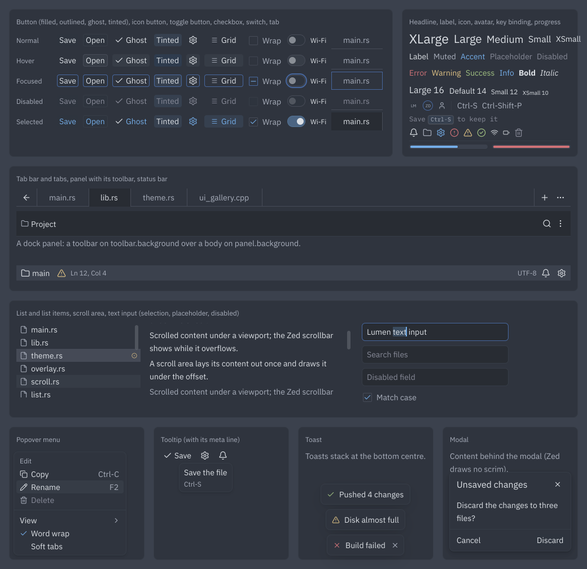
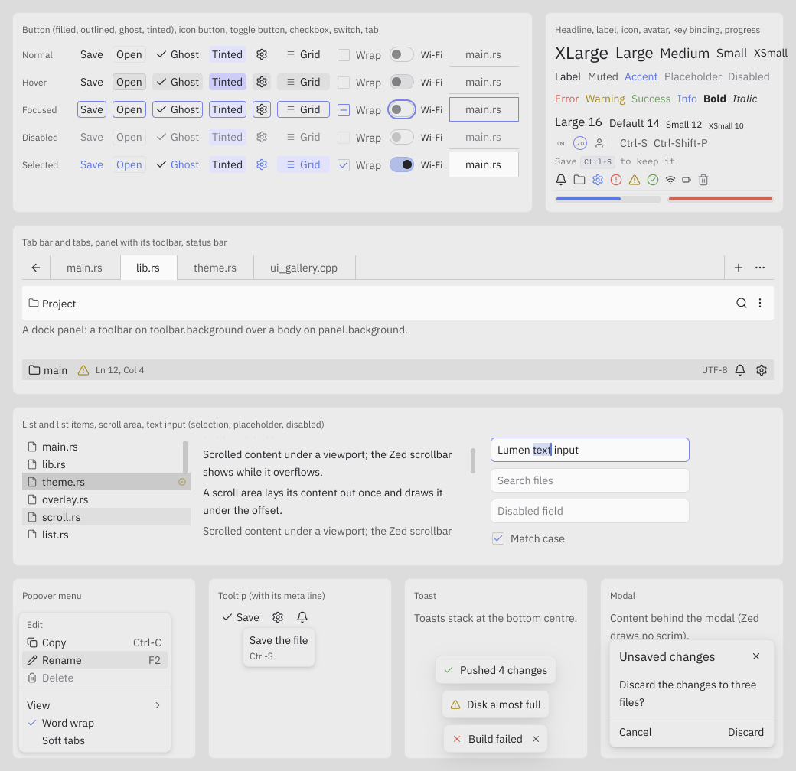

# UI architecture

How `lx.ui` turns application state into draw commands.

**Related:** [threading.md](threading.md) · [rendering-performance.md](rendering-performance.md) ·
[architecture.md](../architecture.md)

---

## 1. The model in one paragraph

A build function describes the UI it wants as a tree of cheap **descriptors**
(`lx::ui::element`). The **reconciler** folds that description onto the **retained tree**
(`lx::ui::ui_node`), reusing a node whenever its type and key match so per-node state
survives. Retained nodes then run a two-pass layout and **emit draw commands** into the
scene graph, which snapshots to the render thread. UI is a function of state; nothing
outside the tree holds a node pointer.

```
state change
  → build(state) produces descriptors        (arena, thrown away each rebuild)
  → reconciler.apply(retained, described)    (reuses nodes by type + key)
  → measure / arrange                        (two passes, hint-driven)
  → emit(draw_scope)                         (appends scene::draw_command)
  → scene_graph::commit_frame                (index swap to render thread)
```

This is the reconciling-descriptor model, adapted from the same idea used by React and
by the Karm framework. The adaptation matters as much as the borrowing: Karm paints into
a CPU canvas, allocates retained nodes with reference counting on every rebuild, and
forces a full-window repaint on any relayout. None of those hold here — see §7.

---

## 2. Descriptors vs retained nodes

These are two different trees with two different lifetimes, and keeping them distinct is
the whole point.

| | Descriptor (`element`) | Retained node (`ui_node`) |
|--|------------------------|---------------------------|
| Lifetime | One rebuild | Until the tree shape changes |
| Storage | UI frame arena | Retained-tree pool, via `construct` |
| Contents | Props by value, child pointers | Geometry, scroll offset, caret, animation phase |
| Identity | `type` + `key` | Same `type` + `key`, matched against descriptors |
| Destructor | None — trivially discarded | Virtual; owns its children |

Descriptors are plain data with no destructor, so a rebuild costs a bump-pointer
allocation per node and the arena reset at the end of the frame reclaims everything.

**Allocation rule:** describing is per-frame and arena-backed. Constructing a retained
node calls `new` and happens **only when the tree shape changes** — a node appears,
disappears, or changes type. Steady-state animation and state updates reuse every node
and allocate nothing but arena bytes.

**Node storage.** A node holds its own fields and a pointer to its children, nothing
more. The child pointers live out of line in a span of 1, 2, 4 … `k_max_children` (64)
slots, taken when the child count first needs it and grown only when the count outgrows
it (the reconciler reserves the count it is about to fill, once). Nodes and spans both come
from one UI-affinity pool (`ui_node::operator new`, 16-byte size classes up to 512 B, 64 KB
chunks, a free list per class). A freed block is the next one of its size, so a reshaped
tree recycles storage. Fresh blocks are carved in the order the reconciler takes them —
node, span, first child … — which is the order layout and emit walk the tree: one dense
run with no allocator headers between nodes. The pool never returns chunks; it holds the
peak tree. A node type must not be over-aligned (more than 16 bytes).

The inline 64-slot array this replaced made every node 640 B whatever its fan-out: S3's
10 651 nodes came to about 7 MB against this host's 4 MB L3, and 82 % of the emit samples
stalled on a node's first field. Out of line, S3's drifting quad is 128 B and the tree
about 1.4 MB; emit fell 45 % and layout 62 % (p50, ADR-010 §7).

---

## 3. Reconciliation and identity

`reconciler::apply(retained, desired)` returns the node that should occupy a slot:

- **type and key match** → re-apply props onto the existing node, recurse into children,
  keep all node-local state
- **anything else** → damage the vacated bounds, destroy the retained subtree, construct
  a fresh one

Children are matched by **key first, position second**. A keyed row is found anywhere
among the previous siblings, so reordering or filtering a list moves nodes instead of
rebuilding them. Unkeyed children match by index.

```cpp
// Rows keep their scroll position and caret across a reversal.
const child kids[3] = { row(30, /*key*/3), row(20, 2), row(10, 1) };
list = rec.apply(list, with_children(parent, kids, 3));
```

**Type ids must be unique.** `apply` is taken from the descriptor, not the node, so two
types sharing an id would let one node be `static_cast` to the other. Always allocate
ids through `next_element_type_id()` from a function-local static:

```cpp
[[nodiscard]] static element_type_id static_type() {
    static const element_type_id id = next_element_type_id();
    return id;
}
```

**Never store a `ui_node*` in application state.** State holds plain data; the tree is
derived from it. A stored node pointer dangles the moment its type changes. The toolkit's
own holders of node pointers — the focused, hovered and pressed node, a timer's target, a
trap's scope — are `node_observer`s: a node they refer to carries `node_flag::referenced` and
tells them when it dies.

**Reducers.** A `reducer_node` hosts a piece of state and a build function for its subtree.
`dispatch` reduces the state and queues the reducer (an intrusive list, no allocation); the
next `ui_root::tick` describes **that reducer's subtree only** and reconciles it, reusing every
unchanged node, so the damage is the nodes whose props changed. The reconciler never walks
into a reducer's children (`node_flag::opaque_children`): when the tree around it is described
again the reducer is re-applied and its subtree and state are left as they are.

```cpp
child build_counter(const counter& s, reducer_node<counter, action>& host) {
    const child kids[2] = {button("+").on_press(bind(host, action::increment)), label(s.text)};
    return div(style{}.flex_row().gap(sp::b04), kids);
}
```

---

## 4. Composition: decorators, not builders

Modifiers are values that wrap one descriptor in another, composed with `operator|`:

```cpp
auto content = label("Hello")
    | insets(8)
    | center()
    | pin_size({300, 300});
```

Every modifier has a direct form (`insets(padding, content)`) and a curried form
(`insets(padding)`) returning a `child -> child` callable. Because each call produces a
fresh descriptor, two subtrees can be decorated independently — which is exactly what a
`static` fluent builder shared across calls gets wrong, and why that pattern is listed as
an anti-pattern in `AGENTS.md`.

Built-in proxies: `insets`, `align` / `center`, `sizing` / `pin_size` / `min_size`,
`grow`, `opacity`, `clip`, and `keyed`. In a flex container (§5) `grow` is the item's
`flex-grow` and `sizing` its min and max size; both pass the rest of their child's item
style through, as `opacity` and `clip` pass all of it, so `label | min_size(..) | grow(1)`
is one item with both.

Deferred subtrees use a `slot` thunk so overlays and collapsed panels are not described
until they are shown.

### Styles, tokens and themes (ADR-010 §4.8, §5)

A box's look is one packed **`style`** value (`lx.ui:style`, 112 bytes) carried in its
props, written the way GPUI writes it:

```cpp
const child kids[] = {icon_view(icon::bell, &icons), label};
div(style{}.flex_row().gap(sp::b08).px(sp::b12).h(px(32))
        .bg(tok::surface_background).border_1(tok::border_variant)
        .rounded(radius::lg).shadow(elevation::elevated_surface),
    kids);
// or, on a container already described: flex(...) | styled(style{}...)
```

Nothing in a style is a resolved colour or a resolved spacing: colours are **tokens**
(`tok::*`, u16 indices into the theme's colour table — every colour key of Zed's theme
schema, the status triples, eight players, the syntax colours), spacing is a length or a
**step** of Zed's density-dependent scale (`sp::b00`…`b48`), radii are GPUI's scale
(`radius::xs`…`full`), shadows an **elevation** (`elevation::elevated_surface`,
`modal_surface`: §5.2's shadow stacks plus the 1 px `border.variant` border). The
**`styled_node`** (`lx.ui:styled`) resolves the style against the active theme in `apply`:
the layout half becomes the flex container's `layout::flex_style`, the paint half one packed
quad (background, border, radii) and the elevation's shadows, emitted under the style's
opacity before the children. Re-applying an equal style under the same theme costs one
comparison; a paint-only change damages the bounds without a relayout. Text fields (colour
token, size step, weight, line height) are inherited by the box's text
(`inherited_text(node)`).

A **theme** (`lx.ui:theme`) is a compiled `.lxtheme` file: `tools/lumen-theme` compiles a
theme family in Zed's JSON schema at build time (`theme_compiler`, with Zed's own fallback
rules for missing keys), and `theme::load` reads it with one read and a bounds check —
nothing is parsed at run time. The file is a 128-byte header (magic `LXTH`, version, the
table sizes and offsets, an FNV-1a checksum of the rest), the colour table twice (sRGB
`u8×4` and premultiplied linear `f16×4`, one entry per `tok`), the 14 status and 8 player
token triples, 46 syntax styles (colour token, weight, italic, background), the font
settings of ADR-010 §5.4 and the default density: 3 816 B for One Dark. A missing key is
refined as Zed refines it (its derived rules, then the base value of its appearance), and the
compiler reports each fallback and ignored key. Each colour is stored sRGB-encoded (what UI surfaces blend in)
and as premultiplied linear-light halves (the compositor's linear pass); a token's colour is
an array index. The bundled One Dark and One Light are also compiled into the binary
(`theme::builtin`), so an app without the files renders One Dark. The UI thread has one
**active theme** and a **density**; changing either bumps `theme_generation`, and
`ui_root::tick` then describes again, relayouts and repaints the whole tree. Density is
Zed's `UiDensity`: every `sp` step resolves through it (`spacing_px(step, density, rem)`,
compact / standard / comfortable, ADR-010 §5.3), so a density change moves every padding and
gap and nothing else. `theme_watcher` reloads a theme file on change (inotify; read and
checked on the worker affinity, swapped in on UI).

### Components (ADR-010 §5.6)

`lx.ui:components` builds the component set from three node types: **`control_node`**
(`lx.ui:control`) — a flex container that paints one rounded, bordered box whose background
and border follow the pointer (`control_paint`: a rest, hover and pressed `box_paint`, each a
token, a faded token, a token blended with another, or a darkened one), takes hover, press,
focus and activation, and draws the focus ring — `text_block_node` and `icon_node`. Each
component is a **builder**, a value converted to a `child` inside a describe, with one shape
across the set:

```cpp
button("Save").style(button_style::filled).icon(icon::check).on_press(save)
icon_button(icon::x).shape(icon_button_shape::square).on_press(close)
checkbox(toggle_state::selected).label("Wrap lines").on_toggle(set_wrap)  // gets the next state
toggle_switch(wifi).label("Wi-Fi").on_toggle(set_wifi)
tab("main.rs").position(i, n, selected).on_select(show)                   // gets the index
```

Sizes, spacing, radii and tokens are Zed's (crates/ui, cited at each builder): a default
button is 22 px with `b04` padding and `rounded_sm`, an icon button 24 × 22 (square 20 × 20),
a checkbox's box 16 px in a 20 px holder, a switch 38 × 26 around a `b32` × `b20` track, a
tab 32 px. Disabled and selected are props, so the label colours they change are described;
hover and press change a background or a border only (§5.5). `ui_resources` gives labels and
icons the app's text engine, glyph cache and icon cache. `handler`s (function pointers,
reducer bindings, small trivially copyable lambdas) ride in props inline.

### Interaction

- **Focus** (`lx.ui:focus`): `focus_manager` over the `ui_node` tree. Tab and shift-tab walk
  focusable, enabled, visible nodes in tree order, positive `focus_order()` first, negative
  ones skipped; a trap (`trap(scope)`) confines the sequence to a modal's subtree and gives
  the focus back on `release`. Focus-visible follows GPUI: the ring shows after keyboard input
  and hides after a pointer press; programmatic focus keeps the last input's modality. The
  ring is a 1 px `border.focused` border on the node's own rounded box, drawn by the node,
  separate from selection. Groups (tab bars, status bars, lists) move the focus with the
  arrow keys, home and end (`move_within`, `move_to_edge`; one tab stop per group).
- **Pointer** (`lx.ui:interact`): `pointer_state` keeps the hovered and pressed node — the
  topmost interactive, enabled node under the pointer — in their flags; a release over the
  pressed node activates it; a press moves the focus there without a ring. Each state change
  calls the node's `on_interaction_changed`, which damages that control's bounds and nothing
  else. `ui_root` routes `pointer_move`, `pointer_button`, `pointer_leave` and `key`.
- **Time and motion**: `ui_now_ns()` is the frame clock (latched per tick). A `transition`
  (100–150 ms ease-out, §5.5) sampled through `animate` in `emit` asks for the next frame only
  while it runs; `reduced_motion` makes it jump to its end. Delays are timers (`ui_timers`, 32
  entries): hover intent fires 500 ms after a hover begins, and `ui_root::next_deadline_ns`
  tells the event loop when to wake — a delay requests no frames, an idle tree nothing (G1).

**Icons** (`lx.ui:icon`) are the bundled Lucide SVGs, rasterised per (icon, device size)
once by librsvg into the atlas's R8 pages and drawn as `mono_sprite`s tinted with an
`icon.*` token (`icon_view`, `icon_cache`). A miss rasterises at once on the UI thread, or on
the worker with `icon_cache::set_async`, the icon then appearing on the frame after it lands.

### Overlays, scrolling, lists and text (ADR-010 §5.6)

- **Overlays** (`lx.ui:overlay`): GPUI's deferred draw. An `overlay_node` is a zero-size,
  absolute item anywhere in the tree; while open, the UI thread's `overlay_layer` (16 slots,
  `overflow_action::reject`) lays its one child out against the window after the tree's
  layout, beside an anchor (the overlay node's parent, a surface point, the window) with
  GPUI's anchored rules (`place_overlay`: flip, hang from the anchor's other end, shift 8 px
  inside the window), and emits it after the tree. Overlays are hit-tested first (a modal's
  scrim blocks the tree); a press outside dismisses one, Escape the topmost, an activated
  menu item its menu chain; modals and menus trap the focus while open. `open` in the props
  opens and closes on its edges (`on_dismiss` tells the app a user closed it); `open_at`
  opens one from the node itself (a tooltip, a context menu, a submenu). The content's bounds
  are surface coordinates (`node_flag::layer`).
- **Viewports**: a node may draw a child translated and clipped (`child_viewport`: a scroll
  offset). `surface_rect`, `surface_bounds` and `local_point` map through every viewport above
  a node; damage, hit tests, pointer events and the IME's cursor rectangle use them. A scroll
  (`scroll_area`, `list`) changes the offset only: no measure, no arrange, the viewport
  repainted. Nodes that clip to their bounds use `draw_scope::push_clip_local`.
- **Pointer events** (`ui_node::on_pointer`): press, drag and release go to the pressed
  interactive node (a scrollbar thumb, a text selection; double and triple presses counted),
  wheel and secondary presses to the node under the pointer and up its ancestors
  (`ui_root::pointer_axis`, a context menu's area).
- **Lists** (`lx.ui:list`): rows of one height (Zed's `ListItem` spacing), described by the
  app's row function, in 16-row chunks under a reducer host; past 100 rows only the chunks
  near the viewport exist, in a fixed pool recycled in place as it scrolls (no node created
  or destroyed). The list has one tab stop and moves its selection (`ghost_element.selected`)
  with the arrow, page, home and end keys; the selection and the focus ring are separate.
- **Text input** (`lx.ui:text_input`): single-line editing on `lx.text`'s grapheme
  boundaries and bidi-correct carets in a fixed buffer, with `ime_target` — the
  preedit / commit / delete-surrounding interface text-input-v3 drives — and a caret blink on
  a timer that stops with the focus.
- **Menus, modals, toasts, tooltips** (`lx.ui:popups`, `button(…).tooltip(…)`): Zed's
  `ContextMenu`, `PopoverMenu`, modal layer, status toast and tooltip on overlays.

---

## 5. Layout

Two passes, mirroring the constraint model already in `lx.layout`:

1. **`measure(constraints, size_hint)`** — must not mutate observable state; it is called
   more than once per pass. `size_hint` selects `min` (the min-content width), `preferred`,
   or `max`, which is what lets a flex container distribute slack without guessing.
   `measure_content` is the same without the node's own size styles (what a flex container
   asks of an item whose width, min and max it applies itself).
2. **`arrange(bounds)`** — assigns final geometry and recurses.

A node asks its children through **`measure_cached`** and **`place`**, never the virtuals
directly (ADR-010 §4.7):

- Each node has a 4-entry `(constraints, hint, mode) → size` cache (Yoga's shape) in a
  104-byte block of the UI thread's measure-cache pool, taken the first time the node is
  measured; `ui_node` itself stays 80 bytes. A key whose min is neither 0 nor its max goes
  uncached; the flex container never makes one. An entry whose measurement read the percent
  base (below) is keyed by it too.
- Percentages resolve against the **percent base**, the parent's content box (NaN where it
  is indefinite), which a parent sets for its children with a `percent_base_scope`: a flex
  container its content box (the engine's `child_query::parent_*` while it measures, its
  arranged inner size while it places), a decorator, scroll area, list or the overlay layer
  the box it lays its children out in, `ui_root` the window; a wrapper that is its child's box
  (opacity, clip, grow, sizing, a reducer) leaves it. A container resolves its own padding
  and border (and, when no flex parent applies them, its size, min and max) against it, so
  the parent's and the child's passes agree; a node with percentage padding or border is
  re-arranged even at unchanged bounds.
- `mark_layout_dirty()` (`invalidate_layout`, the reconciler when props or children change)
  clears the node's cache and marks it and its ancestors dirty, stopping below one already
  dirty: the passes keep "dirty ⇒ parent dirty" because an `arrange` places every child.
- `place(bounds)` skips a clean node whose bounds did not change, so a pass walks the dirty
  path only; `ui_root` places the root and no longer measures it. An `arrange` must store
  the bounds it is given (a node that positions itself inside them is re-arranged whenever
  its parent is).
- Props that change nothing layout reads leave the layout alone: an `apply` returning
  `bool` says whether they did (`describe` marks the node when it returns true, and on every
  apply when it returns nothing).

A styled box (§4, `div` / `styled`) is the same container with its `flex_style` resolved
from a `style`; rem lengths resolve against the active theme's UI font size (`ui_rem_px`).

The flex container is **`flex_node`** (`lx.ui:flex`, `flex(style, children)`), a
`layout::flex_style` over `lx.layout:flex`: the CSS flexbox subset Taffy gives GPUI
(direction, wrap, justify / align content, items and self, gaps, grow / shrink / basis,
min / max, margin with `auto`, padding, border, `position: absolute` with insets, overflow;
lengths px, rem, percent, auto). `box()` is a flex column or row with a gap. Text wraps at
the width the container gives it and shrinks to its longest word. Counts of what a pass did
are in `ui_layout_counters()`.

Layout invalidation does **not** imply a full-surface repaint.

---

## 6. Painting: draw emission, never rasterization

`ui_node::emit(draw_scope&)` appends `lx::scene::draw_command`s. Widgets do not
rasterize, do not touch Vulkan, and do not receive a graphics context.

`draw_scope` keeps a fixed-depth stack of clip, opacity, and origin, applied on the way
in so a child cannot draw outside its parent. Fully clipped quads are dropped before they
reach the draw list. `fill()` emits a null-texture quad, which the render side treats as a
solid colour needing no binding.

The stack depth is capped at 32 frames; exceeding it keeps the innermost frame rather
than growing, so a pathological tree cannot allocate mid-frame.

### Emission scoped to the damage

`ui_root` emits the whole tree into each produced frame by default (`emit_scope::full`, for
a consumer that redraws the whole surface). A consumer that keeps its last frame — a buffer
of known age, a retained target — sets `emit_scope::damage`: the root's clip is then the
frame's damage (`frame_damage`, the union of its rects; the first frame and animation ticks,
which carry no rects, emit everything), and the draw list holds only what touches it. Every
emitter already drops what the clip hides; on top of that a node skips the work it would draw
nothing with:

- `ui_node::emit` walks no children through an empty clip, so a clipping container
  (`overflow: hidden`) outside the damage costs one call;
- a text block whose lines lie wholly beside the clip — its bounds, widened by its overflow
  and an em — looks at no glyph (`text_block_node`; lines above and below the clip were
  already skipped by the binary search);
- an icon outside the clip makes no cache lookup and stamps no tile (`draw_scope::culled`).

The ordering of a client frame becomes: buffer age known → its damage added to the ledger →
`tick` (which emits inside it) → record per damage rect. On S2 (ADR-010 §8.3: a 301-node panel
whose clock changes) a clock frame walks 7 nodes and emits 10 primitives in 2 batches
instead of the tree's 141, and its emit, woken from idle, takes 8 µs p50 where the whole
tree's took 55 µs (`lumen-ui-bench --scenario S2`). `test_ui_components`'
`damage_scoped_emit_repaints_the_damage_exactly` checks that the kept pixels with the damage
repainted from the scoped list equal a full redraw.

> The previous `widget::paint(lx::gfx::render_pass&)` signature is superseded. `render_pass`
> was an empty placeholder class, so nothing painted through it could ever reach the
> screen. See §9.

### Text emission (ADR-010 §4.6, Phase 2)

Text is emitted, never rasterized into a buffer by the node: `text_block_node` (`lx.ui:text_node`)
holds a retained `text::text_layout` and appends one sprite per glyph — `mono_sprite` (R8
coverage × the span's colour) or, for a colour glyph, `poly_sprite` (RGBA8) — plus an
`underline` per underlined or spell-marked run. See [text.md](text.md) for the layout, the
caches and the threading contract.

- **Invalidation.** `apply` hands every prop to the layout's setters, which ignore an equal
  value: the shape pass runs only when text, font, scale, attributes, direction or language
  change, the wrap pass only when width, wrap, max lines or alignment change. Width comes
  from `arrange` (bounds width over the scale). Text of 4 KiB or more is shaped on the
  worker (`text_async_shaping`); the old layout is drawn until the new one lands.
- **Placement.** Bounds are device pixels; the layout is laid out at `scale`. Each glyph is
  placed by `text::glyph_pen` (x on a quarter pixel — the subpixel variant —, y on a whole
  pixel), so its sprite is its tile 1:1 on whole pixels. A glyph is looked up once
  (`glyph_cache::find_placed`: one probe, one `atlas::use`) and its box and tile kept until
  the layout runs a pass; a frame that only moves the text costs one `atlas::use` per glyph.
  A miss rasterizes on that frame, under the face lock taken once per emit.
- **Culling.** Lines are stacked, so the lines the clip reaches are found by a binary search
  over their tops (widened by an em) before any glyph is touched.
- **Order.** A line's sprites share one order from the overlap grid
  (`draw_scope::group_order`, at most 128 sprites a group; an underline closes the group),
  each group's order above the previous one's, so a block's sprites batch in push order —
  one draw per atlas page — and the sort has nothing to move.
- **Colour.** Packed once per run (premultiplied f16, opacity folded in), in the space the
  target blends in (encoded sRGB, §4.5 of the ADR). A linear-light target raises glyph
  coverage to the theme's `text.contrast` exponent in the renderer.
- **Allocation.** None per frame: the layout's storage, the placements, the glyph cache and
  the atlas are retained.

The compositor's server-side title bars use the same primitives without `lx.ui`:
`compositor::frame_node` emits its title and close glyph as `mono_sprite`s from the
compositor's own atlas, laid out per output scale by `decoration_manager` (text.md §6).

---

## 7. Damage

Widgets report what changed; the root turns that into compositor damage.

```cpp
invalidate_paint(node);           // node's own bounds
invalidate_paint(node, region);   // sub-region, e.g. a caret or hover ring
invalidate_layout(node);          // subtree geometry, damages current bounds
invalidate_animate(node);         // request a frame tick
```

`damage_ledger` accumulates regions into a **fixed 16-slot array**. A region that can be
absorbed into an existing rect for free is merged in place; once full, the ledger merges
the pair whose union wastes the least area. It never grows, satisfying the overflow-cap
rule for per-frame structures, and repeated invalidation of one region stays one slot.

Two deliberate differences from the model this was adapted from:

- **Rects are merged.** Karm accumulates them unbounded and never coalesces.
- **Relayout does not damage the whole surface.** Karm marks the entire window dirty on
  any layout change, which would make the damage useless to KMS. Here `ui_node::place`
  damages a node the layout moved — its old and its new bounds — and a node whose look changed
  with its layout (`mark_repaint`: a label's text), but not an ancestor re-arranged in place,
  whose own pixels did not change. A paint-only change (a hover, a colour) damages the node's
  bounds from `apply` or `on_interaction_changed`.

Inside a scrolled viewport a node's bounds are where it is laid out, not where it shows: every
damage call maps the region through the viewports above the node (`surface_rect`), clipped
to them. A tree without a viewport maps nothing.

What a produced frame repaints is `ui_root::frame_damage()`: the ledger as the tick found
it plus what the describe, a reducer's rebuild and the layout raised on the way (a moved
node, a label whose text changed). What the emit raises — an animation asking for its next
frame — stays in the ledger for the next tick.

Merged regions are what should feed `kms_damage_region` on the atomic commit path.

---

## 8. Threading

Everything in this document is **UI affinity**. `build_scope` asserts it.

The render thread never sees a `ui_node` or an `element`; it reads the immutable frame
snapshot produced by `scene_graph::commit_frame`. Cross-thread results reach the UI via
`executor.post(affinity::ui, …)`, which then dispatches an action.

Descriptor storage comes from `memory_pool::ui` and is reclaimed by
`reset_frame_arenas(memory_pool::ui)`. If the arena is exhausted mid-rebuild,
`build_context::overflowed()` becomes true, a warning is logged once, and the caller
**keeps the previous retained tree** rather than reconciling against a truncated
description.

---

## 9. Migration status

The declarative core (`:element`, `:node`, `:invalidate`, `:reconcile`, `:decorator`,
`:reducer`) is in place and covered by `tests/test_ui_reconcile.cpp`. Focus, pointer state,
motion, reducers wired into the root and the first components (`:focus`, `:interact`,
`:control`, `:components`) are covered by `tests/test_ui_components.cpp` and the
`components_states` / `components_gallery` golden images; overlays, scroll areas, lists, the
text input and the menus, modals, toasts and tooltips (`:overlay`, `:scroll`, `:list`,
`:text_input`, `:popups`) by the same test and the `menu_open`, `tooltip`, `modal`,
`toast_stack`, `scroll_area` and `text_input` golden images. Flex layout (`:flex`)
is covered by `tests/test_layout_flex.cpp`; styles, themes, styled boxes and icons
(`:style`, `:theme`, `:theme.compile`, `:styled`, `:icon`) by `tests/test_ui_theme.cpp` and
the `styled_surfaces` / `icons` golden images. The old string-keyed `style_ref` survives only
for `:widgets` and `lx.ui.builder`, and reads nothing. Every §5.6 component in its states is
drawn by `lumen-ui-gallery` (§10); `lumen-ui-bench --scenario S2` is a shell panel built from
them (ADR-010 §8.3, gate G2).

The legacy retained-widget API (`:widgets`, `:widget_node`) is still exported so existing
callers compile. It is superseded and should not gain new widgets:

| Legacy | Replacement |
|--------|-------------|
| `widget` base with raw `widget*` children | `ui_node` with owned children + reconciliation |
| `widget::paint(gfx::render_pass&)` | `ui_node::emit(draw_scope&)` |
| `widget::invalidate()` (no-op) | `invalidate_paint` / `invalidate_layout` |
| `widget::preferred_size(constraints)` | `measure(constraints, size_hint)` |
| `lx.ui.builder` fluent builders | `operator|` decorators |

Still to build:

- Driving `ime_target` from `zwp_text_input_v3` and the clipboard from `wl_data_device`
  (ADR-010 Phase 4)
- Grid containers (flex is `lx.ui:flex`, which reads `grow_node::grow_factor()`)
- Feeding merged damage into `kms_damage_region`
- A design-system layer (shell chrome: scaffold, rows, toolbars) as a separate module
  above `lx.ui`, keeping primitives and opinionated components apart

---

## 10. Components against Zed

`lumen-ui-gallery` (tests/ui_gallery.cpp) draws every ADR-010 §5.6 component in its states —
normal, hovered, focused, disabled and selected controls, the text styles, a tab bar, a panel
and a status bar, a list, a scroll area and text inputs (one with a selection), an open popover
menu, a tooltip, a toast stack and a modal — at 1× under the compiled theme, on the CPU or GL
renderer (`--theme one-dark|one-light --backend cpu|gl --out PATH`). The two CPU renderings
are committed; the `ui_gallery` test (`lumen-ui-gallery --check`) redraws them bit for bit and,
where a hardware GLES 3.1 context exists, on GL within G10's 3/255 (1/255 on this host);
`LUMEN_UI_GOLDEN_UPDATE=1` rewrites them.





The values below are Zed's at zed-industries/zed a5c4ca8 (crates/ui/src/components, styles,
crates/workspace, crates/notifications), at the default density and the 16 px rem; "Lumen"
is what `lx.ui:components` / `:popups` build, checked by `test_ui_components` where a size is
given.

| Component | Zed | Lumen | Match |
|-----------|-----|-------|-------|
| Button height | `ButtonSize` Large 32, Medium 28, Default 22, Compact 18, None 16 px (button_like.rs `rems`) | 32 / 28 / 22 / 18 / 16 | yes |
| Button padding, gap | `px(Base08)` large and medium, `px(Base04)` default and compact, `px_px` none; `gap(Base04)` | same | yes |
| Button radius | `rounded_sm` (4 px) on every corner | `radius::sm` | yes |
| Button colours | Filled: `element.background`, hover the same at 50 %, active `element.active`; Outlined: + 1 px `border.variant`, hover `ghost_element.hover` + `border`; Subtle (ghost): `ghost_element.*`; Tinted: the status background and border, hover darkened (`theme.darken` 0.05 / 0.2) | same tokens and rules | yes |
| Transparent button, hovered | label and icon turn `Color::Muted` (button_like.rs `hovered`) | label keeps its colour | no — ADR-010 §5.5's rule kept; listed in §7 Phase 3 |
| Icon button | `Wide`: the 16 px icon + `Base04` each side by the size's height (24 × 22); `Square`: icon + `Base02` each side (20 × 20) | 24 × 22, 20 × 20 | yes |
| Toggle button, selected | `Tinted(Accent)`: `info.background`, `info.border`, accent label; entries `XSmall` icons | same | yes |
| Checkbox | 20 px container (the hover group: the box's border at 70 % while it is hovered), 16 px box `m_1` `rounded_xs` `border_1` `border`, check `IconSize::Small` in the accent; the label keeps its colour when disabled | same | yes (Lumen's is also a tab stop) |
| Switch | `p(1px)` + `border_2` around a `Base32` × `Base20` track (`rounded_full`, 1 px border), 12 px thumb; on: `info` at 40 %, border `text.accent` at 20 %; focus: the 2 px border `border.focused`; label `text`, not dimmed when disabled | 38 × 26 outer, 32 × 20 track, 12 px thumb 3 px from the end, same tokens; the ring 2 px | yes |
| Divider | 1 px `border.variant`; vertical `h_4` (16 px) | same | yes |
| Progress bar | `h_2` (8) with `p_0p5` (2), `rounded_full`, track `background`, fill `info` (`error` past the max) | 8 px, 4 px fill | yes |
| Avatar | `rems(1.)` (16 px), round, optional border | same | yes (Lumen also draws initials) |
| Key binding | a key `h(TextSize::Default)` (14) in `py_0p5` | 14 px in 18 px | yes |
| Key binding hint | keys at `Small` − 2 (10 px), `py_0p5`, a 1 px cap border; the whole hint in the buffer font, italic | same, 16 px cap, the theme's buffer family | yes |
| Tab, tab bar | `Tab::container_height` = `Base32` (32), content `Base32` − 1; start slot 12 px, end slot 14 px; bar groups `gap(Base04)` `px(Base06)`; the close button (pane.rs) shows on the hovered tab only | 32 / 31, same slots and groups (the gallery, a still image, shows no close buttons) | yes |
| Label | `TextSize` Large 16, Default 14, Small 12, XSmall 10; line height φ (`TextLabel`) or 1 (`UiLabel`) | same | yes |
| Headline | 0.88 / 1 / 1.125 / 1.27 / 1.43 rem, line height 1.6 rem | same | yes |
| Icon | `IconSize` 10 / 12 / 14 / 16 / 48 px, Zed's own glyphs, 16-unit grid with a 1.2-unit stroke (1.2 px at 16 px) | Lucide 1.61.0 at the same sizes, its 24-unit stroke set to 1.8 units at raster time (1.2 px at 16 px) | sizes and weight yes; glyphs differ (Zed's set is not bundled, ADR-010 §9) |
| Tooltip | `elevation_2` — `elevated_surface.background`, 1 px `border.variant`, `rounded_lg` (8 px), §5.2 shadows — `py_1` `px_2`, title `max_w_72` (288), meta `Small` muted, 8 / 10 px from the pointer | same (`rounded_lg` since Phase 3's gate; was `md`) | yes |
| Context / popover menu | `elevation_2` (`rounded_lg`), `min_w(200)`, list `py(Base04)`, inset items (`px(Base04)` outside, `px(Base06)` box, `rounded_sm`), separator 1 px `my(Base06)`; entry icons `Default` (`Muted` disabled, a toggle's check `Accent`), the submenu chevron `Muted`; submenus open on hover | same (`rounded_lg` since the gate); submenus open on a click, space, enter or → | radius, sizes and colours yes; submenu trigger no |
| Modal | `elevation_3` (four §5.2 shadows, `rounded_lg`), `top_20` (5 rem) below the window's top; the layer occludes the window below and a press outside dismisses; a scrim `elevated_surface.background` faded 0.2 (80 %) only when the modal asks (`fade_out_background`, default false); the header's `Headline` in `text` | same: occluding always, the scrim with `modal(…).scrim()` | yes |
| Status toast | `elevation_3` (1 px `border.variant`), then `surface.background` and `shadow_lg`; `gap_2` `py_1p5` `pl_2p5`, `pr_1p5` with an action else `pr_2p5`; the status in the icon's colour only; close: a square `Small` `Muted` icon button; 10 s, resumed with ≥ 800 ms | same | yes |
| List item | dense: a 14 px label on the φ line (23 px); extra dense − 2 (21); sparse `py_1` (31); `px(Base06)`, `gap_1`; hover `ghost_element.hover`, selected `ghost_element.selected` | 23 / 21 / 31, same tokens | yes |
| Scrollbar | `Regular`: 6 px thumb, 4 px padding, 14 px strip, 25 px minimum thumb; no track unless given colours; the thumb borderless, `surface.background` (alpha ≤ 0.7 unless hovered) blended with `scrollbar.thumb.*`; hidden 1 s after scrolling stops (`ShowScrollbar::Auto` → autohide, 400 ms fade) | same sizes and paint; shown whenever the content overflows | sizes and paint yes; autohide no |
| Input field | `px_2` `py_1p5` `rounded_md`, 1 px `border.variant`, `border.focused` while focused; the editor's 1.2 line (17 px at 14 px), so `min_h_8` makes it 32 px | same, 32 px | yes |
| Status bar | `p(Base04)` around default buttons (30 px), `status_bar.background` | 30 px | yes |
| Panel toolbar | `py(Base06)` around a `min_h_8` (32 px) row, 1 px rule below: 45 px, `toolbar.background` | 45 px | yes |
| Focus ring | per component (some draw `border.focused`, many draw nothing) | a 1 px `border.focused` ring on every focusable control (focus-visible only) | no — deliberate (keyboard use is visible everywhere) |
